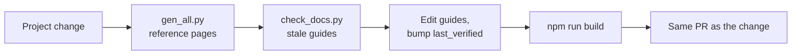

# Keeping The Wiki Current

**The rule:** a change to the project is not done until the wiki describes it. The wiki update goes in the same
branch and the same PR as the change.

## The Routine (After Any Project Change)

```powershell
python wiki/tools/gen_all.py       # 1. refresh every reference page from the project files
python wiki/tools/check_docs.py    # 2. list the hand-written pages whose sources changed since last_verified
#                                    3. edit those pages; set last_verified: to today
cd wiki; npm run build; cd ..      # 4. must build (broken links are listed)
```



| What Changed | What To Update |
|---|---|
| A view, a style, a script, a named query, tags, UDTs | Usually only `gen_all.py` (generated reference); plus the guide page if behaviour or "how to" changed |
| A new feature | A page under [Features](../features/index.md) (what, where, how to use, how it works, how to change it in the Designer) |
| A gateway setting | The page under [Gateway](../gateway/index.md); setting values are hand-written |
| The Docker stack, ports, `.env` keys | [Infrastructure](../infrastructure/index.md), [Getting Started](../getting-started/index.md) |
| The change process itself | [Git Workflow](../git-workflow/index.md), [Deployment](../deployment/index.md) |

## In This Section

| Page | Covers |
|---|---|
| [Page Conventions](page-conventions.md) | Front matter (`sources`, `last_verified`, `generated`), file layout, links, images |
| [Style Guide](style-guide.md) | Voice, Title Case, terms, tables, admonitions, what never goes in the wiki |
| [Wiki Tools](wiki-tools.md) | `gen_all.py`, `check_docs.py`, writing a reference tool |
