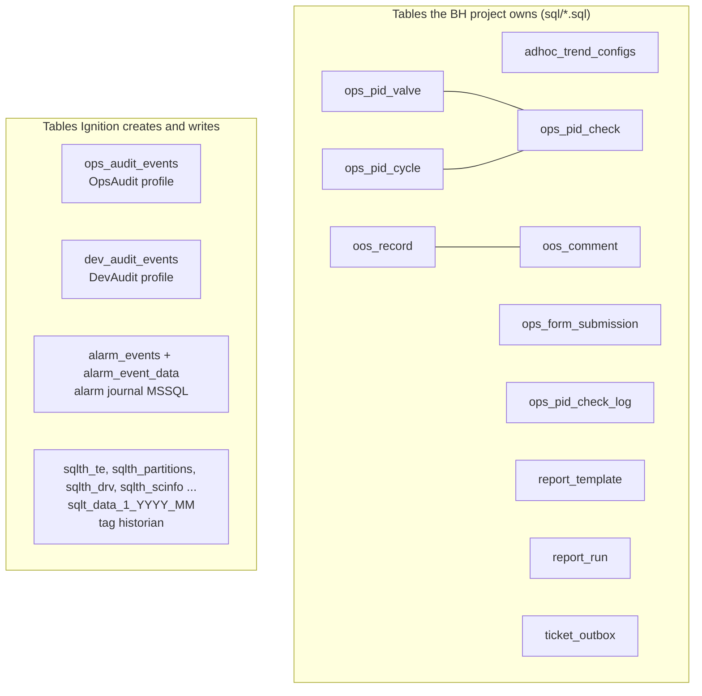

# Database

Everything the HMI stores outside tags lives in **one Microsoft SQL Server database called `ignition`**, in the
`bh-mssql` container.

| | |
|---|---|
| Server | SQL Server 2022 Developer (container `bh-mssql`, image `mcr.microsoft.com/mssql/server:2022-latest`) |
| From the host | `localhost,11433` (port from `.env` `MSSQL_PORT`; see `.env.example`) |
| From the gateway | `jdbc:sqlserver://mssql:1433`, `databaseName=ignition;encrypt=true;trustServerCertificate=true` |
| Gateway connection name | **`ignition`** (Gateway web UI: **Config > Databases > Connections**; file `config/resources/core/ignition/database-connection/ignition/config.json`) |
| Login | `sa` with `MSSQL_SA_PASSWORD` from `.env` (never commit or print it) |
| Data | Docker named volume `bh-mssql-data` mounted at `/var/opt/mssql` (not in git, not a bind mount) |
| Size (2026-10-23) | about 17.6 GB data + 0.8 GB log; recovery model FULL; compatibility level 160 |

## What is in it

| Group | Tables | Rows (2026-10-23) | Written by | Page |
|---|---|---|---|---|
| Saved trends | `adhoc_trend_configs` | 9 | Trending page / Saved Trends (`AdhocTrend/*` queries) | [Our Tables](./owned-tables.md) |
| Operations Forms | `ops_form_submission`, `ops_pid_valve`, `ops_pid_cycle`, `ops_pid_check`, `ops_pid_check_log` | 3, 725, 0, 0, 0 | `shared.Forms` (`OpsForms/*`) | [Our Tables](./owned-tables.md) |
| Out Of Service | `oos_record`, `oos_comment` | 6, 0 | `shared.OutOfService` (`OutOfService/*`) | [Our Tables](./owned-tables.md) |
| Custom reports | `report_template`, `report_run` | 0, 3 | `shared.Reports` (`Reports/Templates/*`, `Reports/Runs/*`) | [Our Tables](./owned-tables.md) |
| Ticket Logger | `ticket_outbox` | not counted | `shared.TicketLogger` (`TicketLogger/Outbox*`) | [Our Tables](./owned-tables.md) |
| Operator audit | `ops_audit_events` | 9,882 | audit profile `OpsAudit` via `shared.Audit` | [Ignition Tables](./ignition-tables.md) |
| Gateway / Designer audit | `dev_audit_events` (`audit_events` is an empty leftover) | 1,792 | audit profile `DevAudit` (gateway audit profile) | [Ignition Tables](./ignition-tables.md) |
| Alarm journal | `alarm_events`, `alarm_event_data` | 1.1 M, 3.6 M | alarm journal profile `MSSQL` | [Ignition Tables](./ignition-tables.md) |
| Tag historian | `sqlth_*`, `sqlt_data_1_2026_07` ... `_10` | about 209 M samples, 18,792 tag paths (1,908 live) | historian provider `historian` | [Ignition Tables](./ignition-tables.md) |

The exact columns of our tables are generated from `sql/*.sql` in [SQL Schema Files](./reference/sql-schema.md).

## How the project reaches the database

- **Named queries** for everything our code reads or writes (see
  [Named Queries](../scripting/named-queries.md)); all of them use the connection `ignition`.
- **Ignition subsystems** write their own tables through the same connection: the audit profiles, the alarm
  journal, the tag historian (with store-and-forward, so short DB outages are buffered).
- **The schema scripts** in `sql/` are applied with `sqlcmd -I` inside `bh-mssql` (see [Operations](./operations.md)).

## Pages

| Page | Contents |
|---|---|
| [Our Tables](./owned-tables.md) | purpose, writers, readers and rules of each table we own |
| [Ignition Tables](./ignition-tables.md) | historian, alarm journal and audit tables: what they hold and how to query them |
| [Operations](./operations.md) | read-only querying, retention, backups, recreating the schema, cleaning test data |
| [SQL Schema Files (Generated)](./reference/sql-schema.md) | every column of every table in `sql/*.sql` |
