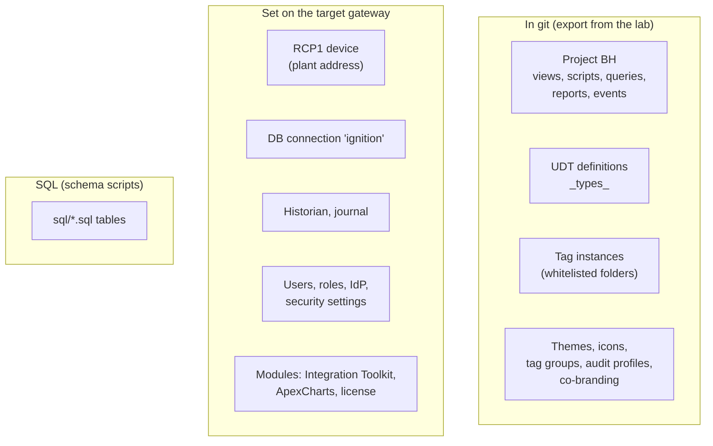

# Deployment

The lab gateway (`bh-standard` in Docker) is where everything is changed and tested. A **production** gateway is a
separate Ignition installation at the plant or in the enterprise data centre. Nothing in the lab deploys itself:
promoting a change is a deliberate, checklisted step.

| Page | When You Need It |
|---|---|
| [Deployment Modes](deployment-modes.md) | Switching the HMI between **Local Groveport** (default) and the **enterprise demo** |
| [The Edge Move](edge-move.md) | Planning the move of the local HMI onto an Ignition Edge gateway |
| [Promote To Production](promote-to-production.md) | Step by step: what to export, in which order, what to set by hand on the target |
| [Rollback](rollback.md) | Undoing a deployment that went wrong |
| [Go-Live Checklist](go-live-checklist.md) | Everything to tick before and after a production cut-over |

## What Makes Up A Deployment

