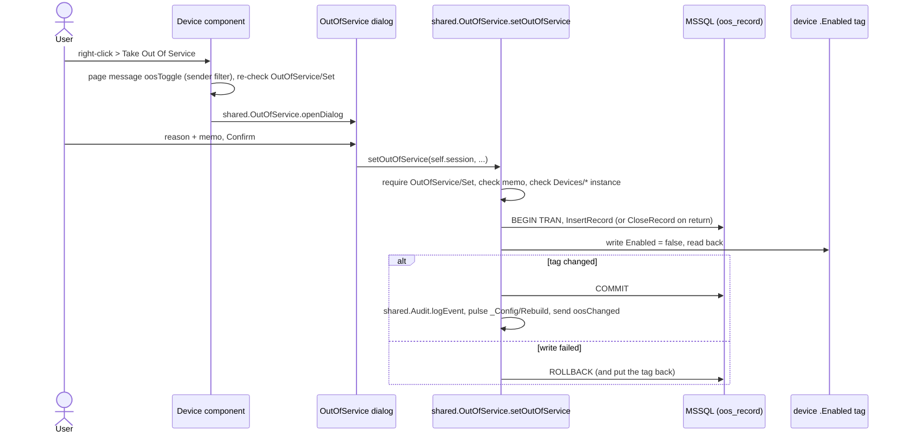

# Out Of Service

## What it does

A device (pump, valve, evaporator, sensor ...) can be **taken out of service** for maintenance, repair, parts,
season or a safety lockout. While it is out of service the HMI shows it as `OUT OF SERVICE`, hides its values and
alarms, and drops it from the device tables. Every take and return needs a **written memo**, is stored in a SQL
log with who and when, can collect a **comment thread**, and is recorded in the audit log.

Technically, "out of service" **is** the device's UDT instance being disabled: `<device>.Enabled = false`. A
disabled UDT instance stops its members, values and Ignition alarms; its `Enabled` property stays readable, so it
doubles as the flag.

## How to use it (operators)

### Take a device out of service

1. **Right-click** the device on any page and choose **Take Out Of Service** (shown only if your role has
   `OutOfService/Set`, i.e. Maintenance and up).
2. In the dialog pick a **Reason**: Maintenance, Repair, Awaiting Parts, Seasonal, Safety Lockout or Other.
3. Write a **Memo** of at least 10 characters (max 2,000). The counter shows `n / 10 Characters Minimum`;
   **Confirm** stays disabled until the memo and reason are valid.
4. Confirm. The device shows `OUT OF SERVICE` and disappears from the Overview / Details tables at once.

### Return it to service

Right-click > **Return To Service** (or the button on the log's detail pane). A memo is required here too: say
what was done and whether the device is ready to run. This closes the record.

### The log

- The **notes icon** in the header (left of the bell, a grey badge with the number of open records) opens
  **Operations > Out Of Service Log** (`/operations/out-of-service`).
- Filter by **Show** (Out Of Service / Returned / All), **From / To** (records whose out-of-service period overlaps
  the range; default the last 365 days) and **Search** (device, area, type, reason).
- Click a row for the **detail pane**: full memo and return info, **Open Faceplate**, **Device History**,
  **Return To Service**, and the **comment thread**.
- **Add Comment** (Engineering and up, `OutOfService/Comment`): optional status change on open records (In
  Progress, Awaiting Parts, On Hold, Ready To Return) plus a comment of at least 10 characters.
- **Device history**: right-click a device > **Out Of Service History**, or Device History in the detail pane,
  opens `/operations/out-of-service/<device>` with every record of that device. **Show All Devices** returns.

On screens under 1500 px the list takes the full width and a row click replaces it with the detail (**Back To
List**); under 900 px Memo and Returned At hide. The table scrolls vertically only.

## Where the pieces live (developers)

| Piece | Where |
|---|---|
| Device flag + menu | the 9 device components `02_Components/01_Devices/{Compressor, CoolingTower, Evaporator, ExhaustFan, LTU, Pump, Sensor, SolenoidValve, Tank}`: `custom.oos` from `tag(tagPath + '.Enabled')`, `meta.contextMenu` items, `oosToggle` / `oosHistory` handlers; CSS rule `device-oos` hides the alarm frame |
| Memo dialog | `01_Popups/00_Faceplates/Alerts/OutOfService` (modal), opened by `shared.OutOfService.openDialog` |
| Server logic | `shared.OutOfService` : `setOutOfService`, `addComment`, `openHistory`, `historyPage` |
| Log page | `00_Pages/Boars Head/Operations/OutOfService/OutOfServiceLog` + `_Assets/CommentEntry`, `_Assets/TwoLineCell`; routes `/operations/out-of-service` and `/:device` |
| Header icon | `00_Pages/00_Docked/_Assets/OosNotification` (`material/sticky_note_2`) |
| SQL | `dbo.oos_record`, `dbo.oos_comment` (`sql/out_of_service_log.sql`) - see [Our Tables](../database/owned-tables.md) |
| Named queries | `OutOfService/*`: page reads `Records`, `Record`, `Comments`, `OpenCount` (with `:allowed`); server-only `OpenRecordId`, `InsertRecord`, `CloseRecord`, `InsertComment`, `SetStatus` - [reference](../scripting/reference/named-queries/outofservice.md) |
| Permissions | matrix rows `OutOfService/Set` (Maintenance+), `OutOfService/View` (Maintenance+), `OutOfService/Comment` (Engineering+) |

## How it works

- Who / when come from `session.props.auth.user` and the gateway clock, never from the dialog.
- The filtered unique index allows only **one open record per device**.
- `shared.Audit.writeTag` **refuses** direct `.Enabled` writes from sessions, so nothing can bypass the memo and
  log. Gateway scripts can still write it.
- Edge cases: returning a device that has no record (disabled in the Designer) creates a backfill record and closes
  it; taking a device whose old record is still open but which is back in service closes the stale record as
  "Returned Outside The HMI" first. Devices found disabled with no record get a backfill row
  (`is_backfill = 1`, "Out Of Service (No Record)").
- Audit entries: `out of service`, `return to service`, `out of service comment`, with reason, memo and record id.

## How To Change It

All steps are Designer edits; save, then test in a session as Maintenance (take and return) and Engineering
(comment).

- **Reasons, comment statuses and memo limits:** constants at the top of the `shared.OutOfService` script module
  (Project Browser > Scripting > Project Library > `shared` > `OutOfService`): `REASONS`, `COMMENT_STATUSES`,
  `MIN_TEXT`, `MAX_TEXT`.
- **The memo dialog:** Project Browser > Perspective > Views > `01_Popups/00_Faceplates/Alerts` > `OutOfService`.
- **The log page:** Views > `00_Pages/Boars Head/Operations/OutOfService` > `OutOfServiceLog` (and `_Assets`
  `CommentEntry`, `TwoLineCell`). Its queries are under Named Queries > `OutOfService`.
- **The header icon:** Views > `00_Pages/00_Docked/_Assets` > `OosNotification`.
- **Another device type:** open the device component (Views > `02_Components/01_Devices/<Type>`), copy the
  `custom.oos` binding (`tag(tagPath + '.Enabled')`), the `meta.contextMenu` items and the `oosToggle` / `oosHistory`
  handlers from an existing one, and make sure the type's UDT has an `Enabled` member.
- **Permissions:** the `OutOfService/Set`, `OutOfService/View` and `OutOfService/Comment` rows of the matrix tag
  `[default]_Config/RolesPermissions` ([Roles And Permissions](roles-permissions.md#how-to-change-it)).

## Known limitations and parked items

- Other sessions see a take / return only on their next poll (30 to 60 s); only the acting session gets the
  `oosChanged` message.
- The log page has a **Generate Report** button that opens the Report Builder on the Out Of Service source with the page's date range (needs `Reports/Use`).
- Test records `oos_record` ids 5-9 ("TEST", all Returned) are in the lab database; see
  [Database Operations](../database/operations.md) to remove them.
- Mapped PLC devices: "out of service" disables the HMI's UDT instance, not anything in the PLC.
