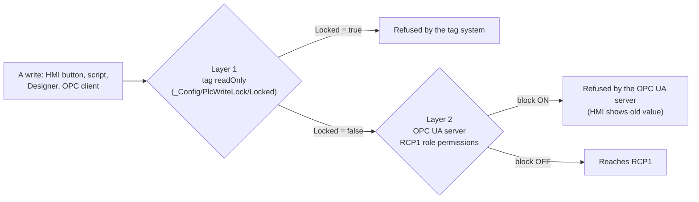

# RCP1 Device And Write Protection

**RCP1** is the Groveport refrigeration PLC: an Allen-Bradley ControlLogix running the PlantPAx library. It is the
**live production controller**. The lab reads it over the plant VPN; nothing in the lab may write to it.

## The Device Connection

**Where:** Gateway web UI > Connections > Devices > Connections > `RCP1`
(`config/resources/core/com.inductiveautomation.opcua/device/RCP1/config.json`, not tracked in git).


| Setting | Value | Notes |
|---|---|---|
| Driver | Allen-Bradley **Logix Driver** (`LogixDriver`) | Module `com.inductiveautomation.opcua.drivers.logix` |
| Hostname | `host.docker.internal` | The container reaches the Windows host, where a port proxy forwards to the SecureLink tunnel. See [PLC Connectivity](../infrastructure/plc-connectivity.md). On the plant network this becomes the PLC's own address |
| Port | a local forwarded port (not 44818) | 44818 is the standard EtherNet/IP port, used directly on the plant LAN |
| Connection path / slot | empty / `0` | Controller in slot 0 |
| Timeout | 2000 ms | |
| Concurrent requests | **2** | Driver default. With the slow link the driver completes about 15 requests/s |
| CIP connection size | **4000 bytes** | Raised from 500: about 8x fewer requests for the same data. Changing it restarts the driver |
| CIP connection timeout | 16000 ms | |
| Automatic rebrowse | on | Re-reads the controller tag database after a program download |
| Identity request frequency | 5000 ms | |

### Status And Performance

- Status should read **Connected**. Driver diagnostics are under the OPC path `[RCP1][Diagnostics]/...` (for example
  `Sampling/*`) and the tags `[default]_RCP1_/_Diagnostics_/*`.
- **The link is the bottleneck.** Over SecureLink each request takes about 145 ms, so the driver completes about
  15 requests/s (about 400 items/s). The tag groups were tuned on 2026-10-23 to ask for 5x less, which brought
  faceplate first values from 34 to 48 s down to 0 to 5 s
  ([Tag Groups](tag-providers-and-groups.md#tag-groups)).
- **Saving the device restarts its driver** (not the gateway). Data tags show `Uncertain_LastKnownValue` until each
  gets a fresh value; on 2026-10-22 that took 16 to 30 minutes for all tags over the slow link. Avoid casual saves.

### What Reads RCP1

- `[default]_RCP1_/**`: about 35,000 browsed controller tags (pruned from 197,751 to a whitelist of PlantPAx members
  the HMI needs), every one `readOnly`, in the tag groups `RCP1_Status` / `RCP1_Faceplate`. Nothing on screen reads
  `_RCP1_` directly.
- The OPC members of the device UDTs (`_types_/PLC/**`, `PLC_Ref`, `Devices`, `Units`) used by the device instances
  under `[default]Boars_Head/GrovePort/**`. These are what the HMI displays.

More in [Tags](../tags/index.md).

## Write Protection: Two Layers

A write reaches the PLC only when **both** layers allow it.



| `Locked` | Server Block | Result |
|---|---|---|
| `true` (default) | ON | Refused by the tag system |
| `false` | ON | Tag write goes out, OPC UA server refuses it. No error on screen, the value just stays. `shared.Audit.writeTag` sees bad quality and writes no OpsAudit entry |
| `true` | OFF | Refused by the tag system |
| `false` | OFF | **The write reaches the PLC** |

### Layer 1: Tag `readOnly` (The Write Lock Boolean)

- **The switch:** the memory tag `[default]_Config/PlcWriteLock/Locked`. `true` = read only (the default and the
  fail-safe). Flip it in the Designer Tag Browser (`default > _Config > PlcWriteLock > Locked`).
- **How it works:** the project gateway tag-change event `plcWriteLock` (value and quality changes on that tag) calls
  `shared.PlcWriteLock.onLockChange`. It sets `readOnly = Locked` on every AtomicTag under `[default]_RCP1_` and on
  every OPC member of the UDT definitions in `PLC/**`, `PLC_Ref`, `Devices` and `Units` (about 37,300 tags and
  members), in chunks of 5,000 with `system.tag.configure`, in one background worker. It sends configuration only,
  never a value. The gateway log line (logger `shared.PlcWriteLock`) records each flip with counts.
- **Why a script, not a binding:** Ignition 8.3 can't bind a tag's `readOnly` property to another tag; such bindings
  are dropped on import.
- **Fail-safe:** a bad, null or unreadable `Locked` counts as locked. When the gateway has just started (JVM uptime
  under 10 minutes) the script forces `Locked` back to `true`.
- **HMI guards:** `shared.Audit.writeTag`, `shared.Alerts.confirmApplyWrite` and `shared.ValveCommands` refuse any write
  that resolves to `[RCP1]` while locked (`shared.PlcWriteLock.writeAllowed`). While unlocked, the header shows a red
  **PLC Writes Unlocked** indicator.
- **Testing:** only with the separate test boolean `[default]_Config/PlcWriteLock/_Test/Locked` (event
  `plcWriteLockTest`), which drives memory test tags and a test UDT. Never with the real one.

The old PLC Write Lock page (`/operations/plc-write-lock`) and its scopes were removed on 2026-10-23 at the user's
request; the boolean is the whole interface now. Full history: `docs/plc-write-lock.md` and
[Features](../features/index.md).

### Layer 2: OPC UA Server Block

**Status: ON** since 2026-10-22, at the user's request, until they test.

The RCP1 device resource carries `config.profile.rolePermissionMappings`:

```json
[
  {"role": "Anonymous", "permissions": ["Browse", "Read"]},
  {"role": "AuthenticatedUser", "permissions": ["Browse", "Read"]}
]
```

This overrides the gateway-wide defaults (`com.inductiveautomation.opcua/access-control`:
`AuthenticatedUser` = Browse, Read, Write, Call) for RCP1 only. Every OPC tag reaches a device through the gateway's
own OPC UA server, via the loopback connection `Ignition OPC UA Server`, logged in as an `AuthenticatedUser`
([OPC UA](opc-ua.md)). With no Write or Call permission on `[RCP1]` nodes, the server refuses:

- OPC tag writes from the HMI, `system.tag.write*` and tag/timer scripts;
- `system.opc.write*`;
- writes from the Designer OPC browser;
- writes from any external OPC UA client of this gateway.

It does **not** stop tools that reach the PLC without this gateway (Studio 5000, another HMI), or someone with gateway
config rights removing the override.

**Managing it.** The 8.3.7 web UI doesn't show per-device permissions: Connections > OPC > OPC UA Server Settings >
Permissions shows only the defaults (below). So this block is **changed by the system integrator**; it cannot be
changed from the Designer or the Gateway web UI pages. Ask them to check its state, set it, or remove it.


- Changing it takes about 1.5 minutes and **restarts the RCP1 driver** (see above), so tag values go Uncertain until
  they resample.
- **Do not** change the gateway-wide `access-control` defaults instead: other features rely on them.
- Don't edit the device's `config.json` by hand.

### Testing A Real PLC Write (Owner Only)

Only the project owner does this, on site or with the plant's agreement:

1. The system integrator removes the server block.
2. Set `Locked = false` in the Designer.
3. Test.
4. Re-lock both: `Locked = true` first, then the system integrator restores the server block.

Nobody else unlocks either layer.
