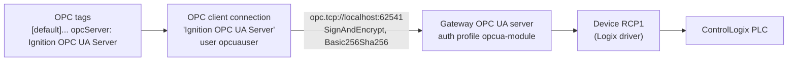

# OPC UA

In Ignition, device drivers (like the Logix driver for RCP1) don't talk to tags directly. They publish their data
through the gateway's built-in **OPC UA server**, and OPC tags read it back through an **OPC UA client connection**.
That indirection is why a server-side permission can block every write to a device.

## The OPC UA Server

**Where:** Connections > OPC > OPC UA Server Settings > General Settings
(`com.inductiveautomation.opcua/server-config/config.json`).

| Setting | Value | Meaning |
|---|---|---|
| Bind address / port | `localhost` : **62541** | Listens inside the container only; no external OPC UA clients can reach it (the port isn't published by compose) |
| Endpoint addresses | `<hostname>`, `<localhost>` | |
| Security policies | `Basic256Sha256` | Signed and encrypted sessions only |
| Anonymous access | **off** | Clients must log in |
| Authentication profile | **`opcua-module`** | The internal user source holding `opcuauser` |
| Expose tag providers | off (`exposedTagsEnabled: false`) | Ignition tags are not served over OPC UA |
| Max sessions | 100 | |
| Redundancy: read only when inactive | off | Only matters on a redundant pair; it is **not** a write block |

## Default Role Permissions

**Where:** Connections > OPC > OPC UA Server Settings > **Permissions**
(`com.inductiveautomation.opcua/access-control/config.json`).

| Scope | Anonymous | AuthenticatedUser |
|---|---|---|
| Default device permissions | Browse, Read | Browse, Read, Write, Call |
| Default tag provider permissions | Browse, Read | Browse, Read, Write, Call |
| Per tag provider overrides | none | none |

These defaults apply to every device that has no `rolePermissionMappings` of its own. **RCP1 has its own** (Browse and
Read only), which is the server-level write block: see
[RCP1 Device And Write Protection](devices-rcp1.md#layer-2-opc-ua-server-block). Leave the defaults alone.

## The Client Connection

**Where:** Connections > OPC > Connections > `Ignition OPC UA Server`
(`ignition/opc-connection/Ignition OPC UA Server/config.json`).

| Setting | Value |
|---|---|
| Type | `com.inductiveautomation.OpcUaServerType` (the gateway's own server) |
| Endpoint | `opc.tcp://localhost:62541`, security mode `SignAndEncrypt`, policy `Basic256Sha256` |
| Username | `opcuauser` (user source `opcua-module`, role `ReadWrite`); password stored encrypted |
| Read only | no (writes are stopped per device instead) |
| Request / session timeout | 60 s / 120 s |
| Keep-alive | every 15 s, 1 failure allowed |
| Certificate validation | on, client keystore alias `client` |

Every OPC tag in the project names this connection as its `opcServer`, and an OPC item path such as
`ns=1;s=[RCP1]Controller:Global/...`.

## Certificates

The server and client keystores are local resources (`config/resources/local/com.inductiveautomation.opcua/`), never
copied between gateways. Manage trust in Connections > OPC > Security (Client and Server tabs). A new gateway creates
its own; the loopback connection trusts itself automatically.

## Browsing And Testing Reads

- **Connections > OPC > Quick Client** in the web UI browses and reads any OPC node, for example
  `[RCP1]Controller:Global/...`. Use it for reads only.
- In the Designer, the OPC Browser (Tag Browser > OPC tab) does the same and lets you drag nodes in as tags.

Never use either to write to `[RCP1]`; the server block refuses it anyway.
