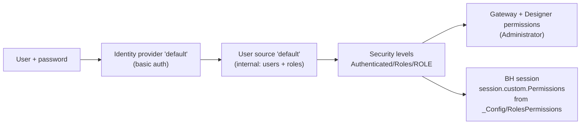

# Security

Ignition 8.3 separates **who you are** (user sources, identity providers), **what labels you carry** (security
levels: roles, zones, API token levels) and **what you may do** (permissions that require levels). On top of that the
BH project has its own **permission matrix** for HMI actions.



## User Sources

**Where:** Platform > Security > User Sources (`ignition/user-source/<name>/`; users and roles in `users.json`, with
hashed passwords; not tracked).

| User Source | Type | Roles | Used By |
|---|---|---|---|
| **`default`** | Internal | `Administrator`, `OneShot`, `ReadOnly`, `Maintenance`, `Engineering` | Every person: HMI, Designer, Gateway web UI |
| `opcua-module` | Internal | `ReadWrite` | Only the OPC UA loopback login `opcuauser` ([OPC UA](opc-ua.md)) |

Both: lockout after 5 failed attempts within 15 minutes; password minimum length 1, no history or expiry (lab
defaults; **tighten for production**: length, complexity, expiry).

Manage users from the HMI (Admin > **User Management**, `/operations/users`, Administrator only) or from the web UI.
The HMI page uses `shared.UserAdmin`. Role meanings (the tiers):

| Role | Can |
|---|---|
| `ReadOnly` | View pages, alarms, trends; save own trends |
| `Maintenance` | + open faceplates, operate (modes, commands, setpoints), ack/shelve alarms, Out Of Service, forms |
| `Engineering` | + alarm configuration, engineering content edit, audit log, others' trends and forms (inherits Maintenance) |
| `Administrator` / `OneShot` | Everything, plus User Management and Roles & Permissions |

Every role may log tickets (matrix row `TicketLogger/Use`). The Ticket Logger **Settings** (API setup, destinations,
routing) are for `OneShot` only (row `TicketLogger/Settings`, a restricted row that is not implied for
Administrator and is hidden on Roles & Permissions from everyone else).

The exact ticks are data, in the DataSet tag `[default]_Config/RolesPermissions`, edited on Admin > **Roles &
Permissions** (`/operations/roles-permissions`). Never hard-code role names in views or scripts: role lists live in
`[default]_Config/Security/*` and are read through `shared.Security`. Full model:
[Features](../features/index.md).

**Device-type rows (2026-10-24).** Besides the general rows (Faceplates/Operate and so on) the matrix has rows per
device type, for example `Pump/Command`, `Valve/Mode`, `Evaporator/Setpoint`, `Sensor/Alarm`. A control is allowed only
when the **general row AND the device row** are ticked; a type or action with no row needs only the general row.
The gateway also enforces it server side. To gate a new type, add a row on Roles & Permissions. See
[Roles & Permissions](../features/roles-permissions.md). (User Management and Roles & Permissions were redesigned on 2026-10-23.)

## Identity Providers

**Where:** Platform > Security > Identity Providers (`ignition/identity-provider/<name>/`).

| IdP | Type | User Source | Notes |
|---|---|---|---|
| **`default`** | Internal, basic (username/password) | `default` | The **system identity provider** and the one the BH project uses. Session inactivity timeout 30 min |
| `Lightspeed` | Internal | `default` | Came with the reference project `Lightspeed-FrontEnd` |
| `temp` | Internal | `temp` | Leftover; its user source doesn't exist. Delete before production |

The login page of the `default` IdP is the one that carries the Boar's Head [co-branding](cobranding.md).

## Gateway And Designer Permissions

**Where:** Platform > Security > General Settings (`ignition/security-properties/config.json`).

| Setting | Value |
|---|---|
| System identity provider / auth profile | `default` / `default` |
| Gateway **read** permission | `Authenticated/Roles/Administrator` |
| Gateway **write** permission | `Authenticated/Roles/Administrator` **or** API token level `Write` |
| Gateway access permission | API token level `Access` |
| **Designer** permission | `Authenticated/Roles/Administrator` (Designer role name `Administrator`) |
| Designer SSO | off; classic Designer authentication |
| Force IdP authentication | on |
| Gateway audit profile | `DevAudit` |
| Gateway user inactivity timeout | 10 min |

## Security Levels

**Where:** Platform > Security > Levels. A tree of labels a user or token carries:

```text
Authenticated
└── Roles
    ├── Administrator
    ├── Engineer
    └── Operator
API Token
├── Access
├── Read
└── Write
```

`Engineer` and `Operator` are older placeholders; the roles in use come from the user source (a role named `X` maps
to `Authenticated/Roles/X` automatically). The project requires **Authenticated** for every Perspective session.

## Login Required For Everything (2026-10-24)

Directive: nothing in the project may be reachable without a login. Perspective projects `BH` and `Lightspeed-FrontEnd`
have session permission AllOf Authenticated (Designer > Project > Properties > Perspective > Permissions), so every
page, deep link and popup shows only "You must log in to continue" until login. The WebDev resources are gated too:
`globe/map`, `globe/mapMarkers` and `rack3d/*` answer 401 unless the browser holds a logged-in BH session, and the
`Lightspeed-FrontEnd` WebDev resources use HTTP Basic against user source `default` (writes also need Administrator).
The gateway web UI is unchanged. What an anonymous browser can still reach and how to check: [Security Access](../features/security-access.md).

## Security Zones

**Where:** Platform > Security > Zones. Only the built-in **`Default`** zone (applies to everything, not secure,
gateway/Designer/client scopes). No zone-based rules are used.

## API Key `Access`

**Where:** Platform > Security > API Keys (`ignition/api-token/Access/`, only a hash is stored).

- Carries the levels `Authenticated` and `API Token/Access, Read, Write`, so it can read and write gateway config.
- Used by `ignition-trial-watch` as the header
  `X-Ignition-API-Token: Access:<secret>`.
- The secret is in `.env` (`IGNITION_API_TOKEN`). **It is a lab token.**
  Production needs its own key with the least levels the tools require, kept out of git.

## Production Hardening Checklist

- Replace the lab `sa` database login and the lab API key.
- Password policy on the user source; remove test users and the `temp` IdP.
- Serve the HMI over HTTPS (port 8043 is mapped as 19043 in the lab) and consider a secure zone.
- Keep the OPC UA server bound to localhost unless an external client needs it.
