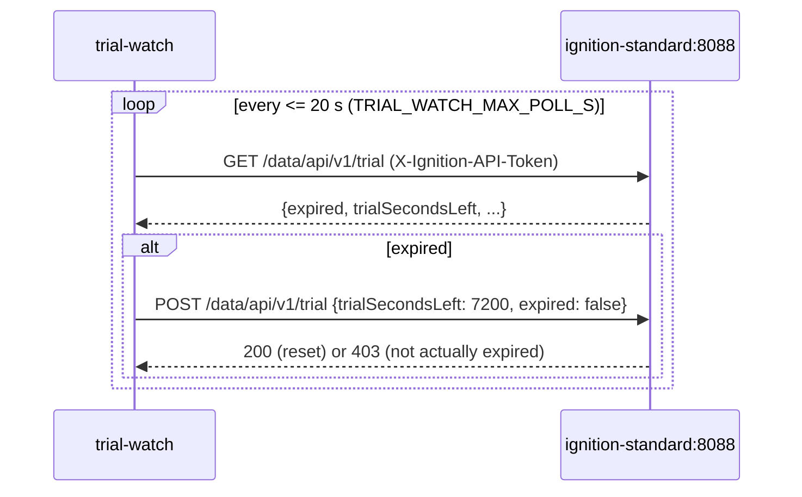

# Trial And Licensing

## The Lab Runs On A Trial

The lab gateway is **unlicensed** (Platform > System > Licensing shows "Trial", `licenseMode: Trial`). An unlicensed
Ignition gateway runs every module for **2 hours**, then stops (Perspective sessions show "trial expired", tags and
history stop) until someone resets the trial. The Gateway web UI shows a blue **Trial Mode** bar with the time left.

## `ignition-trial-watch`

The compose service `ignition-trial-watch` (container `bh-ignition-trial-watch`, built from `trial-watch/`) resets
the trial automatically.



- It reaches the gateway on the **internal** port 8088 over the `bh-ot` network, not a host port.
- It authenticates with `IGNITION_API_TOKEN` from `.env`, in `Name:secret` form (a bare secret returns 401).
- **Why 20 s:** the gateway expires on three trial clocks with different phases (T, T+40 min, T+45 min every 2 hours),
  and `trialSecondsLeft` only reports one of them. With a 300 s poll the HMI could sit in "trial expired" for up to 5
  minutes; 20 s keeps that under half a minute.
- `403` on the reset means the trial had not expired yet: normal.
- The script was once only inside a built image and nearly lost; it is now tracked (`trial-watch/watch_trial.py`).

```powershell
docker logs -f bh-ignition-trial-watch
# 2026-10-23T16:40:04 [trial-watch] INFO trial status HTTP 200: expired=False trialSecondsLeft=4834 ...
```

"Demo_Expired → Demo_Enabled" lines in the gateway log are these resets.

**Side effects of the trial:**
- Reporting PDFs carry a trial watermark.
- An expiry while you test looks like a frozen HMI; check the trial bar before debugging.

## Production Licensing

A production gateway needs a real license with the modules the project uses: at least Perspective, Reporting, WebDev,
SQL Historian (Historian), the Allen-Bradley Logix driver (part of the Allen-Bradley Drivers / OPC UA), plus the
third-party **Integration Toolkit** (free) and **ApexCharts** (Kyvis Labs) modules. `docs/ignition-license-quote-checklist.md`
lists the add-ons for a distributor quote; [Modules](modules.md) lists what is installed. Remove
`ignition-trial-watch` from a licensed deployment.
