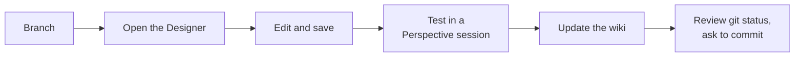

# Your First Change

This walkthrough makes one small HMI change in the Ignition Designer and takes it all the way to a commit that is
ready for review. Do it once on a throwaway branch to learn the loop.



## 1. Branch

```powershell
cd C:\Users\<you>\Documents\Bors
git switch main; git pull
git switch -c fix/cg-page-title-case
```

Branch names: `feature/...`, `fix/...`, `ticket/<monday-id>-...` ([Git Workflow](../git-workflow/index.md)).

## 2. Open The Designer And Find The View

1. Open the page in the HMI and note the URL, for example `/cg-e2`.
2. Launch the **Ignition Designer** (Designer Launcher > the lab gateway > open the **BH** project; see
   [First Login](first-login.md)).
3. In the **Project Browser**, open **Perspective > Page Configuration** and find the URL. The row shows the view the
   page opens. Or browse **Perspective > Views** directly: the folders mirror the nav
   (`00_Pages`, `01_Popups`, `02_Components`, `03_Elements`). Every view also has a reference page in
   [Perspective](../perspective/index.md).
4. Double-click the view to open it on the canvas.

## 3. Make The Change

Click a component on the canvas (or in the **Component Tree** panel) and edit it in the **Property Editor**.

- **Text or label**: select the label, edit `props.text`. Labels use **Title Case**.
- **Binding**: click the binding icon next to a property. Prefer an **Expression**, then an **Expression Structure**,
  then an **expression transform**; use a script only when nothing else works (one-shot commands, confirm dialogs,
  tag configure). Make every comparison null-safe: `coalesce({view.custom.mode}, '') = 'Auto'`, because
  `if(null, a, b)` puts the binding into an error state.
- **Style**: set `props.style.classes` to project style classes rather than inline colours or fonts
  ([Styling](../perspective/styling/index.md)).

## 4. Save

Press **Ctrl+S** (File > Save Project). The Designer saves through the gateway, which writes the project files, so the
change appears in `git status` right away. There is nothing else to run: the Designer keeps the resource metadata
correct.

## 5. Test In A Perspective Session

- In the Designer choose **Perspective > Launch Session** (or reload the page in the HMI client).
- Check light **and** dark themes (settings gear) and a narrow window (1366 and 1024 px).
- Watch for binding error overlays (red outline, `null` text) and the browser console.
- Check the gateway log for errors: Gateway web UI > **Status > Logs**.
- Never test by writing to an `[RCP1]` / `_RCP1_` tag. If the change involves a PLC write, stop and ask.

## 6. Update The Wiki

Every project change updates the wiki in the same branch ([Contributing](../contributing/index.md)). Edit the pages
that describe what you changed and set their `last_verified:` to today. Then:

```powershell
python wiki/tools/gen_all.py       # refresh the generated reference pages from the project files
python wiki/tools/check_docs.py    # lists hand-written pages whose sources changed
cd wiki; npm run build; cd ..      # must succeed
```

## 7. Review And Ask To Commit

```powershell
git status
git diff --stat
```

- **Stage selectively.** Include the changed view / resource / script / tag files and the wiki pages.
- **Never stage** `gateways/*/data/projects/.resources/*` (gateway churn), `.env`, or `tag-definition/System/Gateway/**`.
- Tag definition changes go in **with** the work that needs them (`tag-definition/**`, `tag-type-definition/**`).
- **No commit, push or PR without explicit approval.** Summarise what would be committed and ask. When approved:

```powershell
git add <paths>
git commit -m "Title Case the CG page headers."
```

Commit messages are short imperative sentences (`Sanitize RCP1 tag documentation bloat.`) or conventional
(`fix: stop valve faceplate tab-switch binding flashes`). The full process for production changes is in
[Making A Change](../git-workflow/making-a-change.md). More recipes: [Common Tasks](common-tasks.md).
