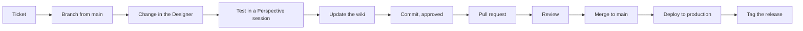

# Making A Change (Once Live On Production)

Every change to the HMI, the tags or the gateway settings is made in the **Ignition Designer** or the **Gateway web
UI**. Git is only the version history of the files the Designer saves.



## 1. Start From A Ticket

Every production change starts with a ticket (Monday.com board) that says what and why. Note the item id: it goes in
the branch name, the PR and the commit.

## 2. Branch

```powershell
git switch main; git pull --ff-only
git switch -c ticket/<id>-<short-topic>       # or feature/... / fix/...
```

Keep one topic per branch. The lab gateway runs whatever is checked out, so tell others on the same machine when you
switch branches (their open Designer sessions see your files).

## 3. Change It In The Designer

1. Open the Designer, sign in, and open the **BH** project (Gateway home page > Get Designer).
2. Make the change: see [Common Tasks](../getting-started/common-tasks.md) for recipes and the feature pages'
   "How To Change It" sections for the exact Project Browser location.
3. **Save** (`Ctrl+S`, or File > Save Project). The Designer writes the project files and keeps their metadata
   correct; there is nothing else to run.
4. Tags: use the Tag Browser and the UDT Definitions editor. Change the **UDT definition**, not instances, for anything
   every device of a type needs (alarms, history, members).
5. Follow the conventions: expressions before scripts, null-safe comparisons, Title Case labels, no hard-coded role
   names (gate on `session.custom.Permissions.*`), faceplates only under `01_Popups/00_Faceplates/`.
6. Never write to `[RCP1]` / `_RCP1_`, never unlock the write lock to test.

## 4. Test In A Perspective Session

- Launch a session from the Designer (Perspective > Launch Session) or open the client at
  `/data/perspective/client/BH`.
- Check the page(s) in light and dark themes, at 1920 and 1366 px.
- Check each role that the change affects (ReadOnly, Maintenance, Engineering, Administrator).
- No binding error overlays; no new errors in the Gateway web UI under Status > Logs.
- Screenshots of before and after help the reviewer.

## 5. Update The Wiki

Edit the pages that describe what you changed and bump their `last_verified` date. See
[Contributing](../contributing/index.md).

## 6. Commit (After Approval)

```powershell
git status
git add <changed view/resource files> <script files> <tag-definition files> <wiki pages>
git diff --cached --stat
git commit -m "Add Title Case headers to the CG pages."
```

- **Ask first.** No commit without the owner's explicit go-ahead.
- Stage selectively. **Never** `gateways/*/data/projects/.resources/*`, `.env`, `*.gwbk`, `tag-definition/System/Gateway/**`.
- Include tag definitions changed for the work ([Tracked Vs Ignored](tracked-vs-ignored.md#tag-definition-rules-for-commits)).
- One logical change per commit; message = short imperative sentence (or `feat:` / `fix:` style).

## 7. Pull Request

```powershell
git push -u origin ticket/<id>-<short-topic>     # after approval
gh pr create --base main --title "CG page Title Case headers" --body-file pr.md
```

The PR body should state:
- **What and why** (link the ticket).
- **Files**: views, scripts, tags, SQL, and gateway settings changed in the Gateway web UI (those are not in the diff).
- **How it was verified** (pages, roles, themes, screenshots).
- **Deployment notes**: tag import order, SQL scripts, settings to set on production, restart needed or not.
- **Rollback**.

## 8. Review

The reviewer checks out the branch in the lab, opens the Designer and the affected pages, then looks for:
- Views that open without errors in the Designer and the client.
- `.resources` churn or secrets in the diff.
- Expressions null-safe, scripts only where needed, Title Case.
- Any path that could write to `[RCP1]` without `shared.Audit.writeTag` / the lock guard.
- Wiki updated, build passes.

## 9. Merge

Merge to `main` with the PR (the owner decides the merge style). After merging, everyone on the lab machine does
`git switch main; git pull`, then reopens the project in the Designer (File > Update Project) so the lab matches `main`.

## 10. Deploy And Tag

Follow [Promote To Production](../deployment/promote-to-production.md) and the
[Go-Live Checklist](../deployment/go-live-checklist.md). Tag what you deployed:

```powershell
git tag -a release-2026-10-30 -m "Groveport: CG header Title Case (ticket <id>)"
git push origin release-2026-10-30      # after approval
```

The tag is how you know exactly what production runs, and the base for the next release's
`git diff --stat <prev-tag>..<new-tag>` and for [Rollback](../deployment/rollback.md).
