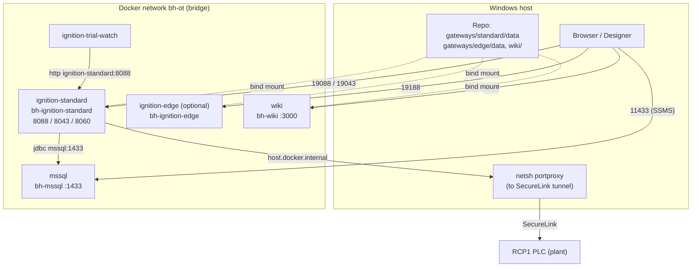

# Infrastructure

The whole lab is one `docker-compose.yml` on Docker Desktop (Linux engine on WSL 2), on the Windows workstation.

| Page | Covers |
|---|---|
| [Docker Compose](docker-compose.md) | Every service, port, volume, network, environment variable; common commands |
| [Bind Mount And .resources](bind-mount-and-resources.md) | Why the gateway data folder lives in git, the content-addressed `.resources` store and its churn |
| [Edge Gateway](edge-gateway.md) | The optional Edge 8.3.7 container and its edition limits |
| [PLC Connectivity](plc-connectivity.md) | How the lab reaches RCP1 through SecureLink (concept, no addresses) |
| [MSSQL](mssql.md) | The SQL Server 2022 container, the `ignition` database, memory cap, backups |
| [The Wiki Service](wiki-service.md) | How this site is built and served (`bh-wiki`, port 3030) |
| [Remote Viewing](remote-viewing.md) | Showing the HMI to someone off-site (Tailscale Funnel) and its risks |
