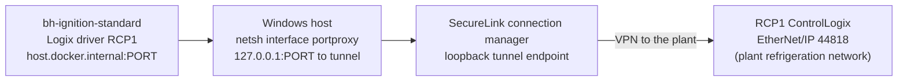

# PLC Connectivity

:::info No addresses here
This page explains the mechanism only. Tunnel addresses, plant IP addresses and VPN credentials are deliberately not
in the wiki. Get them from the project owner when you need them.
:::

## The Path

1. **SecureLink** (the plant's remote-access tool) opens a tunnel on the Windows host. It listens on a **loopback
   address** (a `127.x.x.x` address it picks) on the EtherNet/IP port 44818, and forwards to the PLC.
2. Docker containers can't reach the host's loopback addresses directly. So a **`netsh interface portproxy`** rule on
   the host forwards a local port to the tunnel endpoint.
3. The RCP1 device in the gateway points at **`host.docker.internal`** (Docker Desktop's name for the host) on that
   local port, slot 0.

## When The Link Drops

Symptoms: RCP1 status Disconnected or "Connecting" in Connections > Devices, HMI values gray (the value-quality
placeholder), `Bad_*` quality on RCP1 tags.

Checklist:
1. Is the SecureLink session up? Sessions drop and must be reopened by the owner.
2. Did SecureLink hand out a **new loopback address**? Then only the port proxy needs updating
   (`netsh interface portproxy show all`, then delete and re-add the rule; needs an admin prompt). The gateway
   device does not change.
3. Is anything listening? `netstat -ano | findstr 44818` on the host.
4. After reconnecting, values return gradually: the driver re-registers its monitored items and catches up over the
   slow link (minutes, see [RCP1 Device](../gateway/devices-rcp1.md#status-and-performance)).

Never change the RCP1 device just to "kick" it: a save restarts the driver and costs tens of minutes of catch-up.

## Performance Over The Tunnel

About 145 ms per request and about 15 requests/s. That is why the tag groups are tuned the way they are
([Tag Groups](../gateway/tag-providers-and-groups.md#why-these-rates-2026-10-23)). On the plant LAN, latency drops and
the faster rates can return.

## On The Plant Network

At the plant (production) there is no tunnel: the device points at the PLC's own address on the refrigeration
network, port 44818. That hostname is the one setting that differs between the lab and production; see
[Promote To Production](../deployment/promote-to-production.md). The plant's device inventory (MCCs, PLCs) is in
`docs/network-inventory.md` (internal).
