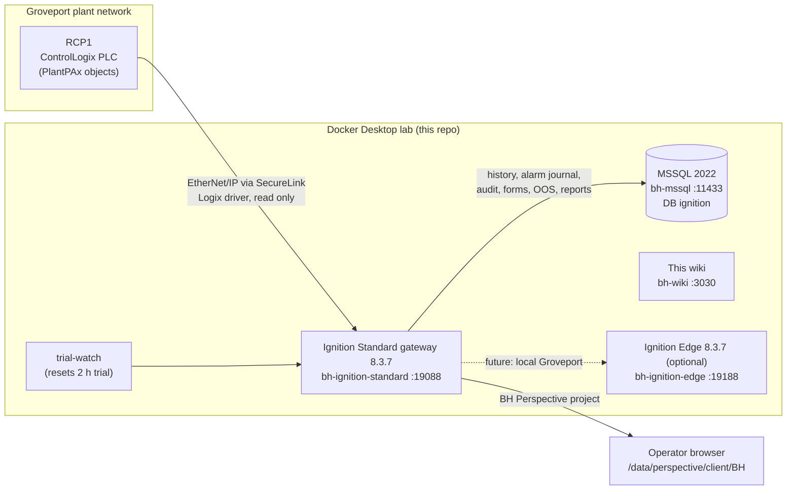

# Boar's Head SCADA Wiki

This wiki documents the **Boar's Head Groveport refrigeration SCADA**: an Inductive Automation **Ignition 8.3.7**
gateway that hosts the **`BH` Perspective project**, the HMI operators use to watch and run the Groveport plant's
ammonia (NH3) refrigeration system: compressors, evaporators (CGs), condensers, tanks, pumps, valves and sensors.
The HMI replaces the plant's FactoryTalk View SE screens; the controller behind it is the plant PLC **RCP1**
(an Allen-Bradley ControlLogix running the Rockwell **PlantPAx** library).

The goal of the wiki: a developer or integrator who has never seen this project can find where everything lives,
understand how it works, make a change safely and ship it to production, **using only this site**.

:::tip Use the search box
Press <kbd>Ctrl</kbd> + <kbd>K</kbd> (or click the search box top right) and type a view name, tag path, script
function, setting or error message. Search is offline full-text over every page, including the generated reference
pages, and highlights your words on the page you open.
:::

## The System In One Picture

- **Gateway**: one Ignition Standard gateway runs everything: the OPC UA server and the Logix driver to RCP1, the tag
  providers, the SQL historian, the alarm journal, audit logging and the Perspective module that serves the HMI.
- **Project `BH`**: views, styles, scripts, named queries, reports and gateway events. Its files live in git under
  `gateways/standard/data/projects/BH/`, because the gateway's data folder is bind-mounted from this repo.
- **Tags**: device instances under `[default]Boars_Head/GrovePort/<Area>/<Type>/<Device>`, built from UDTs that
  nest the PlantPAx library objects (`P_Motor`, `P_AIn`, `P_ValveSO` ...), plus `[default]_RCP1_` (the browsed
  controller tags, read only) and `[default]_Config/**` (settings, enums, permissions).
- **Maintenance**: everything is changed in the **Ignition Designer** (views, scripts, tags, UDTs, named queries) and
  the **Gateway web UI** (devices, databases, security, tag groups). Git records the files they save.
- **Safety**: RCP1 is the **live production PLC**. Writes are blocked twice: every tag that reads it is read only
  (`[default]_Config/PlcWriteLock/Locked`) and the OPC UA server refuses writes to the device
  ([PLC Write Protection](gateway/devices-rcp1.md#write-protection-two-layers)).

## Deployment Mode Today

The HMI runs in **Local Groveport mode**: the nav shows only Groveport and its Utility pages, and `/` opens the
Utility Overview. The enterprise views (globe, other plants, production KPIs) are still in the project behind one
switch. See [Deployment Modes](deployment/deployment-modes.md).

## How This Wiki Is Organised

| Section | What You Find There |
|---|---|
| [Getting Started](getting-started/index.md) | Install, run the Docker stack, log in, open the Designer, the Windows gotchas, a guided first change |
| [Gateway](gateway/index.md) | Every gateway setting: devices, OPC UA, tag providers and groups, historian, databases, alarm journal, audit, security, co-branding, gateway events, trial, modules, memory, backups, logs |
| [Infrastructure](infrastructure/index.md) | Docker Compose services, ports, volumes, the bind mount, the Edge gateway, PLC connectivity, MSSQL, the wiki service |
| [Tags](tags/index.md) | Tag providers and folders, UDTs, the PlantPAx mapping, alarms, history; generated reference of every UDT and folder |
| [Perspective](perspective/index.md) | Pages, docks, views, faceplates, bindings, styles, themes; generated reference of every view |
| [Scripting](scripting/index.md) | The `shared` script library, gateway events, named queries; generated reference |
| [Database](database/index.md) | MSSQL schema: trend configs, forms, Out Of Service, reports, audit, alarm journal |
| [Features](features/index.md) | End-to-end write-ups: alarming, trending, Out Of Service, forms, reports, security, PLC write lock |
| [Deployment](deployment/index.md) | Local vs enterprise mode, the Edge move, promoting to a production gateway, rollback, go-live checklist |
| [Git Workflow](git-workflow/index.md) | Branches, what is tracked, the change process once live, merges |
| [Contributing](contributing/index.md) | How to keep this wiki current after every change |

Pages marked **Generated** are reference pages built from the real project files; don't edit them by hand. Every other page lists the files it describes in its front matter, and `python wiki/tools/check_docs.py`
tells you which pages went stale after a change.

## Where To Start

1. **New to the project?** Read [Getting Started](getting-started/index.md) top to bottom, then the
   [Repository Tour](getting-started/repo-tour.md) and the [Glossary](getting-started/glossary.md).
2. **Need to change a screen?** Find the view in [Perspective](perspective/index.md), then see
   [Common Tasks](getting-started/common-tasks.md) or follow [Your First Change](getting-started/first-change.md).
3. **Need to change a gateway setting?** Start at [Gateway](gateway/index.md); the
   [Gateway UI Map](gateway/gateway-ui-map.md) shows where each setting lives in the 8.3 web UI.
4. **Shipping to production?** Read [Promote To Production](deployment/promote-to-production.md) and the
   [Go-Live Checklist](deployment/go-live-checklist.md) first.

## The Rules That Matter Most

These apply to everyone who works on the project:

1. **Make changes in the Designer or the Gateway web UI and save there.** Don't edit project files by hand. See
   [Your First Change](getting-started/first-change.md).
2. **Never commit, push or open a PR without explicit approval** from the project owner.
3. **Commit tag definitions with the work that needs them**, never the gateway's `.resources/` churn.
4. **Bindings: expressions first, scripts last.**
5. **Title Case** for every user-facing label.
6. **Never write to the PLC** (`[RCP1]`, `[default]_RCP1_`) from the lab, and never unlock the write lock to test.
