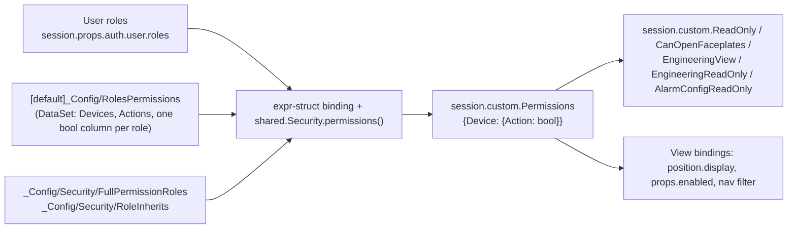

# Security In The UI

BH permissions are a **matrix**: rows are `Device / Action` pairs (for example `Faceplates / Operate`), columns
are roles, a tick grants the action. Admins edit it on Admin > Roles & Permissions (see [Admin Pages](./pages/admin.md)
and [Features](../features/index.md) for the data model). This page is about how the **views** use it.

## From Roles To `session.custom.Permissions`



- A user with several roles gets the union of their columns; `RoleInherits` adds inherited roles;
  `FullPermissionRoles` (Administrator) hold every action.
- The binding is an expression structure over the roles and the three tags, so it re-evaluates on login, logout,
  role change and matrix edit, with no page reload.
- Derived flags in session props:

| Session custom property | Expression |
|---|---|
| `ReadOnly` | `!coalesce({session.custom.Permissions.Faceplates.Operate}, false)` |
| `CanOpenFaceplates` | `coalesce({session.custom.Permissions.Faceplates.Open}, false)` |
| `EngineeringView` | `coalesce({session.custom.Permissions.Engineering.View}, false)` |
| `EngineeringReadOnly` | `coalesce({session.custom.ReadOnly}, true) \|\| !coalesce({session.custom.Permissions.Engineering.Edit}, false)` |
| `AlarmConfigReadOnly` | `coalesce({session.custom.ReadOnly}, true) \|\| !coalesce({session.custom.Permissions.AlarmConfiguration.Edit}, false)` |

All of these are `PROTECTED` session properties, so the browser cannot write them.

## Gating A Control

**Gate on `session.custom.Permissions.<Device>.<Action>`, never on role names.** Role lists in a binding break as
soon as a role is renamed or added; the matrix is the one place to change who can do what. Always `coalesce(...,
false)` so a session whose permissions haven't loaded yet is denied.

| What | How | Example |
|---|---|---|
| Hide a control | `position.display` (keeps no space) or `meta.visible` | Header `OosNotification`: `coalesce({session.custom.Permissions.OutOfService.View}, false)` |
| Disable a control | `props.enabled` | Alarm table `props.enableAcknowledge`: `coalesce({session.custom.Permissions.AlarmSummary.Acknowledge}, false)` |
| Read-only inputs | `session.custom.ReadOnly` / `EngineeringReadOnly` in the element's enabled / edit bindings | AnalogInput pencil only when `permission` param and not read only |
| Menu items | the context-menu expr-struct takes the permission flags | Device menu: `admin: coalesce({session.custom.Permissions.OutOfService.Set}, false)` |
| Nav items | `data.permission: "Device/Action"` on the item | Admin > Audit Log = `AuditLog/View` |
| SQL rows | pass the flag as a named query parameter | `allowed: if(coalesce({session.custom.Permissions.AuditLog.View}, false), 1, 0)` |

Permissions read by views today: `Faceplates/Open`, `Faceplates/Operate`, `Engineering/View`, `Engineering/Edit`,
`AlarmConfiguration/Edit`, `AlarmSummary/Acknowledge`, `AlarmSummary/Shelve`, `OutOfService/Set`, `View`,
`Comment`, `Forms/Use`, `Forms/ViewAll`, `Reports/Use`, `AuditLog/View`, `UserManagement/Edit`, `Add`,
`RolesPermissions/Edit`, `Trends/ManageLocked`, `Trends/Save`. The full row list (with device-type rows such as
`Pump/Command`, `Evaporator/Setpoint`) is on the Roles & Permissions page; `Reports/Page` and `TicketLogger/Use` / `Settings` were added on 2026-10-24.

### Device-Type Rows (2026-10-24)

A device control is enabled only when the **general row AND the device-type row** allow it, for example
`Faceplates/Operate` AND `Pump/Command`. Each gated view has `view.custom.permDevice` (the device type of its path,
looked up in the tag `_Config/Security/DeviceTypes`) and `view.custom.roCommand` / `roMode` / `roInterlocks` /
`roSetpoint` / `roConfiguration` / `roAlarm` (read-only flags: general gate OR NOT the device row), plus `tip<Kind>`
tooltips ("Not Permitted: Pump / Command (Roles & Permissions)"). Controls bind to the `ro<Kind>` flag instead of
`session.custom.ReadOnly`. A type or action with no matrix row needs only the general row, so adding a row gates a new
type with no view change. The gateway repeats the check (`shared.Security.requireWrite` in `shared.Audit.writeTag`,
`Alerts.confirmApplyWrite` and `ValveCommands`; `requireDevice` for alarm configuration); the member-to-action rules
are in the tag `_Config/Security/DeviceActionRules`. A refusal opens a "Not Permitted" dialog.

## The Nav

The Tree's transform drops items whose `data.permission` is not granted (and `adminOnly` items for non-admins), and
a folder whose children were all withheld disappears too. In local mode the Admin folder shows Audit Log, User
Management and Roles & Permissions only to roles with those rows. See [Navigation](./navigation.md#how-the-tree-is-filtered).

`session.custom.Administrator` and the older `adminOnly` nav flag are role-list checks against
`[default]_Config/Security/AdminRoles` (`shared.Security.hasAnyRole`). The Ticket Logger uses the matrix:
`TicketLogAccess` = row `TicketLogger/Use` (every role) and `TicketLogSettings` / `IntegrationAccess` = row
`TicketLogger/Settings`, a **restricted row** (`_Config/Security/RestrictedRows`: OneShot only, not implied for
Administrator, hidden on Roles & Permissions from other roles). `TicketLoggerRoles` is no longer used.

## Always Re-Check On The Gateway

A UI gate is a convenience, not a security boundary: a hidden button can still be triggered by a crafted message.
Every script that changes something re-checks on the gateway:

```python
shared.Security.can('Faceplates', 'Operate')                     # session of the running script
shared.Security.allowed(self.session, 'OutOfService', 'Set')     # from a view script
shared.Security.require('Faceplates', 'Open', tagPath)           # can() + an info log line when denied
```

`Navigation.Faceplate.openFaceplate` calls `require('Faceplates', 'Open', ...)`; `shared.OutOfService`,
`shared.Forms`, `shared.UserAdmin`, `shared.PermissionMatrix` and `shared.Audit.writeTag` check their own rows.
Outside a Perspective session (gateway timers, tag events) `can()` returns true so gateway logic keeps working.

## The Header Lock Icon

The header lock (`PermBadge`) shows the session's write state: a closed lock and `perm-badge-read` when
`session.custom.ReadOnly`, an open lock and `perm-badge-write` otherwise. Its tooltip lists the user's roles.
