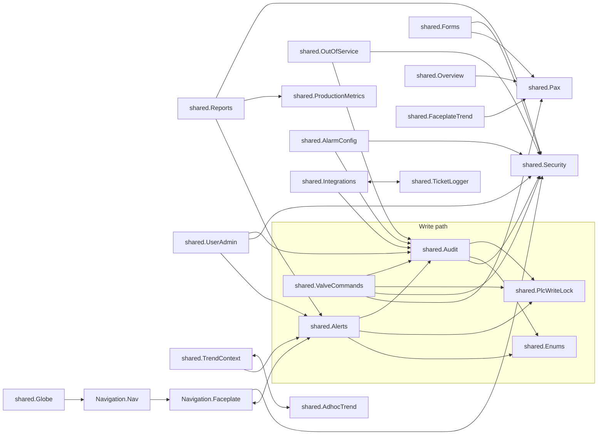

# Project Library

The **project library** is the set of Python modules every script in the BH project can call by name, for example
`shared.Audit.writeTag(...)`. In the Designer it is **Project Browser > Scripting > Project Library**; in the repo each
module is one folder with a `code.py`:

```text
gateways/standard/data/projects/BH/ignition/script-python/
  shared/<Module>/code.py        -> shared.<Module>
  Navigation/Nav/code.py         -> Navigation.Nav
  Navigation/Faceplate/code.py   -> Navigation.Faceplate
  L5K/Parser/code.py             -> L5K.Parser
```

Modules are **not imported** by callers: Ignition makes every top-level package (`shared`, `Navigation`, `L5K`)
available in every script scope automatically. Inside one module you call another as `shared.Security.can(...)`.

:::info Editing a module
Edit modules in the Designer (Project Browser > Scripting > Project Library > `shared` > the module), save, and test
in a Perspective session. Many modules are large (`shared.Reports` is about 2,500 lines): use the Designer's find
(`Ctrl+F`) and keep your change small.
:::

For the exact function list, signatures, docstrings and every caller, see the generated
[Script Modules reference](./reference/modules/index.md).

## Module catalog

### Write path, security and audit

| Module | What it is for |
|---|---|
| `shared.Alerts` | The standard **Alert popup** (`showAlert`), the **confirm-before-write** dialog (`confirmApplyWrite`, `promptConfigWrite`), and the openers for the tabbed device **Faceplate** shell (`showFaceplate`), the Adhoc Trend popups and the Ticket Logger popup. The most-called module: about 258 views reference it. |
| `shared.Audit` | **The one audited write**: `writeTag(tagPath, value, label, viewName)` checks the session permission, the PLC write lock, follows reference tags, writes, reads back, and records an `OpsAudit` entry. `logEvent(...)` records an action without a tag write. `valuesEqual` decides "no change". |
| `shared.Security` | Server-side **permissions**: `permissions()` turns the Roles & Permissions matrix into `{Device: {Action: bool}}` (used by the session prop `custom.Permissions`), `can()/allowed()/require()` check a Device/Action for the calling session. Since 2026-10-24 it also holds the **device-type rows**: `deviceOf(tagPath)` / `actionOf(...)` classify a tag write (rules in `_Config/Security/DeviceActionRules`), `requireWrite(tagPath)` = Faceplates/Operate AND the device row (used by `shared.Audit.writeTag`, `Alerts.confirmApplyWrite` and `ValveCommands`), `requireDevice(tagPath, 'Alarm')` gates alarm configuration, and `restrictedRows` / `rowVisible` / `rowRules` implement the OneShot-only rows (`TicketLogger/Settings`). Finds the session even when Perspective's thread-locals are empty by walking the call stack for `self.session`. |
| `shared.PlcWriteLock` | The **PLC write lock**: `writeAllowed(tagPath)` refuses any write that resolves (through reference tags) to the RCP1 production PLC while `[default]_Config/PlcWriteLock/Locked` is true; `onLockChange` applies `readOnly` to about 37,000 tags when the boolean flips. Fail-safe: unreadable = locked. |
| `shared.ValveCommands` | Pump / valve / mode **command buttons** of the faceplates (`startPump`, `openValve`, `setMode`, `bypassDevice` ...). Each one checks `Faceplates/Operate`, refuses PLC-mapped devices, and writes through `shared.Audit.writeTag`. |
| `shared.PermissionMatrix` | **New 2026-10-23** (Roles & Permissions redesign): groups and labels the matrix rows on the page from `_Config/Security/PermissionCategories` / `PermissionCatalog`. |
| `shared.UserAdmin` | User Management helpers: hides service accounts, keeps restricted roles, `commit()` shows gateway errors in the Alert popup and audits successful changes. |

### Features

| Module | What it is for |
|---|---|
| `shared.OutOfService` | Take Out Of Service / Return To Service / comments: permission, memo rules, SQL record + `<device>.Enabled` in one transaction, audit, rebuild. See [Out Of Service](../features/out-of-service.md). |
| `shared.Forms` | Operations Forms: submit / load / history of Daily Rounds and NH3 Shift Log, the Annual P&ID cycle, **Fill From Live Values**, PDF data (`reportData`) and download. See [Operations Forms](../features/operations-forms.md). |
| `shared.Reports` | Custom report builder engine (catalog, definitions, time buckets, fetchers, PDF / Excel / CSV output, templates, recent runs, and the Saved Reports page: `savedModel`, `renameTemplate`, `setTemplateShared`, `runTemplate`, `runFromRun`). About 2,500 lines. See [Report Builder](../features/custom-reports.md). |
| `shared.ProductionMetrics` | Deterministic **demo** KPI data for the FCM Chipotle Chicken line (enterprise mode only). |
| `shared.Enums` | Code to text for mode / state numbers, read from DataSet tags `[default]_Config/Enums/<Group>/<Name>`. `describe()` gives "Time Of Day (0)" for confirm dialogs and the audit. See [Defrost Enums](../features/defrost-enums.md). |
| `shared.PlcRack` | Opens one PLC rack card as its own pop-out faceplate (`openCard`). UI only. See [PLC Rack / IO](../features/plc-rack-io.md). |
| `shared.AdhocTrend` | Multi-plot helpers for the Adhoc Trend: pens, plots, colours, routing a new tag to an analog or discrete plot (`route_new_tag` / `route_new_pen`), and since 2026-10-23 the shared zoom of all plots: `zoom_event(session, plot_id, event)` pauses live and writes `session.custom.AdhocTrend.zoomMin/zoomMax`, `zoom_reset(session)` clears it. |
| `shared.TrendContext` | **New 2026-10-23** (trending redesign): the right-click trend menu on every historized value and the session "trend basket": `menu`, `menu_action` (`add` / `remove` / `toggle` / `open` / `quick` / `copy` / `ticket`), `is_historized`, `in_trend` / `add` / `remove` / `toggle` / `summary` (the basket, 10 pens), `quick_history`, `copy_path`, `toast`, `label` / `units`, `all_paths` (feeds `shared.tagsTree.getHistoricalTags`) and `points` (bad-quality Tall rows become null = a chart gap). See [Trending](../features/trending.md). |
| `shared.TrendHistorized` | **New 2026-10-23**: an index (`TYPES`, `INSTANCES`, `TAGS`, `OVERRIDES`, label words, units and `LEGACY` names): which UDT members / tags are historized, so the trend menu can refuse dead pens without tag reads. |
| `shared.FaceplateTrend` | Default pens preselected when a faceplate's Trend tab opens (per device type, PLC-mapped members). |
| `shared.Alarms` | Alarm helpers: Device Type / Area source filters for the alarm tables, acknowledge for a tag, `_Alarms` rollup rebuild. |
| `shared.AlarmConfig` | Lists a device's alarm-capable members for the faceplate **Alarm Configuration** tab and applies overrides (`applyOverride`, gated by `AlarmConfiguration/Edit`, audited). |
| `shared.Integrations` | API connections under `[default]_Config/Integrations/<Name>` (Monday today): settings rows, test, `pingAll()` (called every 5 min by the `pingMonday` timer). The API token is write-only from the HMI. |
| `shared.TicketLogger` | The right-click **Ticket Logger**. `send(ticket)` validates, resolves the destination from the routing tag `_Config/TicketLogger/Routing` (`resolve(type, area)`: Type + Area, then Type, then Area, then default) and calls an adapter: Monday (`createTicket`, GraphQL) or Oracle (a stub that writes `dbo.ticket_outbox`). `DryRun` records without sending. Settings calls (`routingForView`, `saveRouting`, `setDryRun`) need `TicketLogger/Settings`. See [Ticket Logger](../features/ticket-logger.md). |
| `shared.WebAuth` | **Login check for WebDev resources**: `perspectiveUser(request)` returns the user of the caller's logged-in BH Perspective session (else `None`); `deny(request)` answers 401 JSON without a Basic prompt. Start every WebDev resource with it. See [Security Access](../features/security-access.md). |
| `shared.GlobePage` | The globe page HTML (served by `globe/map` after `WebAuth`). Generated; don't edit by hand. |
| `shared.Rack3d` | Read-only state builder and static file server of the PLC Rack 3D page (`rack3d/*`). Reads only below `[default]Boars_Head/`. |
| `shared.Globe` | Enterprise globe landing page: relays marker hover / click from the WebDev iframe to exactly one Perspective page (HMAC-signed). |

### Plumbing used by many views

| Module | What it is for |
|---|---|
| `Navigation.Faceplate` | `openFaceplate(...)` (every faceplate popup; checks `Faceplates/Open`) and `openDevice(tagPath)` (open the right faceplate from a tag path alone, used by the nav tree and device tables). |
| `Navigation.Nav` | The nav tree: `navigate`, `pageTitle`, cached master tree from `_Config/Navigation`, demo / local mode (`demoEnabled`), admin and permission filtering. |
| `shared.Overview` | Builds the **Overview / Details device tables**: writes `{columns, data}` (cells = tag paths) to `Overview/Instances` when a `.../Overview/Rebuild` tag goes true (gateway tag-change events). Skips disabled (Out Of Service) devices. |
| `shared.DevicePages` | Plain-English column sets for the Machine Room device-type Details tables. |
| `shared.Pax` | PLC (PlantPAx) member map: which nested PAX member replaces an old HMI member (`member`, `livePath`, `part`). Read only. |
| `shared.Scale` | CSS transform for "scale to fit" coordinate-container pages. |
| `shared.Utilities` | `getLabelValue` for multistate table cells. |
| `shared.tagsTree` | Tag browse helpers (alarm / historized tag lists). Legacy, no current view caller. |
| `L5K.Parser` | Rockwell L5K export parser that generates Ignition UDT / tag JSON. Legacy import tool (one configuration view uses it). |

## How the modules call each other

Arrows mean "calls". Views (not shown) call into almost every module; the busiest entry points from views are
`shared.Alerts` (258 views), `Navigation.Faceplate`, `shared.Scale`, `shared.Security`, `shared.Audit` and
`shared.OutOfService`.



Three modules sit under almost everything:

- **`shared.Security`**: any function that does something on behalf of a user starts with
  `shared.Security.require(device, action, ...)` (or `allowed(self.session, ...)` in a view script).
- **`shared.Audit`**: every operator change ends with a `writeTag` or `logEvent`.
- **`shared.Pax`**: anything that reads a device field by literal path asks `shared.Pax.livePath(...)` first,
  because devices that are mapped to the PLC moved their values into nested PlantPAx members
  (see [Tags](../tags/index.md)).

## Calling a library function

| From | Example |
|---|---|
| A component event script | `shared.Alerts.showFaceplate(tagPath=self.view.params.tagPath, deviceType='Pump')` |
| A script transform on a binding | `return shared.Reports.builderModel(value)` |
| An expression binding | `runScript("shared.Enums.label", 0, 'Evaporator/CycleFans', {view.custom.code})` (prefer `lookup()` on the enum tag) |
| A gateway event | `shared.PlcWriteLock.onLockChange(initialChange, newValue, event)` |
| A report data source | `shared.Forms.reportData(data)` |

Pass `self.session` to functions that take a `session` argument (`shared.Forms.submit(self.session, ...)`,
`shared.OutOfService.setOutOfService(self.session, ...)`): that is how the gateway knows who the user is. Never
pass a username from a view parameter.

## Adding a module

1. Designer > Project Browser > Scripting > Project Library > right-click `shared` > **New Package** (or New Script)
   and name it `<Name>` (PascalCase). The Designer creates `ignition/script-python/shared/<Name>/code.py`.
2. Start the file with a comment block saying what it is for and the doc page.
3. Use `system.util.getLogger("shared.<Name>")` for logging.
4. Gate user actions with `shared.Security.require(...)`; write tags only through `shared.Audit.writeTag`.
5. Save the project, test the function from a Perspective session or the Designer Script Console, then run
   `python -I wiki/tools/gen_all.py scripting` so the reference pages pick it up.
