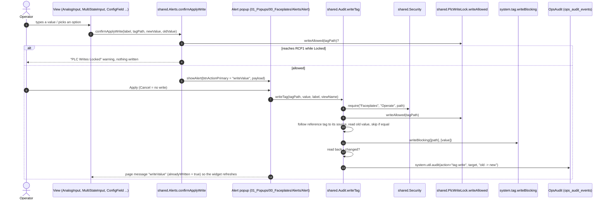
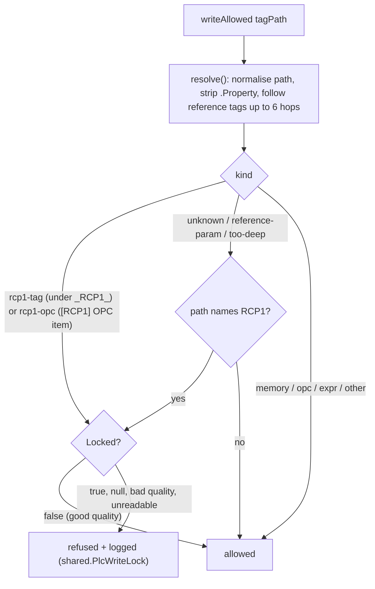

# Write Paths And Guards

**Rule:** an operator never writes a tag directly. Every write from the HMI goes through a short chain of library
functions that (1) asks for confirmation, (2) checks the user's permission on the gateway, (3) refuses anything
that would reach the production PLC while it is locked, (4) writes, (5) reads the value back and (6) records an
audit entry. This page explains that chain so you can extend it without opening a hole.

## The standard write: confirm, then audited write

Step by step, with where each piece lives:

1. **The widget never writes.** Inputs such as `03_Elements/00_Control/AnalogInput`, `MultiStateInput` and the
   faceplate `ConfigField` call `shared.Alerts.confirmApplyWrite(...)` (or `promptConfigWrite`, which first snaps
   the widget back to the old value). No dialog and no write when the new value equals the old one
   (`shared.Audit.valuesEqual`).
2. **PLC check before the dialog.** If the target resolves to the RCP1 controller while
   `[default]_Config/PlcWriteLock/Locked` is true, a "PLC Writes Locked" warning opens instead of the confirm.
3. **Confirm dialog.** The Alert popup shows `Old: ... New: ...`. Enum-backed members show words, for example
   `Time Of Day (0)` (from `shared.Enums.describe`).
4. **Apply.** The popup's primary button calls `shared.Audit.writeTag` itself, then sends the page message
   `writeValue` with `alreadyWritten = true` so the calling view refreshes its binding instead of writing again.
   Cancel sends `cancel` and writes nothing.
5. **`shared.Audit.writeTag`** (gateway side):
   - `_sessionMayWrite`: `Faceplates/Operate` from the Roles & Permissions matrix. `<device>.Enabled` is refused
     for sessions (Out Of Service has its own path); `_Config/Integrations/*` is gated by the caller.
   - `_plcWriteBlocked`: `shared.PlcWriteLock.writeAllowed` again (defence in depth).
   - Reference tags: if the leaf has a `sourceTagPath`, the write goes to the source tag.
   - De-duplication: the same value to the same tag within 1 s is ignored (double clicks).
   - Write, read back. If the quality is bad or the value did not change, the result says `skipped` and **no
     audit row is written** (that is also what happens when the OPC UA server-level block refuses a PLC write).
   - Audit: `system.util.audit(action="tag write", actionTarget=..., actionValue="old -> new", auditProfile="OpsAudit", originatingSystem=[...])`,
     where the target is the last three parts of the tag path and the originating system lists the tag path and view.
   - `.Enabled` changes also pulse `[default]_Config/Rebuild` so the device tables update.
6. **Return value:** `{ok, skipped, denied, plcLocked, oldValue, newValue, quality, statusCode}`.

## Device commands: `shared.ValveCommands`

Faceplate command buttons (Start / Stop / Reset, Open / Close, mode buttons, bypass, enable / disable) call
`shared.ValveCommands.<command>(tagPath)`. `_write`:

1. `shared.Security.require("Faceplates", "Operate", paths)`.
2. **PLC-mapped devices are read only**: if `shared.Pax.part(device)` says the device is mapped to the PLC, the
   command is refused and logged. Commands, modes and bypass bits belong to the PLC.
3. Each value goes through `shared.Audit.writeTag` (audit on). With `audit=False`, `_writeRaw` writes directly but
   still drops every path that `shared.PlcWriteLock.writeAllowed` refuses.

## The PLC write lock (two layers)

RCP1 is the **live production controller**. A write reaches it only when **both** layers allow it:

| Layer | What | Where | Managed by |
|---|---|---|---|
| Tag level (soft) | One boolean `[default]_Config/PlcWriteLock/Locked` (true = locked) drives `readOnly` on every `_RCP1_` tag and every OPC member of the PLC UDT definitions; the HMI guards (`writeAllowed`) refuse writes while it is true | `shared.PlcWriteLock`, gateway tag-change event `plcWriteLock` | flip it in the Designer Tag Browser |
| Server level (hard) | OPC UA device `RCP1` role permissions = Browse + Read only | gateway OPC UA config | changed by the system integrator |

How `writeAllowed(tagPath)` decides:

Full details, the fail-safe at gateway startup and the test boolean are on
[PLC Write Lock](../features/plc-write-lock.md).

:::danger Scripts never unlock the PLC
Never set `Locked = false` from a script, never import tags with values or push a `value` into `_RCP1_`, and never
ask for the OPC UA server block to be removed outside an agreed test. Test lock logic only with `[default]_Config/PlcWriteLock/_Test/Locked`.
:::

## Other write paths (and why they are allowed)

| Path | Writes | Guard |
|---|---|---|
| `shared.OutOfService.setOutOfService` | `<device>.Enabled` + SQL record | `OutOfService/Set`, memo rules, DB transaction, `shared.Audit.logEvent` |
| `shared.AlarmConfig.applyOverride` | alarm properties via `system.tag.configure` | `AlarmConfiguration/Edit`, audited (`alarm config`) |
| Faceplate Ack / Reset buttons, Machine Room Safetys Reset / Silence | ack / reset pulses | the buttons are gated on `session.custom.Permissions.AlarmSummary.Acknowledge`; writes go through `shared.Audit.writeTag` / `logEvent` (`alarm ack/reset`) |
| `shared.Integrations.save / setToken` | `_Config/Integrations/*` | `session.custom.IntegrationAccess` at the caller, audited |
| User Management / Roles & Permissions save | gateway user source, `_Config/RolesPermissions` | `UserManagement/*`, `RolesPermissions/Edit`, audited by `shared.UserAdmin` |
| `shared.PlcWriteLock._setReadOnly` | tag **configuration** (`readOnly`), never a value | gateway tag-change event only |
| `shared.Overview.writeInstances` | `Overview/Instances`, counts (memory tags) | gateway tag-change event only |
| Direct `system.tag.writeBlocking` in a few faceplate scripts | memory / HMI-only members | `self.session.custom.ReadOnly` (a PROTECTED session prop the browser cannot change) |

## Adding a new writable control

1. Bind the widget to the tag for display only (no bidirectional binding to a device tag).
2. On change, call `shared.Alerts.confirmApplyWrite(label, tagPath, newValue, oldValue)`; pass
   `extraPayload={"enumPath": "<Group>/<Name>"}` if the value is an enum code.
3. Gate the control's `enabled` on `!{session.custom.ReadOnly}` (or the more specific
   `EngineeringReadOnly` / `AlarmConfigReadOnly`) so Read Only users see it disabled.
4. If the write is a command (not a setting), add a function to `shared.ValveCommands` rather than calling
   `writeTag` from the view.
5. Test with a memory tag first. Never test against `[RCP1]` / `_RCP1_`.
