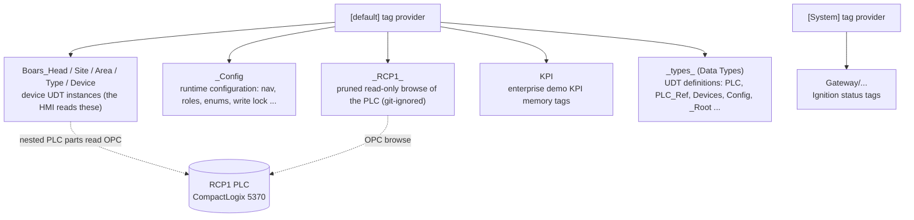

# Tags

Tags are the data layer of the BH HMI. Every value a Perspective view shows (a pump state, a tank level, a zone air
temperature, the navigation tree, the role matrix) is read from a tag. This section explains how the tags are
organized and why, where they are stored, how to change them in the Designer, and where every value comes
from in the PLC.

:::tip Where to start
- New to the project? Read this page, then [UDTs](udts/index.md), then [PAX Mapping](pax-mapping/index.md).
- Looking for one value ("where does this number on the pump faceplate come from")? Go to
  [PAX Mapping](pax-mapping/index.md) and the page of that device type, or search the
  [generated reference](reference/index.md) for the tag path.
- About to change a tag? Read [How To Change Tags](#how-to-change-tags) and
  [PLC Write Lock](plc-write-lock.md) first.
:::

## Words You Need

| Term | Meaning here |
|---|---|
| **Tag** | A named value in a tag provider, like a variable. Atomic tags hold one value; folders group tags. |
| **Tag provider** | A tag database. This gateway has `default` (everything the HMI uses) and `System` (gateway status tags Ignition creates). Paths start with the provider in brackets: `[default]Boars_Head/...`. |
| **UDT** | User Defined Type: a reusable tag template (members, parameters, alarms, history settings). The definition lives in `[default]_types_/...` (Tag Browser > Data Types); each **instance** is a copy that fills in the parameters. |
| **Parameter** | A per-instance value of a UDT, referenced in member settings as `{Name}` (for example `{TagPrefix}` inside an OPC item path). |
| **Nested UDT** | A UDT instance used as a member inside another UDT. Our device UDTs nest the PLC library UDTs this way. |
| **PlantPAx / PAX** | Rockwell's process library. The PLC (`RCP1`) uses PlantPAx objects such as `P_Motor`, `P_AIn`, `P_DIn`, `P_ValveSO`, `P_Intlk`. "PAX member" = a member of such an object, for example `Sts_Running`. |
| **Value source** | Where an atomic tag gets its value: `opc` (reads an OPC item from a device), `memory` (stored by the gateway), `expr` (an expression), `reference` (mirrors another tag). |
| **OPC item path** | The address an OPC tag reads, for example `ns=1;s=[RCP1]HTR_PUMPS[1].Sts_Running` = item `HTR_PUMPS[1].Sts_Running` on the device connection `RCP1`. |
| **Tag group** | The polling schedule of OPC tags. **Direct** groups poll all the time; **Leased** groups poll fast only while something on screen subscribes. See [History And Polling](history.md). |
| **readOnly** | A tag property that makes the tag refuse writes. Every tag that reads the PLC is read only while the [PLC Write Lock](plc-write-lock.md) is on. |

## How The Tag Tree Is Organized



| Top folder | What it holds | Maintained in |
|---|---|---|
| `[default]Boars_Head` | Every device as a UDT instance: `Boars_Head/GrovePort/<Area>/<Type>/<Device>`, for example `Boars_Head/GrovePort/Machine Room/Pumps/HTLR-Pump 1`. The HMI reads only here (plus `_Config`). | The Designer Tag Browser. |
| `[default]_Config` | Configuration the HMI reads at runtime: navigation tree, roles and permissions, security role lists, enums, the PLC write lock boolean, report catalog, forms operators, map data, ticket logger. | The Tag Browser and the admin pages. See [_Config Tags](config-tags.md). |
| `[default]_RCP1_` | A browse of the production PLC `[RCP1]`, pruned from 197,751 to about 35,000 tags (the PlantPAx members the HMI and FactoryTalk use). Every tag is read only and on a Leased group, so it costs almost no polling. Nothing displays it directly except the SAFETYS lamps. | Changed only by the system integrator (configuration only, never values). See [_RCP1_ Mirror](reference/rcp1-mirror.md). |
| `[default]KPI` | KPI memory tags for the enterprise demo (other plants). Hidden in local Groveport mode. | The Tag Browser. |
| `[default]_types_` | The UDT definitions (shown as **Data Types** in the Tag Browser). | The UDT Definitions editor. See [UDTs](udts/index.md). |
| `[System]Gateway/...` | Ignition's own status tags (alarming, database, devices, sessions, store and forward). | Ignition. Only the S&F Auditing pipeline folders are tracked in git. |

### The device tree convention

Every device lives at exactly one place:

```text
[default]Boars_Head/<Site>/<Area>/<Type>/<Device>
[default]Boars_Head/GrovePort/Machine Room/Pumps/HTLR-Pump 1
[default]Boars_Head/GrovePort/West PH/Utility/CG-F2
[default]Boars_Head/GrovePort/Freezer/Sensors/Underfloor Temp
```

**Why:** the alarm system reads **Site / Area / Device** straight out of the path. Every alarm definition carries
associated data `Site = split({PathToTag}, '/')[1]`, `Area = [2]`, `Device = [4]` (see [Alarms](alarms.md)), so
an alarm on `.../Machine Room/Pumps/HTLR-Pump 1/Motor/Alm_IOFault` is filed under GrovePort / Machine Room /
HTLR-Pump 1 with no per-alarm setup. Nested members (a tank's `LvlAIn`, a CG's `Valves/Liquid SV`) still resolve to
the device at position 4.

Rules that follow from it:

- Put a new device under the matching `<Area>/<Type>` folder. Never create devices under the retired `Plant/` tree
  or the legacy root folders (`[default]Compressors`, `Evaporators`, `RCP1`); they are gone or kept only for history.
- A new area folder needs a `.gitignore` whitelist line (see [What is in git](#what-is-in-git)).
- Areas in use at Groveport: Machine Room, Condensers, Freezer, SuperChill, Club, Palletizing, East PH, West PH, Dock,
  Production (FCM line KPI placeholders, not on the PLC).
- Inside an area the type folders are `Pumps`, `Tanks`, `Sensors`, `Valves`, `Compressors`, `Utility` (the CG
  evaporators), `Detectors`, `RuptureDisks`, `LevelSwitches`, `ExhaustFans`, `LTU`, `SafetyRelays`, `Sequences`,
  `Digitals`, `PLC`, and per area an `Overview` instance that feeds the device tables.

The full list of instances with their PLC objects is generated: [Device Instances](reference/devices/index.md).

### `_Config`

Small, global settings that views and scripts read by tag path. Examples: `_Config/Navigation` (the nav tree
document), `_Config/RolesPermissions` (the permission matrix dataset), `_Config/Security/*` (role lists),
`_Config/Enums/*` (code to text lists), `_Config/PlcWriteLock/Locked` (the PLC write lock). Each tag is described in
[_Config Tags](config-tags.md); the generated list with "read by" cross references is
[here](reference/config-tags.md).

### `_RCP1_` (the PLC mirror)

On 2026-10-22 the whole controller was browsed into `[default]_RCP1_` to find out what the PLC holds. It was then
**pruned** to the members the HMI and the old FactoryTalk (FT) screens use (35,207 tags kept, 162,544 deleted), every
tag made **read only**, and its tag groups switched to **Leased** so it does not poll the PLC (the HMI reads through
the device UDTs instead, see [PAX Mapping](pax-mapping/index.md)). Rules:

- It is **git-ignored**, so it exists only on this gateway. A backup zip and an offline catalog of the full browse
  exist (`docs/rcp1-pax-inventory.md`).
- Never import tags with values into `_RCP1_` or write a value to it. Bulk changes to it are made only by the system
  integrator (configuration only).
- Its `readOnly` flags are owned by the [PLC Write Lock](plc-write-lock.md); never unlock it outside an agreed test.

### System tags

`[System]Gateway/...` is created by Ignition (performance, database and device status, store and forward metrics).
The project only reads a few of them. Only `System/Gateway/StoreAndForward/ignition/Pipelines/Auditing/**` is tracked
in git (it backs the audit pipeline); the rest is gateway noise and must not be committed.

## Where Tags Are Stored

The gateway data folder is bind-mounted from the repo (`gateways/standard/data` -> `/usr/local/bin/ignition/data`),
so the tag configuration is plain JSON in the repo (the Designer writes it when you save):

```text
gateways/standard/data/config/resources/core/ignition/
  tag-definition/default/<folder path>/   tags, folders and UDT instances of [default]
      unary-resource.json                 resource header; "files" lists the files that are really used
      tags.json                           atomic tags and inline folders
      udts.json                           UDT instances of that folder
  tag-definition/System/...               [System] provider
  tag-type-definition/default/<folder>/udts.json   UDT definitions ([default]_types_/<folder>/...)
  tag-group/default/<group>/config.json   tag groups (polling)
  tag-provider/default/config.json        provider settings (value persistence, permissions)
```

Things that surprise people:

- **One resource per folder.** Each folder of the tag tree is its own resource folder on disk; `tags.json` holds only
  that level (plus inline folders). A `:` in a tag folder name is stored URL-encoded: `Controller:Global` is the
  folder `Controller%3aGlobal`.
- **`unary-resource.json` decides which file counts.** If it lists only `udts.json`, a `tags.json` next to it is stale
  and ignored by the gateway (this exists, for example in `_Config/Integrations`). The wiki reference follows the same
  rule.
- **Memory values are usually not in the files.** The provider persists runtime values in its internal database
  (`valuePersistence: Database`). A memory tag only has a `value` in JSON when one was saved with it, and that value is a
  *configured default*, not necessarily what the gateway is using right now.
- **UDT definitions and instances are separate.** Edit a member once in `tag-type-definition` and every instance
  follows; an instance file only stores parameters and overrides (for example `enabled: true` on a PLC part).
- The running gateway rewrites these files when someone edits tags in the Designer or imports tags. Expect
  diffs after Designer work and review them before committing.

## What Is In Git

`.gitignore` ignores everything under `gateways/**/data/**` and whitelists folders back with `!` lines. For tags the
whitelist is:

| Path (under `.../core/ignition/`) | Tracked |
|---|---|
| `tag-type-definition/**` (all UDT definitions) | yes |
| `tag-definition/default/Boars_Head/GrovePort/<Area>/**` for Machine Room, Condensers, Freezer, SuperChill, Club, Dock, East PH, West PH, Palletizing, Production | yes |
| `tag-definition/default/_Config/tags.json` and the `Security`, `Forms`, `Reports`, `Enums`, `PlcWriteLock` folders | yes |
| `tag-definition/default/_Config/Integrations`, `Monday`, `TicketLogger`, `Colors`, `Icons`, `Map` | **no** (some hold credentials) |
| `tag-definition/default/_RCP1_/**` | **no** (35K tags, gateway-only) |
| `tag-definition/default/Boars_Head/GrovePort/PLC/**` | **no** |
| `tag-group/default/PAX_Status`, `PAX_Faceplate`, `PAX_Config`, `RCP1_Status`, `RCP1_Faceplate` | yes |
| `tag-definition/System/Gateway/StoreAndForward/ignition/Pipelines/Auditing/**` | yes |
| Legacy root folders (`Evaporators`, `Compressors`, `Pumps`, `Tanks`, `Valves`, `Sensors`, `RCP1`, `CoolingTowers`, `ExhaustFans`, `Plant`) | whitelisted but retired; some still show as deleted in `git status` |

The [Tag Tree Inventory](reference/tag-tree.md) page shows, per top folder, how many tag files are tracked right
now (it asks `git check-ignore`).

**Adding a new folder?** If it is not under an already whitelisted folder, add the matching pair of lines next to the
others in `.gitignore`, or the files will never be committed:

```gitignore
!gateways/standard/data/config/resources/core/ignition/tag-definition/default/Boars_Head/GrovePort/<New Area>/
!gateways/standard/data/config/resources/core/ignition/tag-definition/default/Boars_Head/GrovePort/<New Area>/**
```

When a commit is approved, commit tag changes together with the work that needs them: `tag-definition/**` and
`tag-type-definition/**` as one consistent set, never the `System/Gateway/**` noise and never
`gateways/*/data/projects/.resources/*` (see [Git Workflow](../git-workflow/index.md)).

## How To Change Tags

Everything is done in the Designer **Tag Browser** (the *Tag Browser* panel, with its **All Tags** and **UDT
Definitions** tabs). The gateway applies a change as soon as you save it: no scan, no restart. After any tag or UDT
edit, check in a Perspective session that the value shows and no binding shows an error overlay.

### Change A Tag Value Or Property

1. Tag Browser > select the tag > double-click the value to write it, or right-click > **Edit Tag** to change a
   property (value, data type, tag group, history, alarms, documentation).
2. For a memory tag, the **Value** field in the editor is the live value.
3. **Never** write values to, or make writable, anything under `[default]_RCP1_` or `[RCP1]`.

### Add A Device Instance

1. Tag Browser > **All Tags** > `[default]Boars_Head` > `GrovePort` > the area (for example `Machine Room`) > the type
   folder (for example `Pumps`).
2. Right-click the type folder > **New Tag > Data Type Instance** (or copy and paste a sibling instance and rename it,
   which keeps its parameter values).
3. Pick the UDT from `_types_/Devices` (for example `Devices/Pump`), name the instance, and fill in the parameters
   (for example `MotorTag`, `RunTimeTag`: the PLC object names).
4. Enable the nested PLC parts the PLC really has (for example `Motor`, `Intlk`) by ticking **Enabled** on them.
5. Add the device to the nav and to any page that lists it ([Navigation](../perspective/navigation.md)); device
   list pages read the folder, so the new instance appears by itself.
6. Check its faceplate in a session.

### Add A Member To A UDT

1. Tag Browser > **UDT Definitions** tab > the type (for example `Devices/Pump`).
2. Right-click the definition > **New Tag**, or copy an existing member and rename it. Set its data type, value
   source (`opc` for a PLC member, `memory` for an HMI setting) and its OPC item path using the type's parameters,
   for example `{TagPrefix}.Cfg_Mode`.
3. **Always set `valueSource` = Memory explicitly on a new memory member**: members of `_Root/Analog` and
   `_Root/Digital` default to a reference with an empty source, which reads null.
4. Click **OK**. Every instance gets the member.

### Edit An Alarm On A UDT

Alarms live on UDT members, never on instances. UDT Definitions tab > the library type (for example `PLC/P_AIn`) >
select the member (for example `Sts_Hi`) > tag editor > **Alarming** section. See [Alarms](alarms.md#how-to-add-or-change-an-alarm).

### Change A Tag Group Or Add History

- **Tag group:** on the tag (or UDT member) set **Tag Group**; to change a group's rate use Gateway web UI > Config >
  Tags > Tag Groups ([History And Polling](history.md#how-to-change-it)).
- **History:** on the tag or UDT member, tag editor > **History** > enable, set sample mode, deadband and the
  `historian` provider. Do it on the UDT definition for device members.

### Add A New PLC Card Or A New PLC

See [PLC Rack UDTs](udts/plc-rack.md#how-to-add-a-card-or-a-plc) (UDT Definitions copy, a site instance, the `Rack`
document and a nav item).

### Import And Export Tags

- **Export:** Tag Browser > right-click a folder > **Export Tags** (JSON). Take an export before any bulk change.
- **Import:** Tag Browser > right-click a folder > **Import Tags**, choose the JSON, and a collision policy
  (**Overwrite** for definitions you changed, **Merge** to keep tags that are not in the file). Memory values in the
  JSON are applied. Never import into `_RCP1_`.
- Git holds the same JSON as files (see below), so a branch change can bring tag changes: import the affected
  folders afterwards ([Merge Conflicts](../git-workflow/merge-conflicts.md)).

### Gotchas

- **`_Root/Analog` and `_Root/Digital` default to a reference value source** with an empty source: set a new memory
  member's value source to Memory.
- **Never edit `_Config/DemoEnterpriseNav` in the file**: change it in the Tag Browser only (a file edit blanks the
  live value).
- **A UDT that gains a parent type** may lose inherited members until you remove and re-add the definition; try it on
  a copy first.
- **No gateway restart is needed** for tags. A restart is only the fallback for a stale Perspective view, and it logs
  every session out.
- **Don't edit UDT definitions during a PLC write-lock flip** ([PLC Write Lock](plc-write-lock.md)).

## How To Find Where A Value Comes From (Designer)

1. In the client, note the device (for example the faceplate title **HTLR-Pump 2**) and the field (for example
   **Runtime hours**).
2. In the Designer, open **Tag Browser > default > Boars_Head > GrovePort > Machine Room > Pumps > HTLR-Pump 2**.
3. Expand the instance: the PLC parts are `Motor`, `Intlk`, `RunTime`. **Runtime hours** is `RunTime/Val_TotRunHrs`
   (the field tables are on the [PAX Mapping](pax-mapping/index.md) pages).
4. Right-click the member > **Edit Tag**: the **OPC Item Path** shows `ns=1;s=[RCP1]HTR_PUMPS_RUNTIME[2].Val_TotRunHrs`.
   That is the PLC tag in Studio 5000 (`HTR_PUMPS_RUNTIME[2].Val_TotRunHrs`).
5. To see the template, right-click the instance > **Edit Tag** > the **Type** link, or open **Data Types > Devices >
   Pump**. The parameters tab shows `MotorTag = HTR_PUMPS[2]`, `RunTimeTag = HTR_PUMPS_RUNTIME[2]`.

The same lookup without a Designer: [Device Instances](reference/devices/index.md) lists every instance with its
resolved PLC objects.

## Pages In This Section

| Page | Content |
|---|---|
| [UDTs](udts/index.md) | The UDT families, inheritance and nesting: [PlantPAx library](udts/pax-library.md), [Device and Unit UDTs](udts/device-udts.md), [PLC rack UDTs](udts/plc-rack.md), [_Root, Config and Overview UDTs](udts/root-and-config.md). |
| [PAX Mapping](pax-mapping/index.md) | Per device type: HMI field -> PAX member -> PLC tag, the evidence, the decisions, live checks, open items. |
| [Alarms](alarms.md) | Alarms on UDT members, priorities, PLC-enable gating, the journal, CG Too Hot / Too Cold. |
| [History And Polling](history.md) | What is historized, tag groups, deadbands, the historian. |
| [PLC Write Lock](plc-write-lock.md) | The safety layers that stop writes to the production PLC. |
| [Enums](enums.md) | Code to text DataSet tags and `shared.Enums`. |
| [_Config Tags](config-tags.md) | Every configuration tag and what reads it. |
| [Reference (Generated)](reference/index.md) | Generated from the files: every UDT, every instance, tag groups, `_Config`, `_RCP1_`, alarm and history indexes. |
