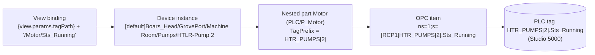

# PAX Mapping: Where Every Value Comes From

**PAX mapping** is the work (2026-10-22 / 23) that connected every device on the BH HMI to its real object in the
production PLC `RCP1`. Before it, most device values were static memory placeholders left over from the simulator.
Now every value is read **live and read only** from the controller, through the nested PlantPAx parts of the device
UDTs ([Device UDTs](../udts/device-udts.md)).

This section is the single place to learn "where does this value come from". Each device type has a page with:

- the devices and the controller objects behind them;
- a **field table**: HMI field -> the member the view reads -> the PLC tag;
- the decisions and the evidence (FactoryTalk exports, photos, the L5X program, live reads);
- alarm behaviour, live check results, open and parked items.

## How To Trace One Value

1. Find the device's tag path: faceplate title / the page's embed `tagPath` param. Devices live at
   `[default]Boars_Head/GrovePort/<Area>/<Type>/<Device>`.
2. Find the field on the device type's page below (for example **Runtime hours** = `RunTime/Val_TotRunHrs`).
3. The PLC object of each part is in the instance's parameters; the generated
   [Device Instances](../reference/devices/index.md) pages list them resolved (`[RCP1]HTR_PUMPS_RUNTIME[2]`).
4. The PLC tag is `<object>.<member>` (folders become dots, `Cfg_CondTxt/Cfg_CondTxt_3_` becomes `Cfg_CondTxt[3]`).

## Status Per Device Type

| # | Device type | Page | Devices | PLC objects |
|---|---|---|---|---|
| 01 | HTR / LTR recirculator pumps | [Recirc Pumps](recirc-pumps.md) | 4 | P_Motor, P_Intlk, P_RunTime |
| 02 | Tanks HTR / LTR / HPR / CSV | [Tanks](tanks.md) | 4 | P_AIn level, P_DIn switches, pump alarm DIs, setpoint atomics |
| 03 | Sensors (pressures, outside air, underfloor) | [Sensors](sensors.md) | 9 | P_AIn (owner) or PLC_Ref (reference) |
| 04 | Solenoid valves (Machine Room, Condensers) | [Valves](valves.md) | 4 | P_ValveSO |
| 05 | Screw compressors COMP 1 / 4 / 5 / 6 / 7 | [Compressors](compressors.md) | 5 | Screw_Compressor + P_Intlk |
| 06 | CG evaporators (19 control groups) | [CG Evaporators](cg-evaporators.md) | 19 | CG_RL_Evap, P_AIn, P_Intlk, P_Motor, P_RunTime |
| 07 | CG solenoid valves | [CG Valves](cg-valves.md) | 76 (70 mapped) | P_ValveSO |
| 08 | Condenser sump pumps and fans | [Condenser Pumps And Fans](condenser-pumps-fans.md) | 7 | P_Motor, P_RunTime (+ shared P_Intlk) |
| 09 | Discrete inputs: detectors, rupture disks, level switches | [Discrete Inputs](discrete-inputs.md) | 52 | P_DIn |
| 10 | Exhaust fans | [Exhaust Fans](exhaust-fans.md) | 2 | P_DIn + BOOL |
| 11 | NH3 liquid transfer unit | [LTU](ltu.md) | 1 | DINT / BOOL atomics + P_DIn |
| 12 | HLCO safety relay (440C-CR30) | [Safety Relay](safety-relay.md) | 1 | module input assembly + BOOLs |
| 13 | Sequences HSS / LSS / HSD | [Sequences](sequences.md) | 3 | Comp_Sequence, FB_2SpUpDownSeqr + atomics |
| 14 | Machine Room SAFETYS lamps | [Machine Room SAFETYS](machine-room-safetys.md) | 8 | references into the program / P_DIn parts |
| 15 | End state: flat members removed | [Flat-Member Cleanup](flat-member-cleanup.md) | all | - |
| - | Open and parked items | [Open Items](open-items.md) | - | - |

Every type is mapped. Not on the PLC at all (nothing to map): the Production / FCM line KPIs (static memory
placeholders under `Boars_Head/GrovePort/Production/FCM`, out of scope in local Groveport mode) and the unmapped
`CoolingTower` type.

## The Evidence Used

The PLC has thousands of objects and the old FactoryTalk (FT) HMI showed only some of them. Every mapping decision
was checked against these sources, all read only:

| Source | Where | What it proves |
|---|---|---|
| FT display XML exports | `docs/ft-display-tags/Displays/*.xml` (85 displays), `docs/BoarsHead/gfx_xml` | Which PLC object each FT graphic binds (`#102 = {[RCP1]HTR_PUMPS[1]}`), labels, positions. |
| FT binary displays | `docs/BoarsHead/Gfx/*.gfx` (e.g. `(STELLAR)DashBoard.gfx`, the Plant Overview) | Read as bytes when no XML exists: object records, `#102` tags, CG numbers. |
| FT parameter files | `docs/BoarsHead/PAR/*.par` | `DataType = P_xxx`, the object of a global object instance. |
| Screenshots of the running FT HMI | `C:\Users\dylan.jones\Pictures\Bors\*.png` (Machine Room, Condensers, Utility Overview, faceplates) | Labels, units, states and positions the operators know. Treated as the source of truth alongside the exports. |
| L5X program export | `Downloads\BoarsHead.L5X` (2026-10-23, Studio 5000 v24), read as data, not in the repo | Which tags the logic really uses, descriptions, I/O rungs, alarm enables. |
| Browse catalog | the offline catalog of the full browse, see `docs/rcp1-pax-inventory.md` (197,751 tags) | That a member exists in the controller, its data type and browse casing. |
| Live reads | read-only checks in a Perspective session and the Tag Browser | Values, labels and alarm enables in the running PLC (2026-10-22 and 2026-10-23, SecureLink up). |

Rule: when FT and the L5X descriptions disagree, **what FT binds wins** (the operators' view), and the conflict is
recorded (example: the underfloor sensors, [Sensors](sensors.md)).

## Rules That Apply To Every Type

- **Read only.** No value was ever written to `[RCP1]` or `_RCP1_` during the mapping. Every PLC member is
  `readOnly`, every command / mode / setpoint control on a mapped device is disabled, and the write helpers refuse
  ([PLC Write Lock](../plc-write-lock.md)). The faceplates show the "PLC Writes Locked" alert when a command is tried.
- **One owner per controller object.** Each object is nested once as a real OPC part (subscribed, alarmed,
  historized); any other device that shows it uses a read-only reference (`PLC_Ref/P_AIn`) or reads the owner's part.
- **Parts enabled only where the PLC has the object.** A device without, for example, an interlock object keeps that
  part disabled; the view shows the field gray or hides it (data-driven, never by device name).
- **Gray placeholder for bad or loading values.** A null, Bad or Uncertain value renders as a neutral gray italic em
  dash (style class `value-bad`, built with `isGood` / `coalesce` / `try` expressions so there are no binding error
  overlays). `StatusIndicator` shows COMM LOSS for Bad quality (a real state). PlantPAx writes about 1.5e38 into an
  unused limit; any value of 1e30 or more is treated as "no value" (gray dash, no unit).
- **Leased values take a moment.** Faceplate-only members (`PAX_Faceplate`, Leased) are polled fast only while shown;
  with the 60 s background rate they usually show within 0-5 s, over a slow link up to a minute.
- **Alarms follow the PLC.** Library alarms are enabled only where the PLC object enables that alarm
  ([Alarms](../alarms.md)).
- **How to change a mapping.** Edit the device UDT in the Designer (Tag Browser > UDT Definitions > `Devices` >
  the type: the nested PLC part and its members), the instance parameters (Tag Browser > the instance), and the view
  binding that reads the member (Project Browser > Perspective > Views > the faceplate or component). Wrap every PLC
  read as `if(isGood(tag(p)), tag(p), null)` so a bad value shows the gray dash. See
  [How To Change Tags](../index.md#how-to-change-tags).

*HTLR-Pump 2 faceplate with live PLC values (2026-10-23): status from `Motor/Sts_Running`, run hours and starts from
`RunTime`, the fail-to-start timer from the Leased `Motor/Cfg_FailToStartT`. Start / Stop / Reset are disabled by the
write lock.*

## Reading The Field Tables

- **Field** is the old HMI member name. Those flat members were deleted in the cleanup, but the names are still the
  field keys of `shared.Pax.FIELDS` (Details-table columns, ConfigSection rows, Daily Rounds), so they are the
  easiest way to search.
- **Reads now** is the member of the device the views read, relative to the device instance (for example
  `Motor/Sts_Running`).
- **PLC tag** is the controller tag of the first mapped instance; the other instances use their own object.
- **Group**: `Status` = `PAX_Status` (Direct), `Faceplate` = `PAX_Faceplate` (Leased).
- **Status**: `mapped`, `mapped (added)` (member added to the library for this), `site-only` (HMI-owned, no PLC
  member), `no PLC object` (the device has no such object; gray or hidden).
- **Live sample** values are from the read-only checks of 2026-10-22 / 23 and only illustrate; they change.
