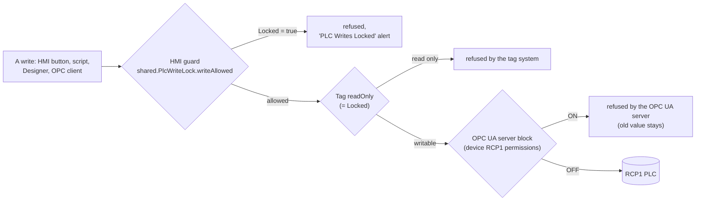

# PLC Write Lock

`[RCP1]` (Logix driver device `RCP1`) is the **live production controller** of the Groveport refrigeration plant.
Nothing in this project may write to it until the user has tested and decided to allow it. Writes are blocked by
**independent layers**, and a write reaches the PLC only when **all of them** allow it.



| Layer | Where | Blocks | Managed by |
|---|---|---|---|
| HMI guards | `shared.PlcWriteLock.writeAllowed` inside `shared.Audit.writeTag`, `shared.Alerts.confirmApplyWrite`, `shared.ValveCommands._writeRaw` | every HMI write that resolves (also through reference tags) to `[RCP1]` while locked | the `shared.PlcWriteLock` script module |
| Tag level | the boolean `[default]_Config/PlcWriteLock/Locked` drives `readOnly` on every tag that reads RCP1 | writes through those tags (HMI, scripts, Designer tag edits) | gateway tag-change event `plcWriteLock` -> `shared.PlcWriteLock.onLockChange` |
| Server level (hard block) | OPC UA permissions of the device `RCP1` (`config.profile.rolePermissionMappings` = Browse + Read only) | every OPC UA write and method call to `[RCP1]`, whatever tag, script or client sends it | the system integrator |

**A PLC write needs `Locked = false` AND the server block removed.** Status on 2026-10-23: both ON.

## The Tag-Level Lock (One Boolean)

`[default]_Config/PlcWriteLock/Locked` (memory Boolean, default `true` = read only). The user asked for exactly this
(2026-10-23): "Just have a boolean under _Config that allows me to unlock and lock the read only param of each tag."

What it changes: `readOnly = Locked` on

- every AtomicTag under `[default]_RCP1_` (about 35,000 browsed controller tags; the driver diagnostics under
  `_Diagnostics_` always stay read only);
- every **OPC member of the UDT definitions** in the `tag-type-definition` folders `PLC/**` (including Modules,
  Controllers, Sites), `PLC_Ref`, `Devices` and `Units`: about 2,266 members, set on the **definition**
  (`[default]_types_/...`), so every instance inherits it. There are no per-instance overrides.

No other standard tag reads `[RCP1]` (checked 2026-10-23).

### Why a script and not a binding

Ignition 8.3 cannot bind a tag's `readOnly` property to another tag (an expression binding on `readOnly` is silently
dropped on import; non-alarm tag properties take only static values or UDT parameters). So a **gateway tag-change
event** (project BH, `ignition/tag-change/plcWriteLock`, on value and quality changes of `Locked`) calls
`shared.PlcWriteLock.onLockChange`, which:

- computes from the file tag store which tags / members have a `readOnly` different from the target (a re-assert while
  already locked changes nothing);
- applies them with `system.tag.configure(..., "m")` per parent folder, in chunks of 5,000 with a 2 s pause;
- runs in one background worker per target, gateway-wide (lock and pending flag in `system.util.getGlobals()`, so they
  survive script reloads); the worker re-reads the boolean until it stops moving, so the final state follows the
  latest value;
- sends **configuration only** (`{name, readOnly}`), never a value;
- logs each flip with its counts (logger `shared.PlcWriteLock`), for example
  `PLC write lock (flip): Locked=False -> readOnly=False on 37322 tags / UDT members: ...`.

### Fail-safe

- A bad, null or unreadable `Locked` counts as **locked** (read only, guards refuse).
- **Gateway startup** (JVM uptime under 10 minutes when the script starts): `Locked` is forced back to `true` and
  `readOnly` re-asserted. A project save only re-asserts the current value.
- While unlocked, the header shows a red **"PLC Writes Unlocked"** pill (indicator only, no click action).

## The Server-Level Hard Block

Every OPC tag reaches a device through the loopback OPC connection `Ignition OPC UA Server`, which logs in as an
authenticated user. The device `RCP1` has its own role permissions:

```json
[
  {"role": "Anonymous", "permissions": ["Browse", "Read"]},
  {"role": "AuthenticatedUser", "permissions": ["Browse", "Read"]}
]
```

That replaces the gateway-wide defaults (Anonymous Browse + Read; AuthenticatedUser Browse + Read + Write + Call) for
RCP1 only. No role has Write or Call, so the server refuses every write and method call to `[RCP1]` nodes: OPC tag
writes, `system.opc.write*`, Designer OPC browser writes, external OPC UA clients. Reads and subscriptions are
unaffected. It does **not** cover anything that reaches the PLC outside this gateway (Studio 5000, another HMI) or
someone with gateway config rights removing it.

The 8.3 Gateway web UI does not show per-device role permissions, so the block is **changed by the system
integrator** (ask them to check, set or remove it). Changing it **restarts its driver** (not the gateway): about 1.5 minutes for the API call, then the data tags
show `Uncertain_LastKnownValue` until the driver catches up (10-30 minutes over SecureLink). Never change the
gateway-wide `access-control` defaults instead.

## The Combinations

| `Locked` | Server block | Result |
|---|---|---|
| true | ON | refused by the HMI guard / tag system |
| false | ON | the tag write goes out, the OPC UA server refuses it; the HMI shows no error, only the old value; `shared.Audit.writeTag` sees bad quality and writes no OpsAudit entry |
| true | OFF | refused by the HMI guard / tag system |
| false | OFF | **the write reaches the PLC** |

## How The User Unlocks And Relocks

Only the user does this, deliberately, when testing real writes:

1. Ask the system integrator to remove the server block, and to confirm it is OPEN.
2. In the Designer: **Tag Browser > default > _Config > PlcWriteLock > Locked**, set it to **false**. The flip applies
   by itself within seconds; a full unlock of about 37,000 tags takes 30-60 s (watch the gateway log). The header
   shows "PLC Writes Unlocked".
3. Test. Every HMI write still goes through `shared.Audit.writeTag` (permission check + OpsAudit entry).
4. **Relock both when done**: `Locked = true` first, then the system integrator restores the server block.

## Why Nobody Unlocks Casually

The lock exists so that nothing can write to the live PLC by mistake. So:

- never set `[default]_Config/PlcWriteLock/Locked = false` and never make an `[RCP1]` / `_RCP1_` tag writable outside
  an agreed test with the owner present;
- never remove the OPC UA server block outside that test;
- never import tags with values into `_RCP1_` (bulk changes there are made only by the system integrator,
  configuration keys only);
- test the flip logic only with the TEST boolean (below).

### Testing

`[default]_Config/PlcWriteLock/_Test/Locked` has its own tag-change event `plcWriteLockTest`
(`shared.PlcWriteLock.onTestChange`). It drives only the memory tags `_Config/PlcWriteLock/_Test/Tags/*` and the test
UDT `_types_/_PlcWriteLockTest/TestCard` (instance `_Test/Instance`), never the PLC. Results 2026-10-23: TEST = false
made the 3 test tags and 3 test UDT members writable, TEST = true made them read only again, a burst of flips ended
on the last value, and the real `Locked` stayed `true` throughout. A check of `_RCP1_`: 35,056 of 35,056
tags read only, 0 value keys; UDT OPC members writable: 0. The generated [_RCP1_ Mirror](reference/rcp1-mirror.md)
page re-checks the first two numbers each time it is refreshed.

## Controls That Write To The PLC

The only HMI control written specifically for a PLC bit so far is the LTU **Reset Count** button (`PlcResetCount` ->
`[RCP1]HMI_Ltu_Clear`, 2026-10-24). It is one click (no confirm dialog, like FT) and goes through `shared.PlcWriteLock.writeAllowed`,
the `Faceplates/Operate` and `LTU/Command` permissions and `shared.Audit.writeTag`, so while `Locked` is true it only shows "PLC Writes Locked". It has not been tested against the
live PLC. See [LTU](pax-mapping/ltu.md).

## Notes For Tag Editors

- An unlock or relock makes the gateway **rewrite** `tag-type-definition/default/PLC/udts.json` (and `Devices`). Don't
  edit those UDT definitions in the Designer during a flip, and expect those files to show in `git status` afterwards.
- UDT members you add to those types should be `readOnly = true`. While unlocked, the next flip or script start
  re-applies the boolean's value.
- Importing a `_Config` export that contains `PlcWriteLock/Locked` sets it to the exported value: check it is `true`
  afterwards (the fail-safe direction).

## History Of The Design

- **v1 (2026-10-22)**: an admin page Operations > PLC Write Lock (`/operations/plc-write-lock`) with a scope dropdown,
  confirm popup, Relock / Relock All and a gateway message handler; matrix row `PLC/WriteUnlock`.
- **v2 (2026-10-23, current)**: the user asked for a plain boolean instead. The page, popup, message handler, matrix
  row, the header pill's click action and the state tags (`Scope`, `UnlockedBy`, `UnlockedAt` ...) were removed. Older
  notes that mention the page are out of date.

Full details: `docs/plc-write-lock.md`.
