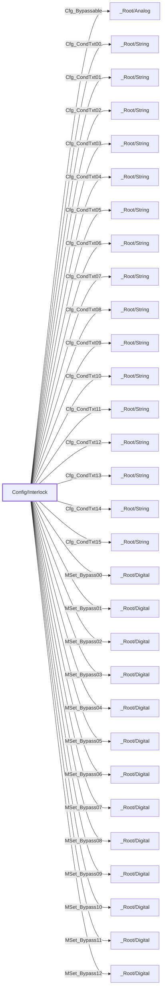

:::note

:::
# UDT `Config/Interlock`

P\_Intlk HMI mirror

Config/Interlock — P\_Intlk-shaped HMI layer; leaves are \_Root/Digital, \_Root/Analog, or \_Root/String (Cfg\_CondTxt)

| | |
|---|---|
| Designer location | Tag Browser &gt; default &gt; Data Types &gt; Config &gt; Interlock |
| Tag path | `[default]_types_/Config/Interlock` |
| File | `gateways/standard/data/config/resources/core/ignition/tag-type-definition/default/Config/udts.json` |
| Inherits from | - |
| Inherited by | - |
| Own members | 47 (0 atomic, 47 nested UDT, 0 folders) |
| Status | no instances |

## Parameters

_No parameters._

## Structure

## Members

| Member | Data type | Source | Tag group | Read only | History | Units / format | Alarms | Documentation |
|---|---|---|---|---|---|---|---|---|
| `Cfg_Bypassable` | UDT | nested [\_Root/Analog](../root/analog.md) | | | | | | Bypassable channel bits |
| `Cfg_CondTxt00` | UDT | nested [\_Root/String](../root/string.md) | | | | | | Interlock condition text 00 |
| `Cfg_CondTxt01` | UDT | nested [\_Root/String](../root/string.md) | | | | | | Interlock condition text 01 |
| `Cfg_CondTxt02` | UDT | nested [\_Root/String](../root/string.md) | | | | | | Interlock condition text 02 |
| `Cfg_CondTxt03` | UDT | nested [\_Root/String](../root/string.md) | | | | | | Interlock condition text 03 |
| `Cfg_CondTxt04` | UDT | nested [\_Root/String](../root/string.md) | | | | | | Interlock condition text 04 |
| `Cfg_CondTxt05` | UDT | nested [\_Root/String](../root/string.md) | | | | | | Interlock condition text 05 |
| `Cfg_CondTxt06` | UDT | nested [\_Root/String](../root/string.md) | | | | | | Interlock condition text 06 |
| `Cfg_CondTxt07` | UDT | nested [\_Root/String](../root/string.md) | | | | | | Interlock condition text 07 |
| `Cfg_CondTxt08` | UDT | nested [\_Root/String](../root/string.md) | | | | | | Interlock condition text 08 |
| `Cfg_CondTxt09` | UDT | nested [\_Root/String](../root/string.md) | | | | | | Interlock condition text 09 |
| `Cfg_CondTxt10` | UDT | nested [\_Root/String](../root/string.md) | | | | | | Interlock condition text 10 |
| `Cfg_CondTxt11` | UDT | nested [\_Root/String](../root/string.md) | | | | | | Interlock condition text 11 |
| `Cfg_CondTxt12` | UDT | nested [\_Root/String](../root/string.md) | | | | | | Interlock condition text 12 |
| `Cfg_CondTxt13` | UDT | nested [\_Root/String](../root/string.md) | | | | | | Interlock condition text 13 |
| `Cfg_CondTxt14` | UDT | nested [\_Root/String](../root/string.md) | | | | | | Interlock condition text 14 |
| `Cfg_CondTxt15` | UDT | nested [\_Root/String](../root/string.md) | | | | | | Interlock condition text 15 |
| `MSet_Bypass00` | UDT | nested [\_Root/Digital](../root/digital.md) | | | | | | Bypass 00 |
| `MSet_Bypass01` | UDT | nested [\_Root/Digital](../root/digital.md) | | | | | | Bypass 01 |
| `MSet_Bypass02` | UDT | nested [\_Root/Digital](../root/digital.md) | | | | | | Bypass 02 |
| `MSet_Bypass03` | UDT | nested [\_Root/Digital](../root/digital.md) | | | | | | Bypass 03 |
| `MSet_Bypass04` | UDT | nested [\_Root/Digital](../root/digital.md) | | | | | | Bypass 04 |
| `MSet_Bypass05` | UDT | nested [\_Root/Digital](../root/digital.md) | | | | | | Bypass 05 |
| `MSet_Bypass06` | UDT | nested [\_Root/Digital](../root/digital.md) | | | | | | Bypass 06 |
| `MSet_Bypass07` | UDT | nested [\_Root/Digital](../root/digital.md) | | | | | | Bypass 07 |
| `MSet_Bypass08` | UDT | nested [\_Root/Digital](../root/digital.md) | | | | | | Bypass 08 |
| `MSet_Bypass09` | UDT | nested [\_Root/Digital](../root/digital.md) | | | | | | Bypass 09 |
| `MSet_Bypass10` | UDT | nested [\_Root/Digital](../root/digital.md) | | | | | | Bypass 10 |
| `MSet_Bypass11` | UDT | nested [\_Root/Digital](../root/digital.md) | | | | | | Bypass 11 |
| `MSet_Bypass12` | UDT | nested [\_Root/Digital](../root/digital.md) | | | | | | Bypass 12 |
| `MSet_Bypass13` | UDT | nested [\_Root/Digital](../root/digital.md) | | | | | | Bypass 13 |
| `MSet_Bypass14` | UDT | nested [\_Root/Digital](../root/digital.md) | | | | | | Bypass 14 |
| `MSet_Bypass15` | UDT | nested [\_Root/Digital](../root/digital.md) | | | | | | Bypass 15 |
| `OCmd_Reset` | UDT | nested [\_Root/Digital](../root/digital.md) | | | | | | Reset interlocks |
| `Rdy_Reset` | UDT | nested [\_Root/Digital](../root/digital.md) | | | | | | Reset ready |
| `Sts_BypActive` | UDT | nested [\_Root/Digital](../root/digital.md) | | | | | | Bypass active |
| `Sts_FirstOut` | UDT | nested [\_Root/Analog](../root/analog.md) | | | | | | First out channel index (PLC Sts\_FirstOut Int2) |
| `Sts_Intlk` | UDT | nested [\_Root/Analog](../root/analog.md) | | | | | | Interlock status bits |
| `Sts_IntlkOK` | UDT | nested [\_Root/Digital](../root/digital.md) | | | | | | Interlocks OK |
| `Sts_NBIntlkOK` | UDT | nested [\_Root/Digital](../root/digital.md) | | | | | | Non-bypassable OK |
| `Cfg_OKState` | UDT | nested [\_Root/Analog](../root/analog.md) | | | | | | OK state channel bits (FT P\_Intlk Cfg\_OKState) |
| `Cfg_Latched` | UDT | nested [\_Root/Analog](../root/analog.md) | | | | | | Must reset (latched) channel bits (FT P\_Intlk Cfg\_Latched) |
| `Cfg_HasNav` | UDT | nested [\_Root/Analog](../root/analog.md) | | | | | | Allow navigation channel bits (FT P\_Intlk Cfg\_HasNav) |
| `Cfg_Desc` | UDT | nested [\_Root/String](../root/string.md) | | | | | | Description (FT P\_Intlk Cfg\_Desc) |
| `Cfg_Label` | UDT | nested [\_Root/String](../root/string.md) | | | | | | Label (FT P\_Intlk Cfg\_Label) |
| `Cfg_Tag` | UDT | nested [\_Root/String](../root/string.md) | | | | | | Tag (FT P\_Intlk Cfg\_Tag) |
| `Cfg_PCmdClear` | UDT | nested [\_Root/Digital](../root/digital.md) | | | | | | Clear program commands upon receipt (FT P\_Intlk Cfg\_PCmdClear) |

## Nested UDTs

| Member | Type | Parameter bindings | Default state |
|---|---|---|---|
| `Cfg_Bypassable` | [\_Root/Analog](../root/analog.md) | - | enabled |
| `Cfg_CondTxt00` | [\_Root/String](../root/string.md) | - | enabled |
| `Cfg_CondTxt01` | [\_Root/String](../root/string.md) | - | enabled |
| `Cfg_CondTxt02` | [\_Root/String](../root/string.md) | - | enabled |
| `Cfg_CondTxt03` | [\_Root/String](../root/string.md) | - | enabled |
| `Cfg_CondTxt04` | [\_Root/String](../root/string.md) | - | enabled |
| `Cfg_CondTxt05` | [\_Root/String](../root/string.md) | - | enabled |
| `Cfg_CondTxt06` | [\_Root/String](../root/string.md) | - | enabled |
| `Cfg_CondTxt07` | [\_Root/String](../root/string.md) | - | enabled |
| `Cfg_CondTxt08` | [\_Root/String](../root/string.md) | - | enabled |
| `Cfg_CondTxt09` | [\_Root/String](../root/string.md) | - | enabled |
| `Cfg_CondTxt10` | [\_Root/String](../root/string.md) | - | enabled |
| `Cfg_CondTxt11` | [\_Root/String](../root/string.md) | - | enabled |
| `Cfg_CondTxt12` | [\_Root/String](../root/string.md) | - | enabled |
| `Cfg_CondTxt13` | [\_Root/String](../root/string.md) | - | enabled |
| `Cfg_CondTxt14` | [\_Root/String](../root/string.md) | - | enabled |
| `Cfg_CondTxt15` | [\_Root/String](../root/string.md) | - | enabled |
| `MSet_Bypass00` | [\_Root/Digital](../root/digital.md) | - | enabled |
| `MSet_Bypass01` | [\_Root/Digital](../root/digital.md) | - | enabled |
| `MSet_Bypass02` | [\_Root/Digital](../root/digital.md) | - | enabled |
| `MSet_Bypass03` | [\_Root/Digital](../root/digital.md) | - | enabled |
| `MSet_Bypass04` | [\_Root/Digital](../root/digital.md) | - | enabled |
| `MSet_Bypass05` | [\_Root/Digital](../root/digital.md) | - | enabled |
| `MSet_Bypass06` | [\_Root/Digital](../root/digital.md) | - | enabled |
| `MSet_Bypass07` | [\_Root/Digital](../root/digital.md) | - | enabled |
| `MSet_Bypass08` | [\_Root/Digital](../root/digital.md) | - | enabled |
| `MSet_Bypass09` | [\_Root/Digital](../root/digital.md) | - | enabled |
| `MSet_Bypass10` | [\_Root/Digital](../root/digital.md) | - | enabled |
| `MSet_Bypass11` | [\_Root/Digital](../root/digital.md) | - | enabled |
| `MSet_Bypass12` | [\_Root/Digital](../root/digital.md) | - | enabled |
| `MSet_Bypass13` | [\_Root/Digital](../root/digital.md) | - | enabled |
| `MSet_Bypass14` | [\_Root/Digital](../root/digital.md) | - | enabled |
| `MSet_Bypass15` | [\_Root/Digital](../root/digital.md) | - | enabled |
| `OCmd_Reset` | [\_Root/Digital](../root/digital.md) | - | enabled |
| `Rdy_Reset` | [\_Root/Digital](../root/digital.md) | - | enabled |
| `Sts_BypActive` | [\_Root/Digital](../root/digital.md) | - | enabled |
| `Sts_FirstOut` | [\_Root/Analog](../root/analog.md) | - | enabled |
| `Sts_Intlk` | [\_Root/Analog](../root/analog.md) | - | enabled |
| `Sts_IntlkOK` | [\_Root/Digital](../root/digital.md) | - | enabled |
| `Sts_NBIntlkOK` | [\_Root/Digital](../root/digital.md) | - | enabled |
| `Cfg_OKState` | [\_Root/Analog](../root/analog.md) | - | enabled |
| `Cfg_Latched` | [\_Root/Analog](../root/analog.md) | - | enabled |
| `Cfg_HasNav` | [\_Root/Analog](../root/analog.md) | - | enabled |
| `Cfg_Desc` | [\_Root/String](../root/string.md) | - | enabled |
| `Cfg_Label` | [\_Root/String](../root/string.md) | - | enabled |
| `Cfg_Tag` | [\_Root/String](../root/string.md) | - | enabled |
| `Cfg_PCmdClear` | [\_Root/Digital](../root/digital.md) | - | enabled |

`disabled` parts subscribe nothing until an instance enables them (instance override `enabled: true`). See the device instance pages for which instances enable which part.

## Alarms

_No alarms defined on this type._

## Used By

Nested in: [Devices/CoolingTower](../devices/coolingtower.md) (as `Interlock`)

