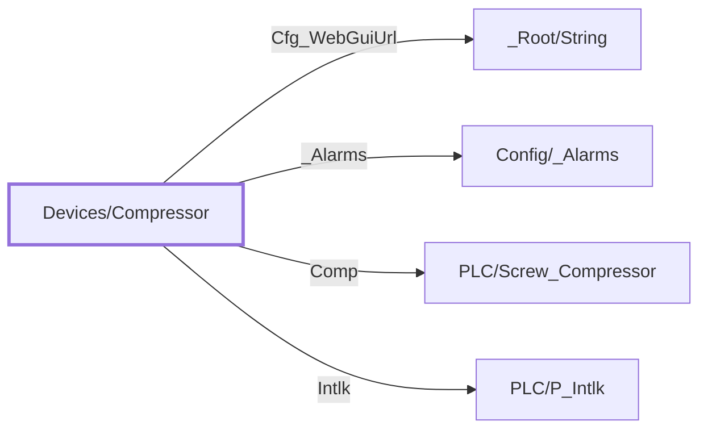

:::note

:::
# UDT `Devices/Compressor`

compressor

screw compressor (Devices HMI layer; PLC source PLC/Screw\_Compressor)

| | |
|---|---|
| Designer location | Tag Browser &gt; default &gt; Data Types &gt; Devices &gt; Compressor |
| Tag path | `[default]_types_/Devices/Compressor` |
| File | `gateways/standard/data/config/resources/core/ignition/tag-type-definition/default/Devices/udts.json` |
| Inherits from | - |
| Inherited by | - |
| Own members | 5 (1 atomic, 4 nested UDT, 0 folders) |
| Status | in use |

## Parameters

| Parameter | Data type | Default | Defined |
|---|---|---|---|
| `PlcDevice` | String | - | own |
| `CompTag` | String | - | own |
| `IntlkTag` | String | - | own |

Parameters are referenced in member settings as `{Name}` and are set per instance (Designer: right-click the instance > Edit Tag > Parameters).

## Structure



## Members

| Member | Data type | Source | Tag group | Read only | History | Units / format | Alarms | Documentation |
|---|---|---|---|---|---|---|---|---|
| `Cfg_WebGuiUrl` | UDT | nested [\_Root/String](../root/string.md) | | | | | | Frick panel web GUI (faceplate Web GUI button) |
| `_Alarms` | UDT | nested [Config/\_Alarms](../config/alarms.md) | | | | | | |
| `Comp` | UDT | nested [PLC/Screw\_Compressor](../plc/screw-compressor.md) | | | | | | Live PLC object \[\{PlcDevice\}\]\{CompTag\} (PLC/Screw\_Compressor); enabled on mapped instances only |
| `Intlk` | UDT | nested [PLC/P\_Intlk](../plc/p-intlk.md) | | | | | | Live PLC object \[\{PlcDevice\}\]\{IntlkTag\} (PLC/P\_Intlk); enabled on mapped instances only |
| `ShowInterlocks` | Boolean | expr `((trim(coalesce({[.]Intlk/Cfg_CondTxt/Cfg_CondTxt_0_}, '')) != '' &&…` (full below) | | yes | | | | Derived from the PLC part (read only): ((trim(coalesce(\{\[.\]Intlk/Cfg\_CondTxt/Cfg\_CondTxt\_0\_\}, '')) != '' &amp;&amp; left(trim(coalesce(\{\[.\]Intlk/Cfg\_CondTxt/Cfg\_CondTx… |

<details>
<summary>Full expressions / references (1)</summary>

**`ShowInterlocks`** (expr)

```
((trim(coalesce({[.]Intlk/Cfg_CondTxt/Cfg_CondTxt_0_}, '')) != '' && left(trim(coalesce({[.]Intlk/Cfg_CondTxt/Cfg_CondTxt_0_}, '')), 17) != 'Enter Description') || (trim(coalesce({[.]Intlk/Cfg_CondTxt/Cfg_CondTxt_1_}, '')) != '' && left(trim(coalesce({[.]Intlk/Cfg_CondTxt/Cfg_CondTxt_1_}, '')), 17) != 'Enter Description') || (trim(coalesce({[.]Intlk/Cfg_CondTxt/Cfg_CondTxt_2_}, '')) != '' && left(trim(coalesce({[.]Intlk/Cfg_CondTxt/Cfg_CondTxt_2_}, '')), 17) != 'Enter Description') || (trim(coalesce({[.]Intlk/Cfg_CondTxt/Cfg_CondTxt_3_}, '')) != '' && left(trim(coalesce({[.]Intlk/Cfg_CondTxt/Cfg_CondTxt_3_}, '')), 17) != 'Enter Description') || (trim(coalesce({[.]Intlk/Cfg_CondTxt/Cfg_CondTxt_4_}, '')) != '' && left(trim(coalesce({[.]Intlk/Cfg_CondTxt/Cfg_CondTxt_4_}, '')), 17) != 'Enter Description') || (trim(coalesce({[.]Intlk/Cfg_CondTxt/Cfg_CondTxt_5_}, '')) != '' && left(trim(coalesce({[.]Intlk/Cfg_CondTxt/Cfg_CondTxt_5_}, '')), 17) != 'Enter Description') || (trim(coalesce({[.]Intlk/Cfg_CondTxt/Cfg_CondTxt_6_}, '')) != '' && left(trim(coalesce({[.]Intlk/Cfg_CondTxt/Cfg_CondTxt_6_}, '')), 17) != 'Enter Description') || (trim(coalesce({[.]Intlk/Cfg_CondTxt/Cfg_CondTxt_7_}, '')) != '' && left(trim(coalesce({[.]Intlk/Cfg_CondTxt/Cfg_CondTxt_7_}, '')), 17) != 'Enter Description') || (trim(coalesce({[.]Intlk/Cfg_CondTxt/Cfg_CondTxt_8_}, '')) != '' && left(trim(coalesce({[.]Intlk/Cfg_CondTxt/Cfg_CondTxt_8_}, '')), 17) != 'Enter Description') || (trim(coalesce({[.]Intlk/Cfg_CondTxt/Cfg_CondTxt_9_}, '')) != '' && left(trim(coalesce({[.]Intlk/Cfg_CondTxt/Cfg_CondTxt_9_}, '')), 17) != 'Enter Description') || (trim(coalesce({[.]Intlk/Cfg_CondTxt/Cfg_CondTxt_10_}, '')) != '' && left(trim(coalesce({[.]Intlk/Cfg_CondTxt/Cfg_CondTxt_10_}, '')), 17) != 'Enter Description') || (trim(coalesce({[.]Intlk/Cfg_CondTxt/Cfg_CondTxt_11_}, '')) != '' && left(trim(coalesce({[.]Intlk/Cfg_CondTxt/Cfg_CondTxt_11_}, '')), 17) != 'Enter Description') || (trim(coalesce({[.]Intlk/Cfg_CondTxt/Cfg_CondTxt_12_}, '')) != '' && left(trim(coalesce({[.]Intlk/Cfg_CondTxt/Cfg_CondTxt_12_}, '')), 17) != 'Enter Description') || (trim(coalesce({[.]Intlk/Cfg_CondTxt/Cfg_CondTxt_13_}, '')) != '' && left(trim(coalesce({[.]Intlk/Cfg_CondTxt/Cfg_CondTxt_13_}, '')), 17) != 'Enter Description') || (trim(coalesce({[.]Intlk/Cfg_CondTxt/Cfg_CondTxt_14_}, '')) != '' && left(trim(coalesce({[.]Intlk/Cfg_CondTxt/Cfg_CondTxt_14_}, '')), 17) != 'Enter Description') || (trim(coalesce({[.]Intlk/Cfg_CondTxt/Cfg_CondTxt_15_}, '')) != '' && left(trim(coalesce({[.]Intlk/Cfg_CondTxt/Cfg_CondTxt_15_}, '')), 17) != 'Enter Description'))
```


</details>

## Nested UDTs

| Member | Type | Parameter bindings | Default state |
|---|---|---|---|
| `Cfg_WebGuiUrl` | [\_Root/String](../root/string.md) | - | enabled |
| `_Alarms` | [Config/\_Alarms](../config/alarms.md) | - | enabled |
| `Comp` | [PLC/Screw\_Compressor](../plc/screw-compressor.md) | `DeviceName = {PlcDevice}; TagPrefix = {CompTag}` | disabled |
| `Intlk` | [PLC/P\_Intlk](../plc/p-intlk.md) | `DeviceName = {PlcDevice}; TagPrefix = {IntlkTag}` | disabled |

`disabled` parts subscribe nothing until an instance enables them (instance override `enabled: true`). See the device instance pages for which instances enable which part.

## Alarms

_No alarms defined on this type._

## Used By

5 direct instance(s):

| Instance | Instance page |
|---|---|
| `[default]Boars_Head/GrovePort/Machine Room/Compressors/COMP 6` | [Machine Room/Compressors](../../devices/machine-room-compressors.md) |
| `[default]Boars_Head/GrovePort/Machine Room/Compressors/COMP 1` | [Machine Room/Compressors](../../devices/machine-room-compressors.md) |
| `[default]Boars_Head/GrovePort/Machine Room/Compressors/COMP 5` | [Machine Room/Compressors](../../devices/machine-room-compressors.md) |
| `[default]Boars_Head/GrovePort/Machine Room/Compressors/COMP 4` | [Machine Room/Compressors](../../devices/machine-room-compressors.md) |
| `[default]Boars_Head/GrovePort/Machine Room/Compressors/COMP 7` | [Machine Room/Compressors](../../devices/machine-room-compressors.md) |
