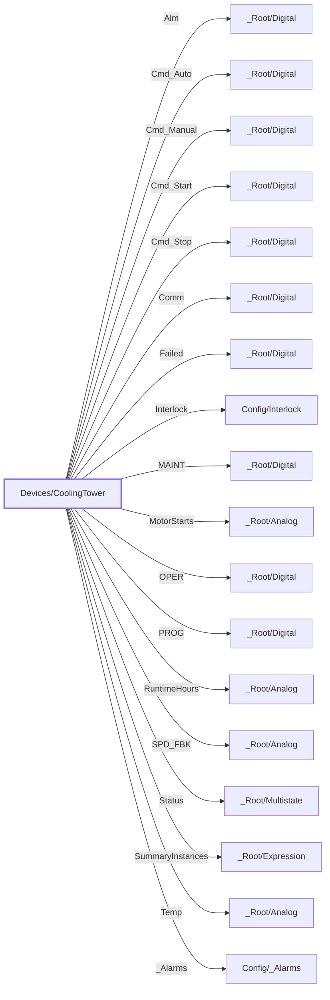

:::note

:::
# UDT `Devices/CoolingTower`

cooling tower

cooling tower fan (motor/VFD hybrid; Devices HMI layer)

| | |
|---|---|
| Designer location | Tag Browser &gt; default &gt; Data Types &gt; Devices &gt; CoolingTower |
| Tag path | `[default]_types_/Devices/CoolingTower` |
| File | `gateways/standard/data/config/resources/core/ignition/tag-type-definition/default/Devices/udts.json` |
| Inherits from | - |
| Inherited by | - |
| Own members | 18 (0 atomic, 18 nested UDT, 0 folders) |
| Status | no instances |

## Parameters

_No parameters._

## Structure

## Members

| Member | Data type | Source | Tag group | Read only | History | Units / format | Alarms | Documentation |
|---|---|---|---|---|---|---|---|---|
| `Alm` | UDT | nested [\_Root/Digital](../root/digital.md) | | | | | | Cooling tower alarm bit |
| `Cmd_Auto` | UDT | nested [\_Root/Digital](../root/digital.md) | | | | | | Auto |
| `Cmd_Manual` | UDT | nested [\_Root/Digital](../root/digital.md) | | | | | | Manual |
| `Cmd_Start` | UDT | nested [\_Root/Digital](../root/digital.md) | | | | | | Start |
| `Cmd_Stop` | UDT | nested [\_Root/Digital](../root/digital.md) | | | | | | Stop |
| `Comm` | UDT | nested [\_Root/Digital](../root/digital.md) | | | | | | Cooling tower communications fault bit |
| `Failed` | UDT | nested [\_Root/Digital](../root/digital.md) | | | | | | Cooling tower failed bit |
| `Interlock` | UDT | nested [Config/Interlock](../config/interlock.md) | | | | | | |
| `MAINT` | UDT | nested [\_Root/Digital](../root/digital.md) | | | | | | Maintenance |
| `MotorStarts` | UDT | nested [\_Root/Analog](../root/analog.md) | | | | | | Cooling tower fan motor starts |
| `OPER` | UDT | nested [\_Root/Digital](../root/digital.md) | | | | | | Operator |
| `PROG` | UDT | nested [\_Root/Digital](../root/digital.md) | | | | | | Program |
| `RuntimeHours` | UDT | nested [\_Root/Analog](../root/analog.md) | | | | | | Cooling tower fan runtime hours |
| `SPD_FBK` | UDT | nested [\_Root/Analog](../root/analog.md) | | | | | | Cooling Tower Fan Speed Feedback |
| `Status` | UDT | nested [\_Root/Multistate](../root/multistate.md) | | | | | | Cooling tower fan status (motor/VFD hybrid): 0=Off, 1=Run, 2=Fault, 3=Manual, 4=Idle |
| `SummaryInstances` | UDT | nested [\_Root/Expression](../root/expression.md) | | | | | | |
| `Temp` | UDT | nested [\_Root/Analog](../root/analog.md) | | | | | | Cooling Tower Basin Temperature |
| `_Alarms` | UDT | nested [Config/\_Alarms](../config/alarms.md) | | | | | | |

## Nested UDTs

| Member | Type | Parameter bindings | Default state |
|---|---|---|---|
| `Alm` | [\_Root/Digital](../root/digital.md) | - | enabled |
| `Cmd_Auto` | [\_Root/Digital](../root/digital.md) | - | enabled |
| `Cmd_Manual` | [\_Root/Digital](../root/digital.md) | - | enabled |
| `Cmd_Start` | [\_Root/Digital](../root/digital.md) | - | enabled |
| `Cmd_Stop` | [\_Root/Digital](../root/digital.md) | - | enabled |
| `Comm` | [\_Root/Digital](../root/digital.md) | - | enabled |
| `Failed` | [\_Root/Digital](../root/digital.md) | - | enabled |
| `Interlock` | [Config/Interlock](../config/interlock.md) | - | enabled |
| `MAINT` | [\_Root/Digital](../root/digital.md) | - | enabled |
| `MotorStarts` | [\_Root/Analog](../root/analog.md) | - | enabled |
| `OPER` | [\_Root/Digital](../root/digital.md) | - | enabled |
| `PROG` | [\_Root/Digital](../root/digital.md) | - | enabled |
| `RuntimeHours` | [\_Root/Analog](../root/analog.md) | - | enabled |
| `SPD_FBK` | [\_Root/Analog](../root/analog.md) | - | enabled |
| `Status` | [\_Root/Multistate](../root/multistate.md) | - | enabled |
| `SummaryInstances` | [\_Root/Expression](../root/expression.md) | - | enabled |
| `Temp` | [\_Root/Analog](../root/analog.md) | - | enabled |
| `_Alarms` | [Config/\_Alarms](../config/alarms.md) | - | enabled |

`disabled` parts subscribe nothing until an instance enables them (instance override `enabled: true`). See the device instance pages for which instances enable which part.

## Alarms

_No alarms defined on this type._

## Used By

Not used by any instance or other UDT.
