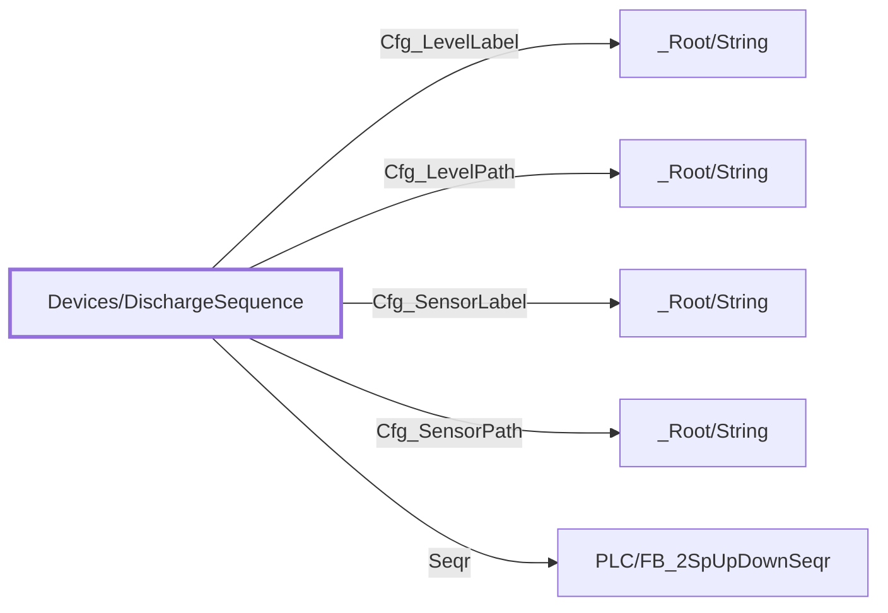

:::note

:::
# UDT `Devices/DischargeSequence`

discharge sequence

condenser high stage discharge pressure sequence (PLC FB\_2SpUpDownSeqr HSD\_Seqr + HSD\_Sequence\[\], HSD\_Fixed\_SP, CD\_SUMP\_\* make-up sets; FT (STELLAR) L3-HSD\_Seq)

| | |
|---|---|
| Designer location | Tag Browser &gt; default &gt; Data Types &gt; Devices &gt; DischargeSequence |
| Tag path | `[default]_types_/Devices/DischargeSequence` |
| File | `gateways/standard/data/config/resources/core/ignition/tag-type-definition/default/Devices/udts.json` |
| Inherits from | - |
| Inherited by | - |
| Own members | 18 (13 atomic, 5 nested UDT, 0 folders) |
| Status | in use |

## Parameters

| Parameter | Data type | Default | Defined |
|---|---|---|---|
| `PlcDevice` | String | - | own |
| `SeqrTag` | String | - | own |
| `Seq1Tag` | String | - | own |
| `Seq2Tag` | String | - | own |
| `Seq3Tag` | String | - | own |
| `Seq4Tag` | String | - | own |
| `Seq5Tag` | String | - | own |
| `Seq6Tag` | String | - | own |
| `Seq7Tag` | String | - | own |
| `FixedSPTag` | String | - | own |
| `FirstNoDelayTag` | String | - | own |
| `MainOpenTag` | String | - | own |
| `MainCloseTag` | String | - | own |
| `BackupOpenTag` | String | - | own |
| `BackupCloseTag` | String | - | own |

Parameters are referenced in member settings as `{Name}` and are set per instance (Designer: right-click the instance > Edit Tag > Parameters).

## OPC Item Path

13 members read OPC through the server `Ignition OPC UA Server`. Common prefix: `ns=1;s=[{PlcDevice}]{`. The Source column shows the part after the device.

## Structure

## Members

| Member | Data type | Source | Tag group | Read only | History | Units / format | Alarms | Documentation |
|---|---|---|---|---|---|---|---|---|
| `Cfg_LevelLabel` | UDT | nested [\_Root/String](../root/string.md) | | | | | | Sump level sensor label (HMI) |
| `Cfg_LevelPath` | UDT | nested [\_Root/String](../root/string.md) | | | | | | Sump level sensor (HMI) |
| `Cfg_SensorLabel` | UDT | nested [\_Root/String](../root/string.md) | | | | | | Discharge pressure sensor label (HMI) |
| `Cfg_SensorPath` | UDT | nested [\_Root/String](../root/string.md) | | | | | | Discharge pressure sensor (HMI) |
| `Seqr` | UDT | nested [PLC/FB\_2SpUpDownSeqr](../plc/fb-2spupdownseqr.md) | | | | | | Live PLC object \[\{PlcDevice\}\]\{SeqrTag\} (PLC/FB\_2SpUpDownSeqr); enabled on mapped instances only |
| `PlcSequence1` | Int2 | OPC `{Seq1Tag}` | PAX\_Faceplate | yes | | | | Live PLC tag \[\{PlcDevice\}\]\{Seq1Tag\} (read only); enabled on mapped instances only |
| `PlcSequence2` | Int2 | OPC `{Seq2Tag}` | PAX\_Faceplate | yes | | | | Live PLC tag \[\{PlcDevice\}\]\{Seq2Tag\} (read only); enabled on mapped instances only |
| `PlcSequence3` | Int2 | OPC `{Seq3Tag}` | PAX\_Faceplate | yes | | | | Live PLC tag \[\{PlcDevice\}\]\{Seq3Tag\} (read only); enabled on mapped instances only |
| `PlcSequence4` | Int2 | OPC `{Seq4Tag}` | PAX\_Faceplate | yes | | | | Live PLC tag \[\{PlcDevice\}\]\{Seq4Tag\} (read only); enabled on mapped instances only |
| `PlcSequence5` | Int2 | OPC `{Seq5Tag}` | PAX\_Faceplate | yes | | | | Live PLC tag \[\{PlcDevice\}\]\{Seq5Tag\} (read only); enabled on mapped instances only |
| `PlcSequence6` | Int2 | OPC `{Seq6Tag}` | PAX\_Faceplate | yes | | | | Live PLC tag \[\{PlcDevice\}\]\{Seq6Tag\} (read only); enabled on mapped instances only |
| `PlcSequence7` | Int2 | OPC `{Seq7Tag}` | PAX\_Faceplate | yes | | | | Live PLC tag \[\{PlcDevice\}\]\{Seq7Tag\} (read only); enabled on mapped instances only |
| `PlcFixedSP` | Float4 | OPC `{FixedSPTag}` | PAX\_Faceplate | yes | | | | Live PLC tag \[\{PlcDevice\}\]\{FixedSPTag\} (read only); enabled on mapped instances only |
| `PlcFirstNoDelay` | Boolean | OPC `{FirstNoDelayTag}` | PAX\_Faceplate | yes | | | | Live PLC tag \[\{PlcDevice\}\]\{FirstNoDelayTag\} (read only); enabled on mapped instances only |
| `PlcMainOpenSP` | Float4 | OPC `{MainOpenTag}` | PAX\_Faceplate | yes | | | | Live PLC tag \[\{PlcDevice\}\]\{MainOpenTag\} (read only); enabled on mapped instances only |
| `PlcMainCloseSP` | Float4 | OPC `{MainCloseTag}` | PAX\_Faceplate | yes | | | | Live PLC tag \[\{PlcDevice\}\]\{MainCloseTag\} (read only); enabled on mapped instances only |
| `PlcBackupOpenSP` | Float4 | OPC `{BackupOpenTag}` | PAX\_Faceplate | yes | | | | Live PLC tag \[\{PlcDevice\}\]\{BackupOpenTag\} (read only); enabled on mapped instances only |
| `PlcBackupCloseSP` | Float4 | OPC `{BackupCloseTag}` | PAX\_Faceplate | yes | | | | Live PLC tag \[\{PlcDevice\}\]\{BackupCloseTag\} (read only); enabled on mapped instances only |

## Nested UDTs

| Member | Type | Parameter bindings | Default state |
|---|---|---|---|
| `Cfg_LevelLabel` | [\_Root/String](../root/string.md) | - | enabled |
| `Cfg_LevelPath` | [\_Root/String](../root/string.md) | - | enabled |
| `Cfg_SensorLabel` | [\_Root/String](../root/string.md) | - | enabled |
| `Cfg_SensorPath` | [\_Root/String](../root/string.md) | - | enabled |
| `Seqr` | [PLC/FB\_2SpUpDownSeqr](../plc/fb-2spupdownseqr.md) | `DeviceName = {PlcDevice}; TagPrefix = {SeqrTag}` | disabled |

`disabled` parts subscribe nothing until an instance enables them (instance override `enabled: true`). See the device instance pages for which instances enable which part.

## Alarms

_No alarms defined on this type._

## Used By

1 direct instance(s):

| Instance | Instance page |
|---|---|
| `[default]Boars_Head/GrovePort/Condensers/Sequences/HSD` | [Condensers/Sequences](../../devices/condensers-sequences.md) |
