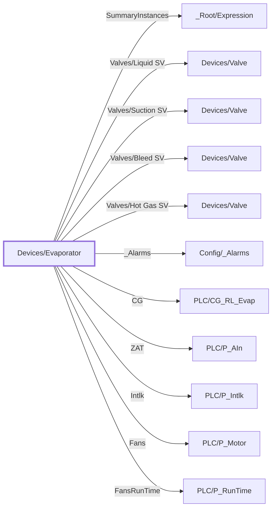

:::note

:::
# UDT `Devices/Evaporator`

Evaporator (CG\_RL\_Evap HMI mirror)

Devices/Evaporator Controls-grade mirror of PLC CG\_RL\_Evap. HMI Status stays simplified (0=STOP,1=CLG,2=DFT,3=FLT,4=MAN,5=IDLE,6-9=DFT stages). PLC Sts\_State map: 0 Off-&gt;0, 1 PumpOut-&gt;6, 2 SoftHG-&gt;7, 3 MainHG-&gt;7, 4 Bleed-&gt;8, 5 FanDelay-&gt;9, 6 Cooling-&gt;1, 7 Idle-&gt;5, 8 Cleanup-&gt;2, 9 Permissive-&gt;5, 10 Interlock-&gt;3.

| | |
|---|---|
| Designer location | Tag Browser &gt; default &gt; Data Types &gt; Devices &gt; Evaporator |
| Tag path | `[default]_types_/Devices/Evaporator` |
| File | `gateways/standard/data/config/resources/core/ignition/tag-type-definition/default/Devices/udts.json` |
| Inherits from | - |
| Inherited by | - |
| Own members | 14 (2 atomic, 11 nested UDT, 1 folders) |
| Status | in use |

## Parameters

| Parameter | Data type | Default | Defined |
|---|---|---|---|
| `PlcDevice` | String | - | own |
| `CGTag` | String | - | own |
| `ZATTag` | String | - | own |
| `IntlkTag` | String | - | own |
| `FansTag` | String | - | own |
| `FansRunTimeTag` | String | - | own |
| `LiquidSVTag` | String | - | own |
| `SuctionSVTag` | String | - | own |
| `HotGasSVTag` | String | - | own |
| `BleedSVTag` | String | - | own |

Parameters are referenced in member settings as `{Name}` and are set per instance (Designer: right-click the instance > Edit Tag > Parameters).

## Structure



## Members

| Member | Data type | Source | Tag group | Read only | History | Units / format | Alarms | Documentation |
|---|---|---|---|---|---|---|---|---|
| `SummaryInstances` | UDT | nested [\_Root/Expression](../root/expression.md) | | | | | | |
| `Valves/` | Folder | | | | | | | |
| `Valves/Liquid SV` | UDT | nested [Devices/Valve](valve.md) | | | | | | Liquid SV |
| `Valves/Suction SV` | UDT | nested [Devices/Valve](valve.md) | | | | | | Suction SV |
| `Valves/Bleed SV` | UDT | nested [Devices/Valve](valve.md) | | | | | | Bleed SV |
| `Valves/Hot Gas SV` | UDT | nested [Devices/Valve](valve.md) | | | | | | Hot Gas SV |
| `_Alarms` | UDT | nested [Config/\_Alarms](../config/alarms.md) | | | | | | |
| `CG` | UDT | nested [PLC/CG\_RL\_Evap](../plc/cg-rl-evap.md) | | | | | | Live PLC object \[\{PlcDevice\}\]\{CGTag\} (PLC/CG\_RL\_Evap); enabled on mapped instances only |
| `ZAT` | UDT | nested [PLC/P\_AIn](../plc/p-ain.md) | | | | | | Live PLC object \[\{PlcDevice\}\]\{ZATTag\} (PLC/P\_AIn); enabled on mapped instances only |
| `Intlk` | UDT | nested [PLC/P\_Intlk](../plc/p-intlk.md) | | | | | | Live PLC object \[\{PlcDevice\}\]\{IntlkTag\} (PLC/P\_Intlk); enabled on mapped instances only |
| `Fans` | UDT | nested [PLC/P\_Motor](../plc/p-motor.md) | | | | | | Live PLC object \[\{PlcDevice\}\]\{FansTag\} (PLC/P\_Motor); enabled on mapped instances only |
| `FansRunTime` | UDT | nested [PLC/P\_RunTime](../plc/p-runtime.md) | | | | | | Live PLC object \[\{PlcDevice\}\]\{FansRunTimeTag\} (PLC/P\_RunTime); enabled on mapped instances only |
| `HmiStatus` | Int4 | expr `case({[.]CG/Sts_State}, 0, 0, 1, 6, 2, 7, 3, 7, 4, 8, 5, 9, 6, 1, 7,…` (full below) | | yes | | | | Derived from the PLC part (read only): case(\{\[.\]CG/Sts\_State\}, 0, 0, 1, 6, 2, 7, 3, 7, 4, 8, 5, 9, 6, 1, 7, 5, 8, 2, 9, 5, 10, 3, null) |
| `ShowInterlocks` | Boolean | expr `((trim(coalesce({[.]Intlk/Cfg_CondTxt/Cfg_CondTxt_0_}, '')) != '' &&…` (full below) | | yes | | | | Derived from the PLC part (read only): ((trim(coalesce(\{\[.\]Intlk/Cfg\_CondTxt/Cfg\_CondTxt\_0\_\}, '')) != '' &amp;&amp; left(trim(coalesce(\{\[.\]Intlk/Cfg\_CondTxt/Cfg\_CondTx… |

<details>
<summary>Full expressions / references (2)</summary>

**`HmiStatus`** (expr)

```
case({[.]CG/Sts_State}, 0, 0, 1, 6, 2, 7, 3, 7, 4, 8, 5, 9, 6, 1, 7, 5, 8, 2, 9, 5, 10, 3, null)
```

**`ShowInterlocks`** (expr)

```
((trim(coalesce({[.]Intlk/Cfg_CondTxt/Cfg_CondTxt_0_}, '')) != '' && left(trim(coalesce({[.]Intlk/Cfg_CondTxt/Cfg_CondTxt_0_}, '')), 17) != 'Enter Description') || (trim(coalesce({[.]Intlk/Cfg_CondTxt/Cfg_CondTxt_1_}, '')) != '' && left(trim(coalesce({[.]Intlk/Cfg_CondTxt/Cfg_CondTxt_1_}, '')), 17) != 'Enter Description') || (trim(coalesce({[.]Intlk/Cfg_CondTxt/Cfg_CondTxt_2_}, '')) != '' && left(trim(coalesce({[.]Intlk/Cfg_CondTxt/Cfg_CondTxt_2_}, '')), 17) != 'Enter Description') || (trim(coalesce({[.]Intlk/Cfg_CondTxt/Cfg_CondTxt_3_}, '')) != '' && left(trim(coalesce({[.]Intlk/Cfg_CondTxt/Cfg_CondTxt_3_}, '')), 17) != 'Enter Description') || (trim(coalesce({[.]Intlk/Cfg_CondTxt/Cfg_CondTxt_4_}, '')) != '' && left(trim(coalesce({[.]Intlk/Cfg_CondTxt/Cfg_CondTxt_4_}, '')), 17) != 'Enter Description') || (trim(coalesce({[.]Intlk/Cfg_CondTxt/Cfg_CondTxt_5_}, '')) != '' && left(trim(coalesce({[.]Intlk/Cfg_CondTxt/Cfg_CondTxt_5_}, '')), 17) != 'Enter Description') || (trim(coalesce({[.]Intlk/Cfg_CondTxt/Cfg_CondTxt_6_}, '')) != '' && left(trim(coalesce({[.]Intlk/Cfg_CondTxt/Cfg_CondTxt_6_}, '')), 17) != 'Enter Description') || (trim(coalesce({[.]Intlk/Cfg_CondTxt/Cfg_CondTxt_7_}, '')) != '' && left(trim(coalesce({[.]Intlk/Cfg_CondTxt/Cfg_CondTxt_7_}, '')), 17) != 'Enter Description') || (trim(coalesce({[.]Intlk/Cfg_CondTxt/Cfg_CondTxt_8_}, '')) != '' && left(trim(coalesce({[.]Intlk/Cfg_CondTxt/Cfg_CondTxt_8_}, '')), 17) != 'Enter Description') || (trim(coalesce({[.]Intlk/Cfg_CondTxt/Cfg_CondTxt_9_}, '')) != '' && left(trim(coalesce({[.]Intlk/Cfg_CondTxt/Cfg_CondTxt_9_}, '')), 17) != 'Enter Description') || (trim(coalesce({[.]Intlk/Cfg_CondTxt/Cfg_CondTxt_10_}, '')) != '' && left(trim(coalesce({[.]Intlk/Cfg_CondTxt/Cfg_CondTxt_10_}, '')), 17) != 'Enter Description') || (trim(coalesce({[.]Intlk/Cfg_CondTxt/Cfg_CondTxt_11_}, '')) != '' && left(trim(coalesce({[.]Intlk/Cfg_CondTxt/Cfg_CondTxt_11_}, '')), 17) != 'Enter Description') || (trim(coalesce({[.]Intlk/Cfg_CondTxt/Cfg_CondTxt_12_}, '')) != '' && left(trim(coalesce({[.]Intlk/Cfg_CondTxt/Cfg_CondTxt_12_}, '')), 17) != 'Enter Description') || (trim(coalesce({[.]Intlk/Cfg_CondTxt/Cfg_CondTxt_13_}, '')) != '' && left(trim(coalesce({[.]Intlk/Cfg_CondTxt/Cfg_CondTxt_13_}, '')), 17) != 'Enter Description') || (trim(coalesce({[.]Intlk/Cfg_CondTxt/Cfg_CondTxt_14_}, '')) != '' && left(trim(coalesce({[.]Intlk/Cfg_CondTxt/Cfg_CondTxt_14_}, '')), 17) != 'Enter Description') || (trim(coalesce({[.]Intlk/Cfg_CondTxt/Cfg_CondTxt_15_}, '')) != '' && left(trim(coalesce({[.]Intlk/Cfg_CondTxt/Cfg_CondTxt_15_}, '')), 17) != 'Enter Description'))
```


</details>

<details>
<summary>State labels (1 members)</summary>

| Member | States (value = label) |
|---|---|
| `HmiStatus` | 0 = Off, 1 = Cooling, 2 = Defrost, 3 = Fault, 4 = Manual, 5 = Idle, 6 = 1.PD, 7 = 2.HG, 8 = 3.BLD, 9 = 3.FD |

</details>

## Nested UDTs

| Member | Type | Parameter bindings | Default state |
|---|---|---|---|
| `SummaryInstances` | [\_Root/Expression](../root/expression.md) | - | enabled |
| `Valves/Liquid SV` | [Devices/Valve](valve.md) | `PlcDevice = {PlcDevice}; ValveTag = {LiquidSVTag}` | enabled |
| `Valves/Suction SV` | [Devices/Valve](valve.md) | `PlcDevice = {PlcDevice}; ValveTag = {SuctionSVTag}` | enabled |
| `Valves/Bleed SV` | [Devices/Valve](valve.md) | `PlcDevice = {PlcDevice}; ValveTag = {BleedSVTag}` | enabled |
| `Valves/Hot Gas SV` | [Devices/Valve](valve.md) | `PlcDevice = {PlcDevice}; ValveTag = {HotGasSVTag}` | enabled |
| `_Alarms` | [Config/\_Alarms](../config/alarms.md) | - | enabled |
| `CG` | [PLC/CG\_RL\_Evap](../plc/cg-rl-evap.md) | `DeviceName = {PlcDevice}; TagPrefix = {CGTag}` | disabled |
| `ZAT` | [PLC/P\_AIn](../plc/p-ain.md) | `DeviceName = {PlcDevice}; TagPrefix = {ZATTag}; EngUnit = °F` | disabled |
| `Intlk` | [PLC/P\_Intlk](../plc/p-intlk.md) | `DeviceName = {PlcDevice}; TagPrefix = {IntlkTag}` | disabled |
| `Fans` | [PLC/P\_Motor](../plc/p-motor.md) | `DeviceName = {PlcDevice}; TagPrefix = {FansTag}` | disabled |
| `FansRunTime` | [PLC/P\_RunTime](../plc/p-runtime.md) | `DeviceName = {PlcDevice}; TagPrefix = {FansRunTimeTag}` | disabled |

`disabled` parts subscribe nothing until an instance enables them (instance override `enabled: true`). See the device instance pages for which instances enable which part.

## Alarms

_No alarms defined on this type._

## Used By

19 direct instances.

<details>
<summary>Show the 19 instances</summary>

| Instance | Instance page |
|---|---|
| `[default]Boars_Head/GrovePort/Club/Utility/CG-C1` | [Club/Utility](../../devices/club-utility.md) |
| `[default]Boars_Head/GrovePort/Dock/Utility/CG-G5` | [Dock/Utility](../../devices/dock-utility.md) |
| `[default]Boars_Head/GrovePort/Dock/Utility/CG-G3` | [Dock/Utility](../../devices/dock-utility.md) |
| `[default]Boars_Head/GrovePort/Dock/Utility/CG-G2` | [Dock/Utility](../../devices/dock-utility.md) |
| `[default]Boars_Head/GrovePort/Dock/Utility/CG-G1` | [Dock/Utility](../../devices/dock-utility.md) |
| `[default]Boars_Head/GrovePort/Dock/Utility/CG-G4` | [Dock/Utility](../../devices/dock-utility.md) |
| `[default]Boars_Head/GrovePort/East PH/Utility/CG-E2` | [East PH/Utility](../../devices/east-ph-utility.md) |
| `[default]Boars_Head/GrovePort/East PH/Utility/CG-E4` | [East PH/Utility](../../devices/east-ph-utility.md) |
| `[default]Boars_Head/GrovePort/East PH/Utility/CG-E1` | [East PH/Utility](../../devices/east-ph-utility.md) |
| `[default]Boars_Head/GrovePort/East PH/Utility/CG-E3` | [East PH/Utility](../../devices/east-ph-utility.md) |
| `[default]Boars_Head/GrovePort/Freezer/Utility/CG-A2` | [Freezer/Utility](../../devices/freezer-utility.md) |
| `[default]Boars_Head/GrovePort/Freezer/Utility/CG-A1` | [Freezer/Utility](../../devices/freezer-utility.md) |
| `[default]Boars_Head/GrovePort/Palletizing/Utility/CG-D1` | [Palletizing/Utility](../../devices/palletizing-utility.md) |
| `[default]Boars_Head/GrovePort/SuperChill/Utility/CG-B2` | [SuperChill/Utility](../../devices/superchill-utility.md) |
| `[default]Boars_Head/GrovePort/SuperChill/Utility/CG-B1` | [SuperChill/Utility](../../devices/superchill-utility.md) |
| `[default]Boars_Head/GrovePort/West PH/Utility/CG-F2` | [West PH/Utility](../../devices/west-ph-utility.md) |
| `[default]Boars_Head/GrovePort/West PH/Utility/CG-F4` | [West PH/Utility](../../devices/west-ph-utility.md) |
| `[default]Boars_Head/GrovePort/West PH/Utility/CG-F1` | [West PH/Utility](../../devices/west-ph-utility.md) |
| `[default]Boars_Head/GrovePort/West PH/Utility/CG-F3` | [West PH/Utility](../../devices/west-ph-utility.md) |

</details>
