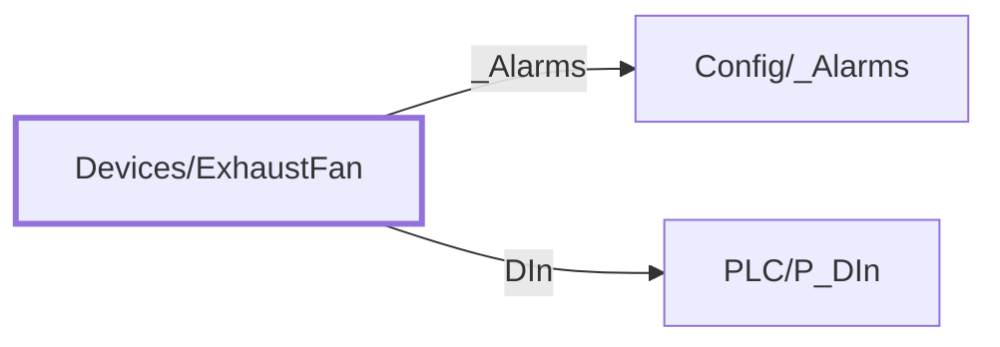

:::note

:::
# UDT `Devices/ExhaustFan`

exhaust fan

exhaust fan (Devices HMI layer; PLC source P\_Motor)

| | |
|---|---|
| Designer location | Tag Browser &gt; default &gt; Data Types &gt; Devices &gt; ExhaustFan |
| Tag path | `[default]_types_/Devices/ExhaustFan` |
| File | `gateways/standard/data/config/resources/core/ignition/tag-type-definition/default/Devices/udts.json` |
| Inherits from | - |
| Inherited by | - |
| Own members | 3 (1 atomic, 2 nested UDT, 0 folders) |
| Status | in use |

## Parameters

| Parameter | Data type | Default | Defined |
|---|---|---|---|
| `PlcDevice` | String | - | own |
| `FanTag` | String | - | own |
| `FailTag` | String | - | own |

Parameters are referenced in member settings as `{Name}` and are set per instance (Designer: right-click the instance > Edit Tag > Parameters).

## OPC Item Path

1 members read OPC through the server `Ignition OPC UA Server`. Common prefix: `ns=1;s=[{PlcDevice}]{FailTag}`. The Source column shows the part after the device.

## Structure

## Members

| Member | Data type | Source | Tag group | Read only | History | Units / format | Alarms | Documentation |
|---|---|---|---|---|---|---|---|---|
| `_Alarms` | UDT | nested [Config/\_Alarms](../config/alarms.md) | | | | | | |
| `DIn` | UDT | nested [PLC/P\_DIn](../plc/p-din.md) | | | | | | Live PLC object \[\{PlcDevice\}\]\{FanTag\} (PLC/P\_DIn); enabled on mapped instances only |
| `FailToStart` | Boolean | OPC `{FailTag}` | PAX\_Status | yes | | | | Live PLC tag \[\{PlcDevice\}\]\{FailTag\} (read only); enabled on mapped instances only |

## Nested UDTs

| Member | Type | Parameter bindings | Default state |
|---|---|---|---|
| `_Alarms` | [Config/\_Alarms](../config/alarms.md) | - | enabled |
| `DIn` | [PLC/P\_DIn](../plc/p-din.md) | `DeviceName = {PlcDevice}; TagPrefix = {FanTag}` | disabled |

`disabled` parts subscribe nothing until an instance enables them (instance override `enabled: true`). See the device instance pages for which instances enable which part.

## Alarms

_No alarms defined on this type._

## Used By

2 direct instance(s):

| Instance | Instance page |
|---|---|
| `[default]Boars_Head/GrovePort/Machine Room/ExhaustFans/BR EF` | [Machine Room/ExhaustFans](../../devices/machine-room-exhaustfans.md) |
| `[default]Boars_Head/GrovePort/Machine Room/ExhaustFans/MR EF` | [Machine Room/ExhaustFans](../../devices/machine-room-exhaustfans.md) |
