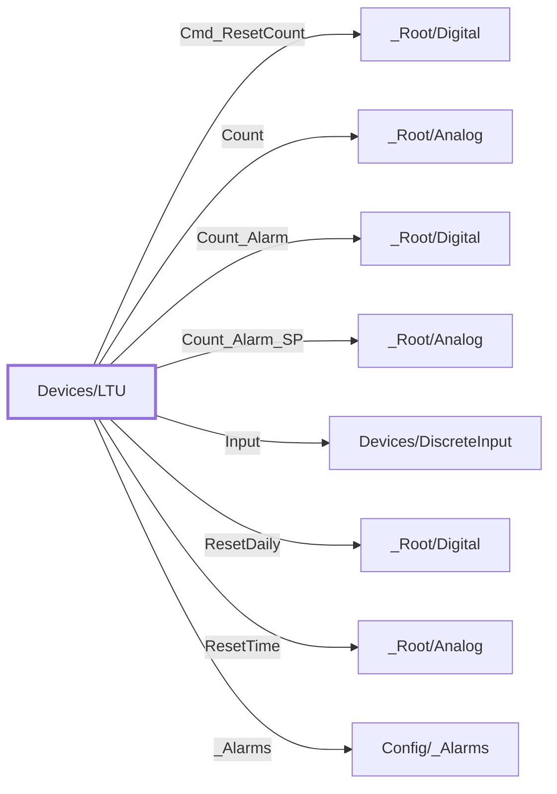

:::note

:::
# UDT `Devices/LTU`

liquid transfer unit

NH3 liquid transfer unit (PLC Liquid\_Transfer\_Unit; FT (STELLAR)MachineRoom LTU panel)

| | |
|---|---|
| Designer location | Tag Browser &gt; default &gt; Data Types &gt; Devices &gt; LTU |
| Tag path | `[default]_types_/Devices/LTU` |
| File | `gateways/standard/data/config/resources/core/ignition/tag-type-definition/default/Devices/udts.json` |
| Inherits from | - |
| Inherited by | - |
| Own members | 12 (4 atomic, 8 nested UDT, 0 folders) |
| Status | in use |

## Parameters

| Parameter | Data type | Default | Defined |
|---|---|---|---|
| `PlcDevice` | String | - | own |
| `InputTag` | String | - | own |
| `CountTag` | String | - | own |
| `CountAlarmTag` | String | - | own |
| `CountAlarmSPTag` | String | - | own |
| `ResetCountTag` | String | - | own |

Parameters are referenced in member settings as `{Name}` and are set per instance (Designer: right-click the instance > Edit Tag > Parameters).

## OPC Item Path

4 members read OPC through the server `Ignition OPC UA Server`. Common prefix: `ns=1;s=[{PlcDevice}]{`. The Source column shows the part after the device.

## Structure

## Members

| Member | Data type | Source | Tag group | Read only | History | Units / format | Alarms | Documentation |
|---|---|---|---|---|---|---|---|---|
| `Cmd_ResetCount` | UDT | nested [\_Root/Digital](../root/digital.md) | | | | | | Reset transfer count (FT MachineRoom Reset Count button) |
| `Count` | UDT | nested [\_Root/Analog](../root/analog.md) | | | | | | Transfer count (FT NH3\_LTU\_HMI\_Count / PLC COUNT.ACC) |
| `Count_Alarm` | UDT | nested [\_Root/Digital](../root/digital.md) | | | | | | Transfer count alarm (FT NH3\_LTU\_Count\_Alarm\_Inp / Count\_Alarm.Inp) |
| `Count_Alarm_SP` | UDT | nested [\_Root/Analog](../root/analog.md) | | | | | | Transfer count alarm setpoint (FT NH3\_LTU\_Count\_Alarm\_SP) |
| `Input` | UDT | nested [Devices/DiscreteInput](discreteinput.md) | | | | | | LTU valve input (FT NH3\_LTU (P\_DIn) / LTU\_Input) |
| `PlcCount` | Int4 | OPC `{CountTag}` | PAX\_Status | yes | | | | Live PLC tag \[\{PlcDevice\}\]\{CountTag\} (read only); enabled on mapped instances only |
| `PlcCountAlarm` | Boolean | OPC `{CountAlarmTag}` | PAX\_Status | yes | | | 1 | Live PLC tag \[\{PlcDevice\}\]\{CountAlarmTag\} (read only); enabled on mapped instances only |
| `PlcCountAlarmSP` | Int4 | OPC `{CountAlarmSPTag}` | PAX\_Faceplate | yes | | | | Live PLC tag \[\{PlcDevice\}\]\{CountAlarmSPTag\} (read only); enabled on mapped instances only |
| `ResetDaily` | UDT | nested [\_Root/Digital](../root/digital.md) | | | | | | Reset count daily (FT Liquid\_Transfer\_Unit.ResetDaily) |
| `ResetTime` | UDT | nested [\_Root/Analog](../root/analog.md) | | | | | | Daily reset time (FT Liquid\_Transfer\_Unit.ResetTime) |
| `_Alarms` | UDT | nested [Config/\_Alarms](../config/alarms.md) | | | | | | |
| `PlcResetCount` | Boolean | OPC `{ResetCountTag}` | PAX\_Status | yes | | | | Live PLC tag \[\{PlcDevice\}\]\{ResetCountTag\} (read only until PLC writes are unlocked; momentary 1, the PLC clears it); enabled on mapped instances only |

## Nested UDTs

| Member | Type | Parameter bindings | Default state |
|---|---|---|---|
| `Cmd_ResetCount` | [\_Root/Digital](../root/digital.md) | - | enabled |
| `Count` | [\_Root/Analog](../root/analog.md) | - | enabled |
| `Count_Alarm` | [\_Root/Digital](../root/digital.md) | - | enabled |
| `Count_Alarm_SP` | [\_Root/Analog](../root/analog.md) | - | enabled |
| `Input` | [Devices/DiscreteInput](discreteinput.md) | `PlcDevice = {PlcDevice}; DInTag = {InputTag}` | enabled |
| `ResetDaily` | [\_Root/Digital](../root/digital.md) | - | enabled |
| `ResetTime` | [\_Root/Analog](../root/analog.md) | - | enabled |
| `_Alarms` | [Config/\_Alarms](../config/alarms.md) | - | enabled |

`disabled` parts subscribe nothing until an instance enables them (instance override `enabled: true`). See the device instance pages for which instances enable which part.

## Alarms

| Member | Alarm | Priority | Mode | Enabled | Display path | Notes |
|---|---|---|---|---|---|---|
| `PlcCountAlarm` | Transfer Count High | Medium | WhenTrue | `true` | | NH3\_LTU\_Count\_Alarm\_Inp (count &gt;= setpoint) |

Associated data `Site` / `Area` / `Device` come from the tag path (`split({PathToTag}, '/')` segments 1 / 2 / 4). Alarms are defined only here, on the UDT, never on instances: see [Alarms](../../../alarms.md).

## Used By

1 direct instance(s):

| Instance | Instance page |
|---|---|
| `[default]Boars_Head/GrovePort/Machine Room/LTU/NH3 LTU` | [Machine Room/LTU](../../devices/machine-room-ltu.md) |
