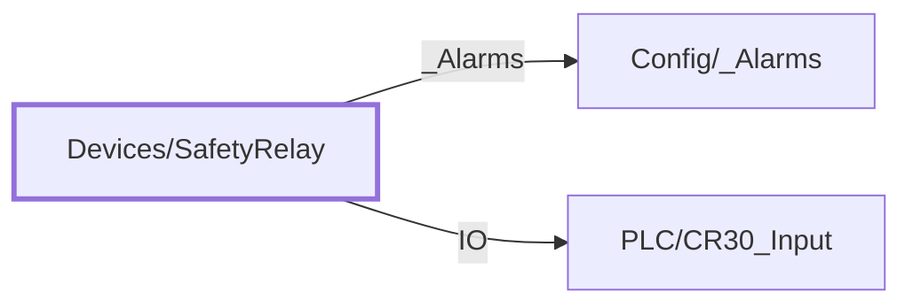

:::note

:::
# UDT `Devices/SafetyRelay`

safety relay

Allen-Bradley 440C-CR30 safety relay + 440C-ENET + 2080-IQ4-OB4 plug-in (Logix module tag SafetyRelay:I; FT (STELLAR)SafetyRelay). No alarms yet.

| | |
|---|---|
| Designer location | Tag Browser &gt; default &gt; Data Types &gt; Devices &gt; SafetyRelay |
| Tag path | `[default]_types_/Devices/SafetyRelay` |
| File | `gateways/standard/data/config/resources/core/ignition/tag-type-definition/default/Devices/udts.json` |
| Inherits from | - |
| Inherited by | - |
| Own members | 4 (2 atomic, 2 nested UDT, 0 folders) |
| Status | in use |

## Parameters

| Parameter | Data type | Default | Defined |
|---|---|---|---|
| `PlcDevice` | String | - | own |
| `ModuleTag` | String | - | own |
| `MajorFaultTag` | String | - | own |
| `ResetAlmTag` | String | - | own |

Parameters are referenced in member settings as `{Name}` and are set per instance (Designer: right-click the instance > Edit Tag > Parameters).

## OPC Item Path

2 members read OPC through the server `Ignition OPC UA Server`. Common prefix: `ns=1;s=[{PlcDevice}]{`. The Source column shows the part after the device.

## Structure

## Members

| Member | Data type | Source | Tag group | Read only | History | Units / format | Alarms | Documentation |
|---|---|---|---|---|---|---|---|---|
| `_Alarms` | UDT | nested [Config/\_Alarms](../config/alarms.md) | | | | | | |
| `IO` | UDT | nested [PLC/CR30\_Input](../plc/cr30-input.md) | | | | | | Live PLC object \[\{PlcDevice\}\]\{ModuleTag\} (PLC/CR30\_Input); enabled on mapped instances only |
| `PlcMajorFault` | Boolean | OPC `{MajorFaultTag}` | PAX\_Status | yes | | | | Live PLC tag \[\{PlcDevice\}\]\{MajorFaultTag\} (read only); enabled on mapped instances only |
| `PlcResetAlm` | Boolean | OPC `{ResetAlmTag}` | PAX\_Status | yes | | | | Live PLC tag \[\{PlcDevice\}\]\{ResetAlmTag\} (read only); enabled on mapped instances only |

## Nested UDTs

| Member | Type | Parameter bindings | Default state |
|---|---|---|---|
| `_Alarms` | [Config/\_Alarms](../config/alarms.md) | - | enabled |
| `IO` | [PLC/CR30\_Input](../plc/cr30-input.md) | `DeviceName = {PlcDevice}; TagPrefix = {ModuleTag}` | disabled |

`disabled` parts subscribe nothing until an instance enables them (instance override `enabled: true`). See the device instance pages for which instances enable which part.

## Alarms

_No alarms defined on this type._

## Used By

1 direct instance(s):

| Instance | Instance page |
|---|---|
| `[default]Boars_Head/GrovePort/Machine Room/SafetyRelays/HLCO Safety Relay` | [Machine Room/SafetyRelays](../../devices/machine-room-safetyrelays.md) |
