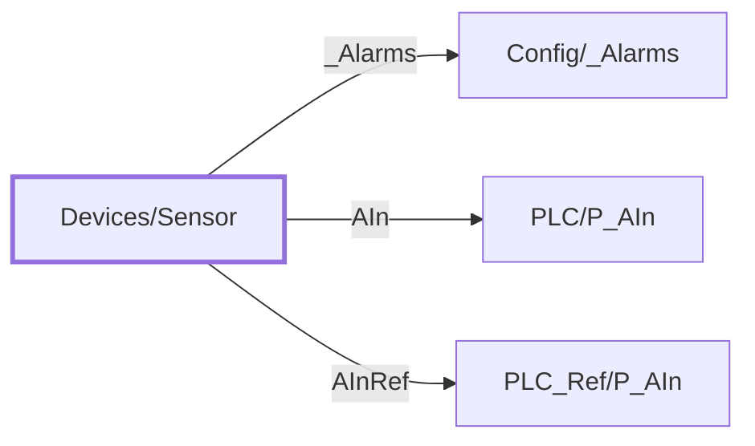

:::note

:::
# UDT `Devices/Sensor`

sensor

process sensor (P\_AIn-shaped; discrete path would use P\_DIn)

| | |
|---|---|
| Designer location | Tag Browser &gt; default &gt; Data Types &gt; Devices &gt; Sensor |
| Tag path | `[default]_types_/Devices/Sensor` |
| File | `gateways/standard/data/config/resources/core/ignition/tag-type-definition/default/Devices/udts.json` |
| Inherits from | - |
| Inherited by | - |
| Own members | 3 (0 atomic, 3 nested UDT, 0 folders) |
| Status | in use |

## Parameters

| Parameter | Data type | Default | Defined |
|---|---|---|---|
| `PlcDevice` | String | - | own |
| `AInTag` | String | - | own |
| `AInSource` | String | - | own |
| `AInEU` | String | - | own |

Parameters are referenced in member settings as `{Name}` and are set per instance (Designer: right-click the instance > Edit Tag > Parameters).

## Structure

## Members

| Member | Data type | Source | Tag group | Read only | History | Units / format | Alarms | Documentation |
|---|---|---|---|---|---|---|---|---|
| `_Alarms` | UDT | nested [Config/\_Alarms](../config/alarms.md) | | | | | | |
| `AIn` | UDT | nested [PLC/P\_AIn](../plc/p-ain.md) | | | | | | Live PLC object \[\{PlcDevice\}\]\{AInTag\} (PLC/P\_AIn); enabled on mapped instances only |
| `AInRef` | UDT | nested [PLC\_Ref/P\_AIn](../plc-ref/p-ain.md) | | | | | | Read-only references to the P\_AIn part that owns the controller object (\{AInSource\}); enabled on mapped instances only |

## Nested UDTs

| Member | Type | Parameter bindings | Default state |
|---|---|---|---|
| `_Alarms` | [Config/\_Alarms](../config/alarms.md) | - | enabled |
| `AIn` | [PLC/P\_AIn](../plc/p-ain.md) | `DeviceName = {PlcDevice}; TagPrefix = {AInTag}; EngUnit = {AInEU}` | disabled |
| `AInRef` | [PLC\_Ref/P\_AIn](../plc-ref/p-ain.md) | `Source = {AInSource}; EngUnit = {AInEU}` | disabled |

`disabled` parts subscribe nothing until an instance enables them (instance override `enabled: true`). See the device instance pages for which instances enable which part.

## Alarms

_No alarms defined on this type._

## Used By

9 direct instance(s):

| Instance | Instance page |
|---|---|
| `[default]Boars_Head/GrovePort/Condensers/Sensors/Outside Air Temp` | [Condensers/Sensors](../../devices/condensers-sensors.md) |
| `[default]Boars_Head/GrovePort/Freezer/Sensors/Underfloor Temp` | [Freezer/Sensors](../../devices/freezer-sensors.md) |
| `[default]Boars_Head/GrovePort/Machine Room/Sensors/LSS-Pumps Pressure` | [Machine Room/Sensors](../../devices/machine-room-sensors.md) |
| `[default]Boars_Head/GrovePort/Machine Room/Sensors/HSD-Discharge Pressure` | [Machine Room/Sensors](../../devices/machine-room-sensors.md) |
| `[default]Boars_Head/GrovePort/Machine Room/Sensors/LSL-Pumps Pressure` | [Machine Room/Sensors](../../devices/machine-room-sensors.md) |
| `[default]Boars_Head/GrovePort/Machine Room/Sensors/HSL-Pumps Pressure` | [Machine Room/Sensors](../../devices/machine-room-sensors.md) |
| `[default]Boars_Head/GrovePort/Machine Room/Sensors/HSS-Pumps Pressure` | [Machine Room/Sensors](../../devices/machine-room-sensors.md) |
| `[default]Boars_Head/GrovePort/Machine Room/Sensors/Condenser Sump Level` | [Machine Room/Sensors](../../devices/machine-room-sensors.md) |
| `[default]Boars_Head/GrovePort/SuperChill/Sensors/Underfloor Temp` | [SuperChill/Sensors](../../devices/superchill-sensors.md) |
