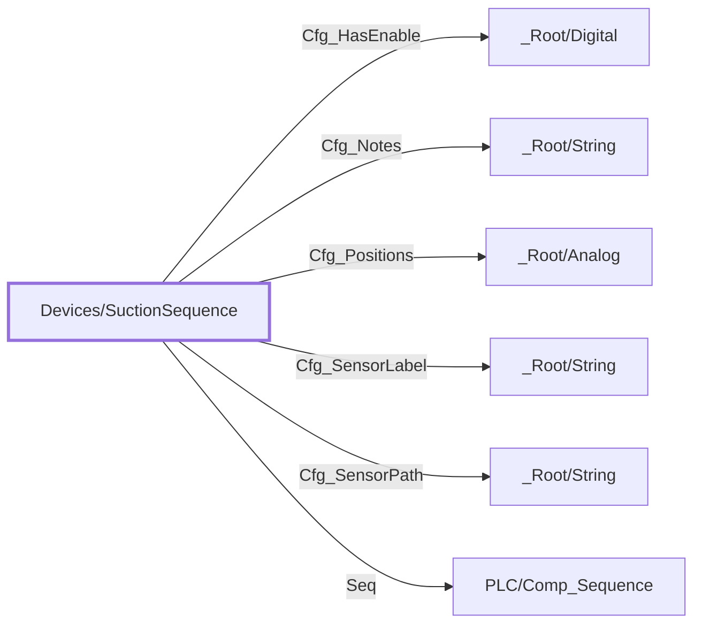

:::note

:::
# UDT `Devices/SuctionSequence`

suction sequence

compressor suction pressure sequence (PLC Comp\_Sequence; FT (STELLAR) L3-HSS\_Seq / L3-LSS\_Seq)

| | |
|---|---|
| Designer location | Tag Browser &gt; default &gt; Data Types &gt; Devices &gt; SuctionSequence |
| Tag path | `[default]_types_/Devices/SuctionSequence` |
| File | `gateways/standard/data/config/resources/core/ignition/tag-type-definition/default/Devices/udts.json` |
| Inherits from | - |
| Inherited by | - |
| Own members | 7 (1 atomic, 6 nested UDT, 0 folders) |
| Status | in use |

## Parameters

| Parameter | Data type | Default | Defined |
|---|---|---|---|
| `PlcDevice` | String | - | own |
| `SeqTag` | String | - | own |
| `EnableTag` | String | - | own |

Parameters are referenced in member settings as `{Name}` and are set per instance (Designer: right-click the instance > Edit Tag > Parameters).

## OPC Item Path

1 members read OPC through the server `Ignition OPC UA Server`. Common prefix: `ns=1;s=[{PlcDevice}]{EnableTag}`. The Source column shows the part after the device.

## Structure

## Members

| Member | Data type | Source | Tag group | Read only | History | Units / format | Alarms | Documentation |
|---|---|---|---|---|---|---|---|---|
| `Cfg_HasEnable` | UDT | nested [\_Root/Digital](../root/digital.md) | | | | | | Has an HMI enable (HMI) |
| `Cfg_Notes` | UDT | nested [\_Root/String](../root/string.md) | | | | | | Faceplate notes (HMI) |
| `Cfg_Positions` | UDT | nested [\_Root/Analog](../root/analog.md) | | | | | | Sequence positions shown (HMI) |
| `Cfg_SensorLabel` | UDT | nested [\_Root/String](../root/string.md) | | | | | | Suction pressure sensor label (HMI) |
| `Cfg_SensorPath` | UDT | nested [\_Root/String](../root/string.md) | | | | | | Suction pressure sensor (HMI) |
| `Seq` | UDT | nested [PLC/Comp\_Sequence](../plc/comp-sequence.md) | | | | | | Live PLC object \[\{PlcDevice\}\]\{SeqTag\} (PLC/Comp\_Sequence); enabled on mapped instances only |
| `PlcHmiEnable` | Boolean | OPC `{EnableTag}` | PAX\_Faceplate | yes | | | | Live PLC tag \[\{PlcDevice\}\]\{EnableTag\} (read only); enabled on mapped instances only |

## Nested UDTs

| Member | Type | Parameter bindings | Default state |
|---|---|---|---|
| `Cfg_HasEnable` | [\_Root/Digital](../root/digital.md) | - | enabled |
| `Cfg_Notes` | [\_Root/String](../root/string.md) | - | enabled |
| `Cfg_Positions` | [\_Root/Analog](../root/analog.md) | - | enabled |
| `Cfg_SensorLabel` | [\_Root/String](../root/string.md) | - | enabled |
| `Cfg_SensorPath` | [\_Root/String](../root/string.md) | - | enabled |
| `Seq` | [PLC/Comp\_Sequence](../plc/comp-sequence.md) | `DeviceName = {PlcDevice}; TagPrefix = {SeqTag}` | disabled |

`disabled` parts subscribe nothing until an instance enables them (instance override `enabled: true`). See the device instance pages for which instances enable which part.

## Alarms

_No alarms defined on this type._

## Used By

2 direct instance(s):

| Instance | Instance page |
|---|---|
| `[default]Boars_Head/GrovePort/Machine Room/Sequences/HSS` | [Machine Room/Sequences](../../devices/machine-room-sequences.md) |
| `[default]Boars_Head/GrovePort/Machine Room/Sequences/LSS` | [Machine Room/Sequences](../../devices/machine-room-sequences.md) |
