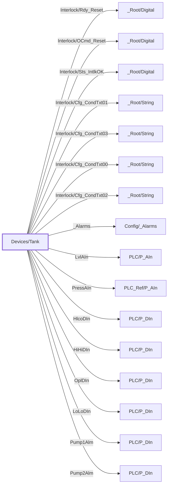

:::note

:::
# UDT `Devices/Tank`

tank / vessel

Recirculator/Accumulator-style vessel (PLC-backed): Level % + SP, HH/H/L/LL marks + SP, LSH/LSL, optional Pressure; no Config/Interlock (vessel has no P\_Intlk — pump interlocks live on Devices/Pump)

| | |
|---|---|
| Designer location | Tag Browser &gt; default &gt; Data Types &gt; Devices &gt; Tank |
| Tag path | `[default]_types_/Devices/Tank` |
| File | `gateways/standard/data/config/resources/core/ignition/tag-type-definition/default/Devices/udts.json` |
| Inherits from | - |
| Inherited by | - |
| Own members | 19 (2 atomic, 16 nested UDT, 1 folders) |
| Status | in use |

## Parameters

| Parameter | Data type | Default | Defined |
|---|---|---|---|
| `PlcDevice` | String | - | own |
| `LevelTag` | String | - | own |
| `PressTag` | String | - | own |
| `HLCOTag` | String | - | own |
| `HiHiTag` | String | - | own |
| `OPLTag` | String | - | own |
| `LoLoTag` | String | - | own |
| `Pump1AlmTag` | String | - | own |
| `Pump2AlmTag` | String | - | own |
| `StartPressTag` | String | - | own |
| `PressSource` | String | - | own |
| `LevelEU` | String | - | own |
| `PressEU` | String | - | own |
| `LeadTag` | String | - | own |

Parameters are referenced in member settings as `{Name}` and are set per instance (Designer: right-click the instance > Edit Tag > Parameters).

## OPC Item Path

2 members read OPC through the server `Ignition OPC UA Server`. Common prefix: `ns=1;s=[{PlcDevice}]{`. The Source column shows the part after the device.

## Structure

## Members

| Member | Data type | Source | Tag group | Read only | History | Units / format | Alarms | Documentation |
|---|---|---|---|---|---|---|---|---|
| `Interlock/` | Folder | | | | | | | |
| `Interlock/Rdy_Reset` | UDT | nested [\_Root/Digital](../root/digital.md) | | | | | | Reset ready |
| `Interlock/OCmd_Reset` | UDT | nested [\_Root/Digital](../root/digital.md) | | | | | | Reset vessel interlocks |
| `Interlock/Sts_IntlkOK` | UDT | nested [\_Root/Digital](../root/digital.md) | | | | | | Vessel interlocks OK |
| `Interlock/Cfg_CondTxt01` | UDT | nested [\_Root/String](../root/string.md) | | | | | | Condition 01 |
| `Interlock/Cfg_CondTxt03` | UDT | nested [\_Root/String](../root/string.md) | | | | | | Condition 03 |
| `Interlock/Cfg_CondTxt00` | UDT | nested [\_Root/String](../root/string.md) | | | | | | Condition 00 |
| `Interlock/Cfg_CondTxt02` | UDT | nested [\_Root/String](../root/string.md) | | | | | | Condition 02 |
| `_Alarms` | UDT | nested [Config/\_Alarms](../config/alarms.md) | | | | | | |
| `LvlAIn` | UDT | nested [PLC/P\_AIn](../plc/p-ain.md) | | | | | | Live PLC object \[\{PlcDevice\}\]\{LevelTag\} (PLC/P\_AIn); enabled on mapped instances only |
| `PressAIn` | UDT | nested [PLC\_Ref/P\_AIn](../plc-ref/p-ain.md) | | | | | | Read-only references to the P\_AIn part that owns the controller object (\{PressSource\}); enabled on mapped instances only |
| `HlcoDIn` | UDT | nested [PLC/P\_DIn](../plc/p-din.md) | | | | | | Live PLC object \[\{PlcDevice\}\]\{HLCOTag\} (PLC/P\_DIn); enabled on mapped instances only |
| `HiHiDIn` | UDT | nested [PLC/P\_DIn](../plc/p-din.md) | | | | | | Live PLC object \[\{PlcDevice\}\]\{HiHiTag\} (PLC/P\_DIn); enabled on mapped instances only |
| `OplDIn` | UDT | nested [PLC/P\_DIn](../plc/p-din.md) | | | | | | Live PLC object \[\{PlcDevice\}\]\{OPLTag\} (PLC/P\_DIn); enabled on mapped instances only |
| `LoLoDIn` | UDT | nested [PLC/P\_DIn](../plc/p-din.md) | | | | | | Live PLC object \[\{PlcDevice\}\]\{LoLoTag\} (PLC/P\_DIn); enabled on mapped instances only |
| `Pump1Alm` | UDT | nested [PLC/P\_DIn](../plc/p-din.md) | | | | | | Live PLC object \[\{PlcDevice\}\]\{Pump1AlmTag\} (PLC/P\_DIn); enabled on mapped instances only |
| `Pump2Alm` | UDT | nested [PLC/P\_DIn](../plc/p-din.md) | | | | | | Live PLC object \[\{PlcDevice\}\]\{Pump2AlmTag\} (PLC/P\_DIn); enabled on mapped instances only |
| `StartPress` | Float4 | OPC `{StartPressTag}` | PAX\_Faceplate | yes | | | | Live PLC tag \[\{PlcDevice\}\]\{StartPressTag\} (read only); enabled on mapped instances only |
| `LeadPump` | Int2 | OPC `{LeadTag}` | PAX\_Faceplate | yes | | | | Live PLC tag \[\{PlcDevice\}\]\{LeadTag\} (read only); enabled on mapped instances only |

## Nested UDTs

| Member | Type | Parameter bindings | Default state |
|---|---|---|---|
| `Interlock/Rdy_Reset` | [\_Root/Digital](../root/digital.md) | - | enabled |
| `Interlock/OCmd_Reset` | [\_Root/Digital](../root/digital.md) | - | enabled |
| `Interlock/Sts_IntlkOK` | [\_Root/Digital](../root/digital.md) | - | enabled |
| `Interlock/Cfg_CondTxt01` | [\_Root/String](../root/string.md) | - | enabled |
| `Interlock/Cfg_CondTxt03` | [\_Root/String](../root/string.md) | - | enabled |
| `Interlock/Cfg_CondTxt00` | [\_Root/String](../root/string.md) | - | enabled |
| `Interlock/Cfg_CondTxt02` | [\_Root/String](../root/string.md) | - | enabled |
| `_Alarms` | [Config/\_Alarms](../config/alarms.md) | - | enabled |
| `LvlAIn` | [PLC/P\_AIn](../plc/p-ain.md) | `DeviceName = {PlcDevice}; TagPrefix = {LevelTag}; EngUnit = {LevelEU}` | disabled |
| `PressAIn` | [PLC\_Ref/P\_AIn](../plc-ref/p-ain.md) | `Source = {PressSource}; EngUnit = {PressEU}` | disabled |
| `HlcoDIn` | [PLC/P\_DIn](../plc/p-din.md) | `DeviceName = {PlcDevice}; TagPrefix = {HLCOTag}` | disabled |
| `HiHiDIn` | [PLC/P\_DIn](../plc/p-din.md) | `DeviceName = {PlcDevice}; TagPrefix = {HiHiTag}` | disabled |
| `OplDIn` | [PLC/P\_DIn](../plc/p-din.md) | `DeviceName = {PlcDevice}; TagPrefix = {OPLTag}` | disabled |
| `LoLoDIn` | [PLC/P\_DIn](../plc/p-din.md) | `DeviceName = {PlcDevice}; TagPrefix = {LoLoTag}` | disabled |
| `Pump1Alm` | [PLC/P\_DIn](../plc/p-din.md) | `DeviceName = {PlcDevice}; TagPrefix = {Pump1AlmTag}; AlarmOnSts = True; Description = Pump #1 Alarm` | disabled |
| `Pump2Alm` | [PLC/P\_DIn](../plc/p-din.md) | `DeviceName = {PlcDevice}; TagPrefix = {Pump2AlmTag}; AlarmOnSts = True; Description = Pump #2 Alarm` | disabled |

`disabled` parts subscribe nothing until an instance enables them (instance override `enabled: true`). See the device instance pages for which instances enable which part.

## Alarms

_No alarms defined on this type._

## Used By

4 direct instance(s):

| Instance | Instance page |
|---|---|
| `[default]Boars_Head/GrovePort/Condensers/Tanks/CSV` | [Condensers/Tanks](../../devices/condensers-tanks.md) |
| `[default]Boars_Head/GrovePort/Machine Room/Tanks/HTR` | [Machine Room/Tanks](../../devices/machine-room-tanks.md) |
| `[default]Boars_Head/GrovePort/Machine Room/Tanks/LTR` | [Machine Room/Tanks](../../devices/machine-room-tanks.md) |
| `[default]Boars_Head/GrovePort/Machine Room/Tanks/HPR` | [Machine Room/Tanks](../../devices/machine-room-tanks.md) |
