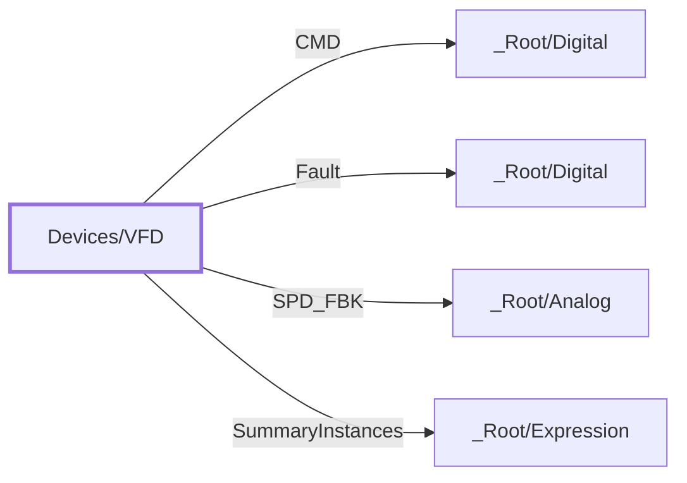

:::note

:::
# UDT `Devices/VFD`

vfd

| | |
|---|---|
| Designer location | Tag Browser &gt; default &gt; Data Types &gt; Devices &gt; VFD |
| Tag path | `[default]_types_/Devices/VFD` |
| File | `gateways/standard/data/config/resources/core/ignition/tag-type-definition/default/Devices/udts.json` |
| Inherits from | - |
| Inherited by | - |
| Own members | 4 (0 atomic, 4 nested UDT, 0 folders) |
| Status | no instances |

## Parameters

_No parameters._

## Structure

## Members

| Member | Data type | Source | Tag group | Read only | History | Units / format | Alarms | Documentation |
|---|---|---|---|---|---|---|---|---|
| `CMD` | UDT | nested [\_Root/Digital](../root/digital.md) | | | | | | |
| `Fault` | UDT | nested [\_Root/Digital](../root/digital.md) | | | | | | |
| `SPD_FBK` | UDT | nested [\_Root/Analog](../root/analog.md) | | | | | | VFD speed feedback (%) |
| `SummaryInstances` | UDT | nested [\_Root/Expression](../root/expression.md) | | | | | | |

## Nested UDTs

| Member | Type | Parameter bindings | Default state |
|---|---|---|---|
| `CMD` | [\_Root/Digital](../root/digital.md) | - | enabled |
| `Fault` | [\_Root/Digital](../root/digital.md) | - | enabled |
| `SPD_FBK` | [\_Root/Analog](../root/analog.md) | - | enabled |
| `SummaryInstances` | [\_Root/Expression](../root/expression.md) | - | enabled |

`disabled` parts subscribe nothing until an instance enables them (instance override `enabled: true`). See the device instance pages for which instances enable which part.

## Alarms

_No alarms defined on this type._

## Used By

Not used by any instance or other UDT.
