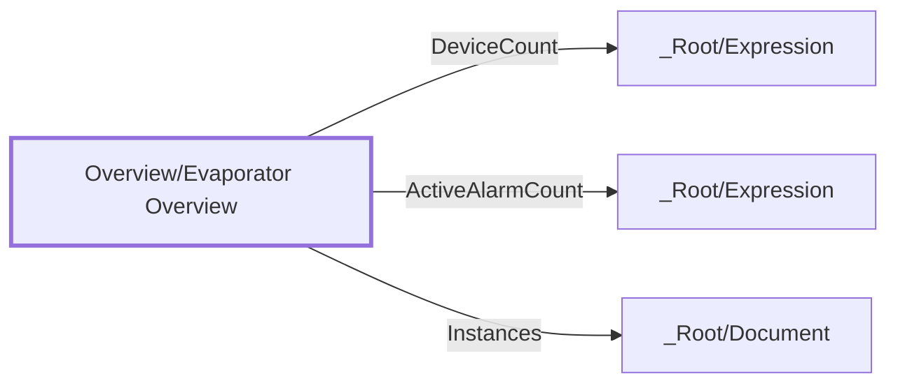

:::note

:::
# UDT `Overview/Evaporator Overview`

evaporator overview

evaporator overview instances table

| | |
|---|---|
| Designer location | Tag Browser &gt; default &gt; Data Types &gt; Overview &gt; Evaporator Overview |
| Tag path | `[default]_types_/Overview/Evaporator Overview` |
| File | `gateways/standard/data/config/resources/core/ignition/tag-type-definition/default/Overview/udts.json` |
| Inherits from | - |
| Inherited by | - |
| Own members | 4 (1 atomic, 3 nested UDT, 0 folders) |
| Status | no instances |

## Parameters

_No parameters._

## Structure

## Members

| Member | Data type | Source | Tag group | Read only | History | Units / format | Alarms | Documentation |
|---|---|---|---|---|---|---|---|---|
| `DeviceCount` | UDT | nested [\_Root/Expression](../root/expression.md) | | | | | | |
| `ActiveAlarmCount` | UDT | nested [\_Root/Expression](../root/expression.md) | | | | | | |
| `Instances` | UDT | nested [\_Root/Document](../root/document.md) | | | | | | overview table columns + data (Lightspeed pattern) |
| `Rebuild` | Boolean | memory = `False` | | | | | | |

## Nested UDTs

| Member | Type | Parameter bindings | Default state |
|---|---|---|---|
| `DeviceCount` | [\_Root/Expression](../root/expression.md) | - | enabled |
| `ActiveAlarmCount` | [\_Root/Expression](../root/expression.md) | `exprFunction = sum; exprTargetPath = /_Alarms/_Active` | enabled |
| `Instances` | [\_Root/Document](../root/document.md) | - | enabled |

`disabled` parts subscribe nothing until an instance enables them (instance override `enabled: true`). See the device instance pages for which instances enable which part.

## Alarms

_No alarms defined on this type._

## Used By

Not used by any instance or other UDT.
