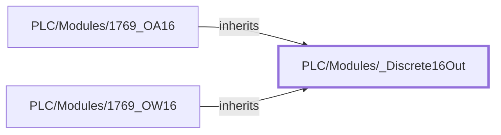

:::note

:::
# UDT `PLC/Modules/_Discrete16Out`

1769 16-point discrete output base (read only)

1769 16-point discrete output base on a Logix local bus: OPC ns=1;s=\[\{DeviceName\}\]Local:\{Slot\}:I\|O\|C.&lt;member&gt;, every member readOnly, tag groups PAX\_Status / PAX\_Faceplate

| | |
|---|---|
| Designer location | Tag Browser &gt; default &gt; Data Types &gt; PLC &gt; Modules &gt; \_Discrete16Out |
| Tag path | `[default]_types_/PLC/Modules/_Discrete16Out` |
| File | `gateways/standard/data/config/resources/core/ignition/tag-type-definition/default/PLC/Modules/udts.json` |
| Inherits from | - |
| Inherited by | [PLC/Modules/1769\_OA16](type-1769-oa16.md), [PLC/Modules/1769\_OW16](type-1769-ow16.md) |
| Own members | 8 (8 atomic, 0 nested UDT, 0 folders) |
| Status | in use |

## Parameters

| Parameter | Data type | Default | Defined |
|---|---|---|---|
| `DeviceName` | String | - | own |
| `Slot` | Integer | `0` | own |
| `Description` | String | - | own |

Parameters are referenced in member settings as `{Name}` and are set per instance (Designer: right-click the instance > Edit Tag > Parameters).

## OPC Item Path

4 members read OPC through the server `Ignition OPC UA Server`. Common prefix: `ns=1;s=[{DeviceName}]`. The Source column shows the part after the device.

## Structure

## Members

| Member | Data type | Source | Tag group | Read only | History | Units / format | Alarms | Documentation |
|---|---|---|---|---|---|---|---|---|
| `CommOk` | Boolean | OPC `[Diagnostics]/Connected` | PAX\_Status | yes | | | | Logix driver connected (gates the card alarms during a comm loss) |
| `ConnectionFaulted` | Boolean | expr `coalesce({[.]CommOk}, false) && {[.]Fault} = -1` | | yes | | | | Connection fault to the card: every Fault bit set (only while the driver is connected) |
| `Data` | Int2 | OPC `Local:{Slot}:O.Data` | PAX\_Status | yes | | | | Output image (controller command), bit n = output n |
| `Fault` | Int4 | OPC `Local:{Slot}:I.Fault` | PAX\_Status | yes | | | | Module fault word (Logix Local:n:I.Fault); 0 = OK, all bits set (-1) = connection fault |
| `Faulted` | Boolean | expr `coalesce({[.]CommOk}, false) && {[.]Fault} != 0` | | yes | | | 1 | Module fault: Fault word non-zero (only while the driver is connected) |
| `ModuleType` | String | expr `'DO'` | | yes | | | | DI / DO / AI / AO / Comm |
| `Points` | Int4 | expr `16` | | yes | | | | Point / channel count |
| `ReadBack` | Int2 | OPC `Local:{Slot}:I.ReadBack` | PAX\_Status | yes | | | | Output readback (actual state), bit n = output n |

## Alarms

| Member | Alarm | Priority | Mode | Enabled | Display path | Notes |
|---|---|---|---|---|---|---|
| `Faulted` | Module Fault | High | WhenTrue | `true` | replace(try(split(\{PathToTag\}, '/')\[1, 0\], ''), 'GrovePort', 'Groveport') + ' / ' + try(split(\{PathToTag\}, '/')\[2, 0\], '') + ' / PLC / ' + try(split(\{PathToTag\}, '/')\[4, 0\], '') + ' / ' + try(split(\{PathToTag\}, '/')\[5, 0\], '') | 1769 16-point Local:n:I.Fault != 0 (-1 = connection fault to the card). Suppressed while PLC commun… |

Associated data `Site` / `Area` / `Device` come from the tag path (`split({PathToTag}, '/')` segments 1 / 2 / 4). Alarms are defined only here, on the UDT, never on instances: see [Alarms](../../../alarms.md).

## Used By

Not used by any instance or other UDT.
