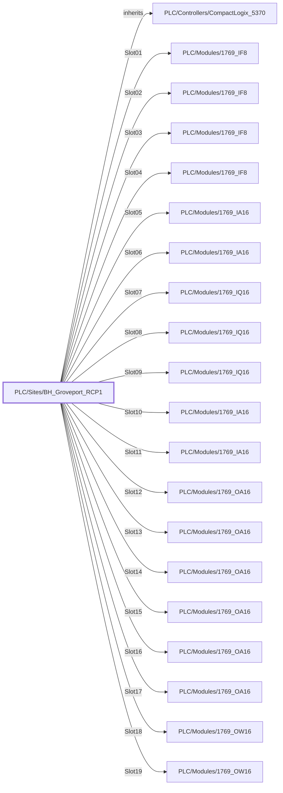

:::note

:::
# UDT `PLC/Sites/BH_Groveport_RCP1`

Groveport RCP1 PLC (CompactLogix 5370, 19 local 1769 cards, read only)

Inherits PLC/Controllers/CompactLogix\_5370; one PLC/Modules card per occupied slot + Rack document

| | |
|---|---|
| Designer location | Tag Browser &gt; default &gt; Data Types &gt; PLC &gt; Sites &gt; BH\_Groveport\_RCP1 |
| Tag path | `[default]_types_/PLC/Sites/BH_Groveport_RCP1` |
| File | `gateways/standard/data/config/resources/core/ignition/tag-type-definition/default/PLC/Sites/udts.json` |
| Inherits from | [PLC/Controllers/CompactLogix\_5370](../plc-controllers/compactlogix-5370.md) |
| Inherited by | - |
| Own members | 28 (9 atomic, 19 nested UDT, 0 folders) |
| Status | in use |

## Parameters

| Parameter | Data type | Default | Defined |
|---|---|---|---|
| `DeviceName` | String | - | own |
| `Description` | String | - | own |

Parameters are referenced in member settings as `{Name}` and are set per instance (Designer: right-click the instance > Edit Tag > Parameters).

## OPC Item Path

2 members read OPC through the server `Ignition OPC UA Server`. Common prefix: `ns=1;s=[{DeviceName}]MajorFaultRecord_`. The Source column shows the part after the device.

## Structure



## Members

Inherited members (listed on the parent page): 21 from [PLC/Controllers/CompactLogix\_5370](../plc-controllers/compactlogix-5370.md).

| Member | Data type | Source | Tag group | Read only | History | Units / format | Alarms | Documentation |
|---|---|---|---|---|---|---|---|---|
| `CatalogNumber` | String | expr `'1769-L36ERM'` | | yes | | | | Catalog: \[Diagnostics\] ProductName 1769-L36ERM/A LOGIX5336ERM, product code 108 (ACD backup identity) |
| `IPAddress` | String | expr `''` | | yes | | | | 
| `MaxLocalModules` | Int4 | expr `30` | | yes | | | | 1769-L36ERM local module limit |
| `MajorFaultRecordCode` | Int4 | OPC `MajorFaultRecord_Code` | PAX\_Faceplate | yes | | | | Last major fault code (controller tag MajorFaultRecord\_Code) |
| `MajorFaultRecordType` | Int4 | OPC `MajorFaultRecord_Type` | PAX\_Faceplate | yes | | | | Last major fault type (controller tag MajorFaultRecord\_Type) |
| `Rack` | Document | memory = `(document, 24144 chars)` | | yes | | | | Slot list for the rack view (slot, member, catalog, type, points, description, pointNames) |
| `Slot01` | UDT | nested [PLC/Modules/1769\_IF8](../plc-modules/type-1769-if8.md) | | | | | | |
| `Slot02` | UDT | nested [PLC/Modules/1769\_IF8](../plc-modules/type-1769-if8.md) | | | | | | |
| `Slot03` | UDT | nested [PLC/Modules/1769\_IF8](../plc-modules/type-1769-if8.md) | | | | | | |
| `Slot04` | UDT | nested [PLC/Modules/1769\_IF8](../plc-modules/type-1769-if8.md) | | | | | | |
| `Slot05` | UDT | nested [PLC/Modules/1769\_IA16](../plc-modules/type-1769-ia16.md) | | | | | | |
| `Slot06` | UDT | nested [PLC/Modules/1769\_IA16](../plc-modules/type-1769-ia16.md) | | | | | | |
| `Slot07` | UDT | nested [PLC/Modules/1769\_IQ16](../plc-modules/type-1769-iq16.md) | | | | | | |
| `Slot08` | UDT | nested [PLC/Modules/1769\_IQ16](../plc-modules/type-1769-iq16.md) | | | | | | |
| `Slot09` | UDT | nested [PLC/Modules/1769\_IQ16](../plc-modules/type-1769-iq16.md) | | | | | | |
| `Slot10` | UDT | nested [PLC/Modules/1769\_IA16](../plc-modules/type-1769-ia16.md) | | | | | | |
| `Slot11` | UDT | nested [PLC/Modules/1769\_IA16](../plc-modules/type-1769-ia16.md) | | | | | | |
| `Slot12` | UDT | nested [PLC/Modules/1769\_OA16](../plc-modules/type-1769-oa16.md) | | | | | | |
| `Slot13` | UDT | nested [PLC/Modules/1769\_OA16](../plc-modules/type-1769-oa16.md) | | | | | | |
| `Slot14` | UDT | nested [PLC/Modules/1769\_OA16](../plc-modules/type-1769-oa16.md) | | | | | | |
| `Slot15` | UDT | nested [PLC/Modules/1769\_OA16](../plc-modules/type-1769-oa16.md) | | | | | | |
| `Slot16` | UDT | nested [PLC/Modules/1769\_OA16](../plc-modules/type-1769-oa16.md) | | | | | | |
| `Slot17` | UDT | nested [PLC/Modules/1769\_OA16](../plc-modules/type-1769-oa16.md) | | | | | | |
| `Slot18` | UDT | nested [PLC/Modules/1769\_OW16](../plc-modules/type-1769-ow16.md) | | | | | | |
| `Slot19` | UDT | nested [PLC/Modules/1769\_OW16](../plc-modules/type-1769-ow16.md) | | | | | | |
| `ModulesFaulted` | Int4 | expr `if(coalesce({[.]Slot01/Faulted}, false), 1, 0) + if(coalesce({[.]Slot…` (full below) | | yes | | | | Number of cards with a non-zero Fault word |
| `ModuleCount` | Int4 | expr `19` | | yes | | | | Number of cards in the rack |
| `ControllerName` | String | expr `''` | | yes | | | | 

<details>
<summary>Full expressions / references (1)</summary>

**`ModulesFaulted`** (expr)

```
if(coalesce({[.]Slot01/Faulted}, false), 1, 0) + if(coalesce({[.]Slot02/Faulted}, false), 1, 0) + if(coalesce({[.]Slot03/Faulted}, false), 1, 0) + if(coalesce({[.]Slot04/Faulted}, false), 1, 0) + if(coalesce({[.]Slot05/Faulted}, false), 1, 0) + if(coalesce({[.]Slot06/Faulted}, false), 1, 0) + if(coalesce({[.]Slot07/Faulted}, false), 1, 0) + if(coalesce({[.]Slot08/Faulted}, false), 1, 0) + if(coalesce({[.]Slot09/Faulted}, false), 1, 0) + if(coalesce({[.]Slot10/Faulted}, false), 1, 0) + if(coalesce({[.]Slot11/Faulted}, false), 1, 0) + if(coalesce({[.]Slot12/Faulted}, false), 1, 0) + if(coalesce({[.]Slot13/Faulted}, false), 1, 0) + if(coalesce({[.]Slot14/Faulted}, false), 1, 0) + if(coalesce({[.]Slot15/Faulted}, false), 1, 0) + if(coalesce({[.]Slot16/Faulted}, false), 1, 0) + if(coalesce({[.]Slot17/Faulted}, false), 1, 0) + if(coalesce({[.]Slot18/Faulted}, false), 1, 0) + if(coalesce({[.]Slot19/Faulted}, false), 1, 0)
```


</details>

## Nested UDTs

| Member | Type | Parameter bindings | Default state |
|---|---|---|---|
| `Slot01` | [PLC/Modules/1769\_IF8](../plc-modules/type-1769-if8.md) | `DeviceName = {DeviceName}; Slot = 1; Description = IF8_S1 (slot 1, 1769-IF8)` | enabled |
| `Slot02` | [PLC/Modules/1769\_IF8](../plc-modules/type-1769-if8.md) | `DeviceName = {DeviceName}; Slot = 2; Description = IF8_S2 (slot 2, 1769-IF8)` | enabled |
| `Slot03` | [PLC/Modules/1769\_IF8](../plc-modules/type-1769-if8.md) | `DeviceName = {DeviceName}; Slot = 3; Description = IF8_S3 (slot 3, 1769-IF8)` | enabled |
| `Slot04` | [PLC/Modules/1769\_IF8](../plc-modules/type-1769-if8.md) | `DeviceName = {DeviceName}; Slot = 4; Description = IF8_S4 (slot 4, 1769-IF8)` | enabled |
| `Slot05` | [PLC/Modules/1769\_IA16](../plc-modules/type-1769-ia16.md) | `DeviceName = {DeviceName}; Slot = 5; Description = IA16_S5 (slot 5, 1769-IA16)` | enabled |
| `Slot06` | [PLC/Modules/1769\_IA16](../plc-modules/type-1769-ia16.md) | `DeviceName = {DeviceName}; Slot = 6; Description = IA16_S6 (slot 6, 1769-IA16)` | enabled |
| `Slot07` | [PLC/Modules/1769\_IQ16](../plc-modules/type-1769-iq16.md) | `DeviceName = {DeviceName}; Slot = 7; Description = IQ16_S7 (slot 7, 1769-IQ16)` | enabled |
| `Slot08` | [PLC/Modules/1769\_IQ16](../plc-modules/type-1769-iq16.md) | `DeviceName = {DeviceName}; Slot = 8; Description = IQ16_S8 (slot 8, 1769-IQ16)` | enabled |
| `Slot09` | [PLC/Modules/1769\_IQ16](../plc-modules/type-1769-iq16.md) | `DeviceName = {DeviceName}; Slot = 9; Description = IQ16_S9 (slot 9, 1769-IQ16)` | enabled |
| `Slot10` | [PLC/Modules/1769\_IA16](../plc-modules/type-1769-ia16.md) | `DeviceName = {DeviceName}; Slot = 10; Description = IA16_S10 (slot 10, 1769-IA16)` | enabled |
| `Slot11` | [PLC/Modules/1769\_IA16](../plc-modules/type-1769-ia16.md) | `DeviceName = {DeviceName}; Slot = 11; Description = IA16_S11 (slot 11, 1769-IA16)` | enabled |
| `Slot12` | [PLC/Modules/1769\_OA16](../plc-modules/type-1769-oa16.md) | `DeviceName = {DeviceName}; Slot = 12; Description = OA16_S12 (slot 12, 1769-OA16)` | enabled |
| `Slot13` | [PLC/Modules/1769\_OA16](../plc-modules/type-1769-oa16.md) | `DeviceName = {DeviceName}; Slot = 13; Description = OA16_S13 (slot 13, 1769-OA16)` | enabled |
| `Slot14` | [PLC/Modules/1769\_OA16](../plc-modules/type-1769-oa16.md) | `DeviceName = {DeviceName}; Slot = 14; Description = OA16_S14 (slot 14, 1769-OA16)` | enabled |
| `Slot15` | [PLC/Modules/1769\_OA16](../plc-modules/type-1769-oa16.md) | `DeviceName = {DeviceName}; Slot = 15; Description = OA16_S15 (slot 15, 1769-OA16)` | enabled |
| `Slot16` | [PLC/Modules/1769\_OA16](../plc-modules/type-1769-oa16.md) | `DeviceName = {DeviceName}; Slot = 16; Description = OA16_S16 (slot 16, 1769-OA16)` | enabled |
| `Slot17` | [PLC/Modules/1769\_OA16](../plc-modules/type-1769-oa16.md) | `DeviceName = {DeviceName}; Slot = 17; Description = OA16_S17 (slot 17, 1769-OA16)` | enabled |
| `Slot18` | [PLC/Modules/1769\_OW16](../plc-modules/type-1769-ow16.md) | `DeviceName = {DeviceName}; Slot = 18; Description = OW16_S18 (slot 18, 1769-OW16)` | enabled |
| `Slot19` | [PLC/Modules/1769\_OW16](../plc-modules/type-1769-ow16.md) | `DeviceName = {DeviceName}; Slot = 19; Description = OW16_S19 (slot 19, 1769-OW16)` | enabled |

`disabled` parts subscribe nothing until an instance enables them (instance override `enabled: true`). See the device instance pages for which instances enable which part.

## Alarms

_No alarms defined on this type._

## Used By

1 direct instance(s):

| Instance | Instance page |
|---|---|
| `[default]Boars_Head/GrovePort/Machine Room/PLC/RCP1` | [Machine Room/PLC](../../devices/machine-room-plc.md) |
