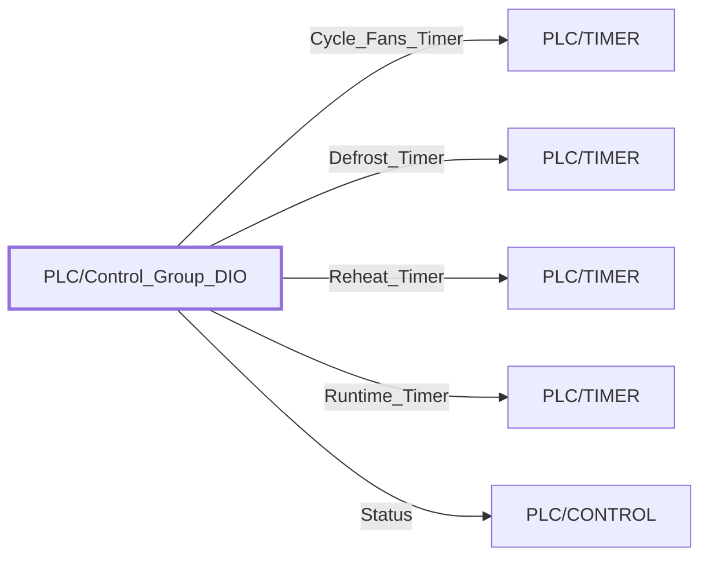

:::note

:::
# UDT `PLC/Control_Group_DIO`

| | |
|---|---|
| Designer location | Tag Browser &gt; default &gt; Data Types &gt; PLC &gt; Control\_Group\_DIO |
| Tag path | `[default]_types_/PLC/Control_Group_DIO` |
| File | `gateways/standard/data/config/resources/core/ignition/tag-type-definition/default/PLC/udts.json` |
| Inherits from | - |
| Inherited by | - |
| Own members | 52 (47 atomic, 5 nested UDT, 0 folders) |
| Status | unused (raw L5K import) |

## Parameters

| Parameter | Data type | Default | Defined |
|---|---|---|---|
| `TagPrefix` | String | - | own |
| `Description` | String | - | own |
| `DeviceName` | String | - | own |

Parameters are referenced in member settings as `{Name}` and are set per instance (Designer: right-click the instance > Edit Tag > Parameters).

## OPC Item Path

47 members read OPC through the server `Ignition OPC UA Server`. Pattern: `ns=1;s=[{DeviceName}]{TagPrefix}.<member>`, so an instance with `DeviceName = RCP1` and `TagPrefix = X` reads `ns=1;s=[RCP1]X.<member>`. The Source column below shows the part after `[{DeviceName}]`.

## Structure

## Members

| Member | Data type | Source | Tag group | Read only | History | Units / format | Alarms | Documentation |
|---|---|---|---|---|---|---|---|---|
| `BEGIN_DEFROST` | Boolean | OPC `{TagPrefix}.BEGIN_DEFROST` | | yes | | | | |
| `BL_Set` | Float4 | OPC `{TagPrefix}.BL_Set` | | yes | | | | |
| `CG_Type` | Int2 | OPC `{TagPrefix}.CG_Type` | | yes | | | | |
| `CYC_FANS` | Int4 | OPC `{TagPrefix}.CYC_FANS` | | yes | | | | |
| `Cycle_Fans_Timer` | UDT | nested [PLC/TIMER](timer.md) | | | | | | |
| `DEFROST_NOW` | Boolean | OPC `{TagPrefix}.DEFROST_NOW` | | yes | | | | |
| `Def_1st_Hr` | Int2 | OPC `{TagPrefix}.Def_1st_Hr` | | yes | | | | |
| `Def_1st_Min` | Int2 | OPC `{TagPrefix}.Def_1st_Min` | | yes | | | | |
| `Def_2nd_Hr` | Int2 | OPC `{TagPrefix}.Def_2nd_Hr` | | yes | | | | |
| `Def_2nd_Min` | Int2 | OPC `{TagPrefix}.Def_2nd_Min` | | yes | | | | |
| `Def_3rd_Hr` | Int2 | OPC `{TagPrefix}.Def_3rd_Hr` | | yes | | | | |
| `Def_3rd_Min` | Int2 | OPC `{TagPrefix}.Def_3rd_Min` | | yes | | | | |
| `Def_4th_Hr` | Int2 | OPC `{TagPrefix}.Def_4th_Hr` | | yes | | | | |
| `Def_4th_Min` | Int2 | OPC `{TagPrefix}.Def_4th_Min` | | yes | | | | |
| `Def_5th_Hr` | Int2 | OPC `{TagPrefix}.Def_5th_Hr` | | yes | | | | |
| `Def_5th_Min` | Int2 | OPC `{TagPrefix}.Def_5th_Min` | | yes | | | | |
| `Defrost_ONS` | Boolean | OPC `{TagPrefix}.Defrost_ONS` | | yes | | | | |
| `Defrost_Timer` | UDT | nested [PLC/TIMER](timer.md) | | | | | | |
| `ENABLE` | Boolean | OPC `{TagPrefix}.ENABLE` | | yes | | | | |
| `FD_Set` | Float4 | OPC `{TagPrefix}.FD_Set` | | yes | | | | |
| `HAS_DUAL_LIQ` | Boolean | OPC `{TagPrefix}.HAS_DUAL_LIQ` | | yes | | | | |
| `HAS_VFD` | Boolean | OPC `{TagPrefix}.HAS_VFD` | | yes | | | | |
| `HEAT_ENABLE` | Boolean | OPC `{TagPrefix}.HEAT_ENABLE` | | yes | | | | |
| `Heat_Set` | Float4 | OPC `{TagPrefix}.Heat_Set` | | yes | | | | |
| `MHG_SET` | Float4 | OPC `{TagPrefix}.MHG_SET` | | yes | | | | |
| `NAME` | String | OPC `{TagPrefix}.NAME` | | yes | | | | |
| `OFF_LATCH` | Boolean | OPC `{TagPrefix}.OFF_LATCH` | | yes | | | | |
| `PO_SET` | Float4 | OPC `{TagPrefix}.PO_SET` | | yes | | | | |
| `Reheat_Timer` | UDT | nested [PLC/TIMER](timer.md) | | | | | | |
| `Runtime_ONS` | Boolean | OPC `{TagPrefix}.Runtime_ONS` | | yes | | | | |
| `Runtime_Timer` | UDT | nested [PLC/TIMER](timer.md) | | | | | | |
| `SHG_SET` | Float4 | OPC `{TagPrefix}.SHG_SET` | | yes | | | | |
| `SHUTDOWN` | Boolean | OPC `{TagPrefix}.SHUTDOWN` | | yes | | | | |
| `STOP_DEF` | Boolean | OPC `{TagPrefix}.STOP_DEF` | | yes | | | | |
| `Status` | UDT | nested [PLC/CONTROL](control.md) | | | | | | |
| `Suction_String` | String | OPC `{TagPrefix}.Suction_String` | | yes | | | | |
| `Superheat` | Float4 | OPC `{TagPrefix}.Superheat` | | yes | | | | |
| `Superheat_Set` | Float4 | OPC `{TagPrefix}.Superheat_Set` | | yes | | | | |
| `TOD_START_DEFROST` | Boolean | OPC `{TagPrefix}.TOD_START_DEFROST` | | yes | | | | |
| `TimeLeft_Min` | Int2 | OPC `{TagPrefix}.TimeLeft_Min` | | yes | | | | |
| `TimeLeft_Sec` | Int2 | OPC `{TagPrefix}.TimeLeft_Sec` | | yes | | | | |
| `ZAT_DB_Set` | Float4 | OPC `{TagPrefix}.ZAT_DB_Set` | | yes | | | | |
| `ZAT_Target` | Float4 | OPC `{TagPrefix}.ZAT_Target` | | yes | | | | |
| `ZZZZZZZZZZControl_Gr1` | Int1 | OPC `{TagPrefix}.ZZZZZZZZZZControl_Gr1` | | yes | | | | |
| `ZZZZZZZZZZControl_Gr16` | Int1 | OPC `{TagPrefix}.ZZZZZZZZZZControl_Gr16` | | yes | | | | |
| `ZZZZZZZZZZControl_Gr20` | Int1 | OPC `{TagPrefix}.ZZZZZZZZZZControl_Gr20` | | yes | | | | |
| `ZZZZZZZZZZControl_Gr23` | Int1 | OPC `{TagPrefix}.ZZZZZZZZZZControl_Gr23` | | yes | | | | |
| `ZZZZZZZZZZControl_Gr30` | Int1 | OPC `{TagPrefix}.ZZZZZZZZZZControl_Gr30` | | yes | | | | |
| `ZZZZZZZZZZControl_Gr34` | Int1 | OPC `{TagPrefix}.ZZZZZZZZZZControl_Gr34` | | yes | | | | |
| `ZZZZZZZZZZControl_Gr38` | Int1 | OPC `{TagPrefix}.ZZZZZZZZZZControl_Gr38` | | yes | | | | |
| `ZZZZZZZZZZControl_Gr41` | Int1 | OPC `{TagPrefix}.ZZZZZZZZZZControl_Gr41` | | yes | | | | |
| `ZZZZZZZZZZControl_Gr49` | Int1 | OPC `{TagPrefix}.ZZZZZZZZZZControl_Gr49` | | yes | | | | |

## Nested UDTs

| Member | Type | Parameter bindings | Default state |
|---|---|---|---|
| `Cycle_Fans_Timer` | [PLC/TIMER](timer.md) | `TagPrefix = {TagPrefix}.Cycle_Fans_Timer; Description = {Description}; DeviceName = {DeviceName}` | enabled |
| `Defrost_Timer` | [PLC/TIMER](timer.md) | `TagPrefix = {TagPrefix}.Defrost_Timer; Description = {Description}; DeviceName = {DeviceName}` | enabled |
| `Reheat_Timer` | [PLC/TIMER](timer.md) | `TagPrefix = {TagPrefix}.Reheat_Timer; Description = {Description}; DeviceName = {DeviceName}` | enabled |
| `Runtime_Timer` | [PLC/TIMER](timer.md) | `TagPrefix = {TagPrefix}.Runtime_Timer; Description = {Description}; DeviceName = {DeviceName}` | enabled |
| `Status` | [PLC/CONTROL](control.md) | `TagPrefix = {TagPrefix}.Status; Description = {Description}; DeviceName = {DeviceName}` | enabled |

`disabled` parts subscribe nothing until an instance enables them (instance override `enabled: true`). See the device instance pages for which instances enable which part.

## Alarms

_No alarms defined on this type._

## Used By

Not used by any instance or other UDT (raw L5K import kept for reference).
