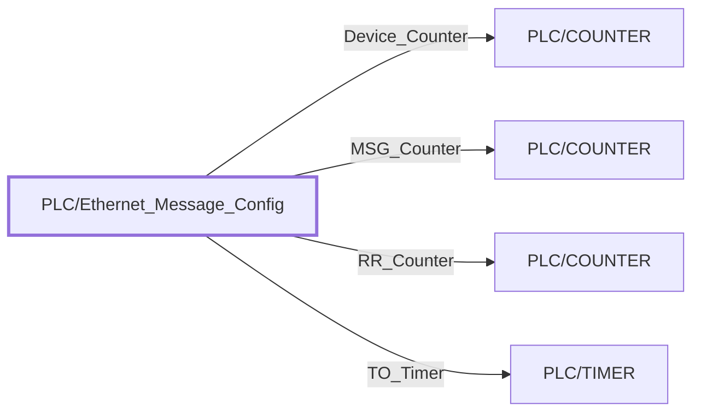

:::note

:::
# UDT `PLC/Ethernet_Message_Config`

| | |
|---|---|
| Designer location | Tag Browser &gt; default &gt; Data Types &gt; PLC &gt; Ethernet\_Message\_Config |
| Tag path | `[default]_types_/PLC/Ethernet_Message_Config` |
| File | `gateways/standard/data/config/resources/core/ignition/tag-type-definition/default/PLC/udts.json` |
| Inherits from | - |
| Inherited by | - |
| Own members | 4 (0 atomic, 4 nested UDT, 0 folders) |
| Status | unused (raw L5K import) |

## Parameters

| Parameter | Data type | Default | Defined |
|---|---|---|---|
| `TagPrefix` | String | - | own |
| `Description` | String | - | own |
| `DeviceName` | String | - | own |

Parameters are referenced in member settings as `{Name}` and are set per instance (Designer: right-click the instance > Edit Tag > Parameters).

## Structure

## Members

| Member | Data type | Source | Tag group | Read only | History | Units / format | Alarms | Documentation |
|---|---|---|---|---|---|---|---|---|
| `Device_Counter` | UDT | nested [PLC/COUNTER](counter.md) | | | | | | |
| `MSG_Counter` | UDT | nested [PLC/COUNTER](counter.md) | | | | | | |
| `RR_Counter` | UDT | nested [PLC/COUNTER](counter.md) | | | | | | |
| `TO_Timer` | UDT | nested [PLC/TIMER](timer.md) | | | | | | |

## Nested UDTs

| Member | Type | Parameter bindings | Default state |
|---|---|---|---|
| `Device_Counter` | [PLC/COUNTER](counter.md) | `TagPrefix = {TagPrefix}.Device_Counter; Description = {Description}; DeviceName = {DeviceName}` | enabled |
| `MSG_Counter` | [PLC/COUNTER](counter.md) | `TagPrefix = {TagPrefix}.MSG_Counter; Description = {Description}; DeviceName = {DeviceName}` | enabled |
| `RR_Counter` | [PLC/COUNTER](counter.md) | `TagPrefix = {TagPrefix}.RR_Counter; Description = {Description}; DeviceName = {DeviceName}` | enabled |
| `TO_Timer` | [PLC/TIMER](timer.md) | `TagPrefix = {TagPrefix}.TO_Timer; Description = {Description}; DeviceName = {DeviceName}` | enabled |

`disabled` parts subscribe nothing until an instance enables them (instance override `enabled: true`). See the device instance pages for which instances enable which part.

## Alarms

_No alarms defined on this type._

## Used By

Not used by any instance or other UDT (raw L5K import kept for reference).
