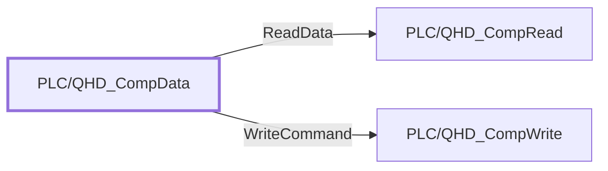

:::note

:::
# UDT `PLC/QHD_CompData`

| | |
|---|---|
| Designer location | Tag Browser &gt; default &gt; Data Types &gt; PLC &gt; QHD\_CompData |
| Tag path | `[default]_types_/PLC/QHD_CompData` |
| File | `gateways/standard/data/config/resources/core/ignition/tag-type-definition/default/PLC/udts.json` |
| Inherits from | - |
| Inherited by | - |
| Own members | 8 (6 atomic, 2 nested UDT, 0 folders) |
| Status | unused (raw L5K import) |

## Parameters

| Parameter | Data type | Default | Defined |
|---|---|---|---|
| `TagPrefix` | String | - | own |
| `Description` | String | `must be 4 octets` | own |
| `DeviceName` | String | - | own |

Parameters are referenced in member settings as `{Name}` and are set per instance (Designer: right-click the instance > Edit Tag > Parameters).

## OPC Item Path

6 members read OPC through the server `Ignition OPC UA Server`. Pattern: `ns=1;s=[{DeviceName}]{TagPrefix}.<member>`, so an instance with `DeviceName = RCP1` and `TagPrefix = X` reads `ns=1;s=[RCP1]X.<member>`. The Source column below shows the part after `[{DeviceName}]`.

## Structure

## Members

| Member | Data type | Source | Tag group | Read only | History | Units / format | Alarms | Documentation |
|---|---|---|---|---|---|---|---|---|
| `Enable` | Boolean | OPC `{TagPrefix}.Enable` | | yes | | | | |
| `ReadData` | UDT | nested [PLC/QHD\_CompRead](qhd-compread.md) | | | | | | |
| `ReadError` | Boolean | OPC `{TagPrefix}.ReadError` | | yes | | | | |
| `WriteCommand` | UDT | nested [PLC/QHD\_CompWrite](qhd-compwrite.md) | | | | | | |
| `WriteError` | Boolean | OPC `{TagPrefix}.WriteError` | | yes | | | | |
| `ZZZZZZZZZZQHD_CompDa1` | Int1 | OPC `{TagPrefix}.ZZZZZZZZZZQHD_CompDa1` | | yes | | | | |
| `ZZZZZZZZZZQHD_CompDa5` | Int1 | OPC `{TagPrefix}.ZZZZZZZZZZQHD_CompDa5` | | yes | | | | |
| `cfg_IPAddr` | String | OPC `{TagPrefix}.cfg_IPAddr` | | yes | | | | must be 4 octets |

## Nested UDTs

| Member | Type | Parameter bindings | Default state |
|---|---|---|---|
| `ReadData` | [PLC/QHD\_CompRead](qhd-compread.md) | `TagPrefix = {TagPrefix}.ReadData; Description = {Description}; DeviceName = {DeviceName}` | enabled |
| `WriteCommand` | [PLC/QHD\_CompWrite](qhd-compwrite.md) | `TagPrefix = {TagPrefix}.WriteCommand; Description = {Description}; DeviceName = {DeviceName}` | enabled |

`disabled` parts subscribe nothing until an instance enables them (instance override `enabled: true`). See the device instance pages for which instances enable which part.

## Alarms

_No alarms defined on this type._

## Used By

Not used by any instance or other UDT (raw L5K import kept for reference).
