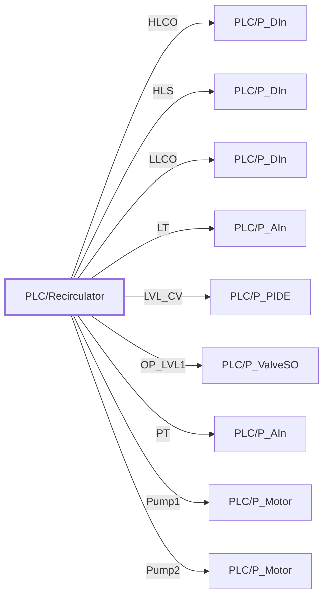

:::note

:::
# UDT `PLC/Recirculator`

| | |
|---|---|
| Designer location | Tag Browser &gt; default &gt; Data Types &gt; PLC &gt; Recirculator |
| Tag path | `[default]_types_/PLC/Recirculator` |
| File | `gateways/standard/data/config/resources/core/ignition/tag-type-definition/default/PLC/udts.json` |
| Inherits from | - |
| Inherited by | - |
| Own members | 24 (15 atomic, 9 nested UDT, 0 folders) |
| Status | unused (raw L5K import) |

## Parameters

| Parameter | Data type | Default | Defined |
|---|---|---|---|
| `TagPrefix` | String | - | own |
| `Description` | String | - | own |
| `DeviceName` | String | - | own |

Parameters are referenced in member settings as `{Name}` and are set per instance (Designer: right-click the instance > Edit Tag > Parameters).

## OPC Item Path

15 members read OPC through the server `Ignition OPC UA Server`. Pattern: `ns=1;s=[{DeviceName}]{TagPrefix}.<member>`, so an instance with `DeviceName = RCP1` and `TagPrefix = X` reads `ns=1;s=[RCP1]X.<member>`. The Source column below shows the part after `[{DeviceName}]`.

## Structure

## Members

| Member | Data type | Source | Tag group | Read only | History | Units / format | Alarms | Documentation |
|---|---|---|---|---|---|---|---|---|
| `COMP_INTERLOCK` | Boolean | OPC `{TagPrefix}.COMP_INTERLOCK` | | yes | | | | |
| `CavLogicDP_SET` | Float4 | OPC `{TagPrefix}.CavLogicDP_SET` | | yes | | | | |
| `CavLogicEN` | Boolean | OPC `{TagPrefix}.CavLogicEN` | | yes | | | | |
| `DeltaP` | Float4 | OPC `{TagPrefix}.DeltaP` | | yes | | | | |
| `HLCO` | UDT | nested [PLC/P\_DIn](p-din.md) | | | | | | |
| `HLS` | UDT | nested [PLC/P\_DIn](p-din.md) | | | | | | |
| `INCHES` | Float4 | OPC `{TagPrefix}.INCHES` | | yes | | | | |
| `LEAD_PUMP_SET` | Int2 | OPC `{TagPrefix}.LEAD_PUMP_SET` | | yes | | | | |
| `LEVEL` | Int2 | OPC `{TagPrefix}.LEVEL` | | yes | | | | |
| `LEVEL_DP` | Float4 | OPC `{TagPrefix}.LEVEL_DP` | | yes | | | | |
| `LEVEL_SP` | Float4 | OPC `{TagPrefix}.LEVEL_SP` | | yes | | | | |
| `LLCO` | UDT | nested [PLC/P\_DIn](p-din.md) | | | | | | |
| `LT` | UDT | nested [PLC/P\_AIn](p-ain.md) | | | | | | |
| `LVL_CV` | UDT | nested [PLC/P\_PIDE](p-pide.md) | | | | | | |
| `OP_LVL1` | UDT | nested [PLC/P\_ValveSO](p-valveso.md) | | | | | | |
| `PT` | UDT | nested [PLC/P\_AIn](p-ain.md) | | | | | | |
| `Pump1` | UDT | nested [PLC/P\_Motor](p-motor.md) | | | | | | |
| `Pump2` | UDT | nested [PLC/P\_Motor](p-motor.md) | | | | | | |
| `Pump_1st_Set` | Int2 | OPC `{TagPrefix}.Pump_1st_Set` | | yes | | | | |
| `Pump_2nd_Set` | Int2 | OPC `{TagPrefix}.Pump_2nd_Set` | | yes | | | | |
| `RESEQUENCE` | Boolean | OPC `{TagPrefix}.RESEQUENCE` | | yes | | | | |
| `Reseq_Now` | Boolean | OPC `{TagPrefix}.Reseq_Now` | | yes | | | | |
| `START_SET` | Float4 | OPC `{TagPrefix}.START_SET` | | yes | | | | |
| `ZZZZZZZZZZRecirculat16` | Int1 | OPC `{TagPrefix}.ZZZZZZZZZZRecirculat16` | | yes | | | | |

## Nested UDTs

| Member | Type | Parameter bindings | Default state |
|---|---|---|---|
| `HLCO` | [PLC/P\_DIn](p-din.md) | `TagPrefix = {TagPrefix}.HLCO; Description = {Description}; DeviceName = {DeviceName}` | enabled |
| `HLS` | [PLC/P\_DIn](p-din.md) | `TagPrefix = {TagPrefix}.HLS; Description = {Description}; DeviceName = {DeviceName}` | enabled |
| `LLCO` | [PLC/P\_DIn](p-din.md) | `TagPrefix = {TagPrefix}.LLCO; Description = {Description}; DeviceName = {DeviceName}` | enabled |
| `LT` | [PLC/P\_AIn](p-ain.md) | `TagPrefix = {TagPrefix}.LT; Description = {Description}; DeviceName = {DeviceName}` | enabled |
| `LVL_CV` | [PLC/P\_PIDE](p-pide.md) | `TagPrefix = {TagPrefix}.LVL_CV; Description = {Description}; DeviceName = {DeviceName}` | enabled |
| `OP_LVL1` | [PLC/P\_ValveSO](p-valveso.md) | `TagPrefix = {TagPrefix}.OP_LVL1; Description = {Description}; DeviceName = {DeviceName}` | enabled |
| `PT` | [PLC/P\_AIn](p-ain.md) | `TagPrefix = {TagPrefix}.PT; Description = {Description}; DeviceName = {DeviceName}` | enabled |
| `Pump1` | [PLC/P\_Motor](p-motor.md) | `TagPrefix = {TagPrefix}.Pump1; Description = {Description}; DeviceName = {DeviceName}` | enabled |
| `Pump2` | [PLC/P\_Motor](p-motor.md) | `TagPrefix = {TagPrefix}.Pump2; Description = {Description}; DeviceName = {DeviceName}` | enabled |

`disabled` parts subscribe nothing until an instance enables them (instance override `enabled: true`). See the device instance pages for which instances enable which part.

## Alarms

_No alarms defined on this type._

## Used By

Not used by any instance or other UDT (raw L5K import kept for reference).
