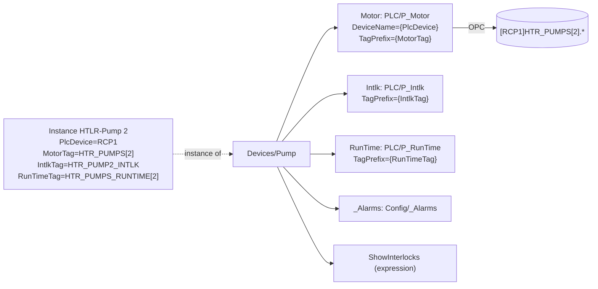

# Device And Unit UDTs (`Devices/*`, `Units/*`)

The `Devices/` UDTs are what the views bind to. A device UDT is a thin shell: it **nests the PLC library parts**
that make up one piece of equipment (a pump = motor object + interlock object + run time object) and adds only the
few members we own (alarm counts, HMI settings, derived flags). Every PLC value is read straight from a nested part.

Generated pages for each type (members, parameters, instances): [Devices/Pump](../reference/udts/devices/pump.md),
[Tank](../reference/udts/devices/tank.md), [Sensor](../reference/udts/devices/sensor.md),
[Valve](../reference/udts/devices/valve.md), [Compressor](../reference/udts/devices/compressor.md),
[Evaporator](../reference/udts/devices/evaporator.md), [DiscreteInput](../reference/udts/devices/discreteinput.md),
[ExhaustFan](../reference/udts/devices/exhaustfan.md), [LTU](../reference/udts/devices/ltu.md),
[SafetyRelay](../reference/udts/devices/safetyrelay.md), [SuctionSequence](../reference/udts/devices/suctionsequence.md),
[DischargeSequence](../reference/udts/devices/dischargesequence.md).

## The End State (After The Flat-Member Cleanup)

Until 2026-10-23 the device UDTs carried a second, "flat" copy of every field as memory stand-in tags (for example
`Sts_Running/Value`) next to the nested PLC parts, plus a `_Pax` flag that told views which copy to read. That
transition design existed only so unmapped devices kept working while the devices were mapped to the PLC one type
at a time. Once every type was mapped, the **flat-member cleanup** (`docs/pax-mapping/15-flat-member-cleanup.md`)
removed it:

- **Removed:** every flat stand-in member whose field now comes from the PLC (77 on Pump, 58 on Valve, 43 on Sensor,
  39 on Evaporator ...), the `_Pax` flag, the old member alarms and their PAX gate, and 1,719 + 548 unreferenced
  memory stand-ins under `Boars_Head/GrovePort/PLC/RCP1/**` (that folder is now empty).
- **Kept:** the nested PLC parts and PLC atomics (enabled per instance where the PLC has the object), and the members
  we own (operator settings, derived status, links, `_Alarms`). No placeholder values were invented: a field with no
  PLC source was either kept as a named HMI-owned member or hidden.
- **Views read the PLC members directly** (`<device>/Motor/Sts_Running`). Shared views that serve several types pick
  the part with a **part key** computed from the instance itself: its UDT type (`.TypeId`: Pump -> `Motor`,
  Valve -> `Valve`, Compressor -> `Comp`, Evaporator -> `CG`, Tank -> `Tank` ...) and, for Sensor / DiscreteInput,
  which part is enabled (`AIn`, `AInRef` or `DIn`). `shared.Pax.KEYS` holds the type -> key map.
- **`shared.Pax` stays** only to resolve the old field names that are not member paths: the Details-table columns
  (`shared.Overview`), the ConfigSection rows, `shared.ValveCommands` (every PLC write refused) and the Daily Rounds
  "Fill From Live Values" (`shared.Pax.livePath`).

Rollback, per-type removed / kept lists and the verification are in
[Flat-Member Cleanup](../pax-mapping/flat-member-cleanup.md).

## The Pattern

1. **Parameters** name the controller objects: `PlcDevice` (OPC device, `RCP1`) plus one `<Part>Tag` per part.
2. **Parts** are nested library UDTs with `DeviceName = {PlcDevice}` and `TagPrefix = {<Part>Tag}`.
3. **Parts are disabled in the type** (`enabled: false`) and the instance enables the ones the PLC has
   (`"tags": [{"name": "Motor", "enabled": true}]`). A disabled part subscribes nothing and its values show the gray
   placeholder in the views.
4. **PLC atomics**: a plain controller tag that is not an object (a setpoint, a BOOL) is a read-only OPC atomic member
   on the device, `ns=1;s=[{PlcDevice}]{<X>Tag}` (for example Tank `StartPress`, LTU `PlcCount`).
5. **Owned members**: `_Alarms` (alarm counts / colors for the device), HMI settings (`Cfg_WebGuiUrl`,
   `Cfg_SensorPath` ...), derived read-only expressions (`ShowInterlocks`, `HmiStatus`).
6. **Out Of Service** disables the whole instance (`Enabled = false` on the instance, set only through
   `shared.OutOfService`); its alarms stop with it.

## Per Type

| Type | Parameters | Nested PLC parts | PLC atomics | Members we own | Instances |
|---|---|---|---|---|---|
| `Devices/Pump` | `PlcDevice`, `MotorTag`, `IntlkTag`, `RunTimeTag` | `Motor` P_Motor, `Intlk` P_Intlk, `RunTime` P_RunTime | - | `_Alarms`, `ShowInterlocks` | 4 recirc pumps, 3 condenser sump pumps, 4 condenser fans |
| `Devices/Tank` | `PlcDevice`, `LevelTag`, `PressSource`, `HLCOTag`, `HiHiTag`, `OPLTag`, `LoLoTag`, `Pump1AlmTag`, `Pump2AlmTag`, `StartPressTag`, `LeadTag`, `LevelEU`, `PressEU` (+ unused `PressTag`) | `LvlAIn` P_AIn, `PressAIn` PLC_Ref/P_AIn, `HlcoDIn` / `HiHiDIn` / `OplDIn` / `LoLoDIn` P_DIn, `Pump1Alm` / `Pump2Alm` P_DIn (with `AlarmOnSts = 1`) | `StartPress`, `LeadPump` | `_Alarms`, `Interlock/*` (HMI layout, no PLC object) | HTR, LTR, HPR, CSV |
| `Devices/Sensor` | `PlcDevice`, `AInTag`, `AInSource`, `AInEU` | `AIn` P_AIn (owner) or `AInRef` PLC_Ref/P_AIn (reference) | - | `_Alarms` | 9 |
| `Devices/Valve` | `PlcDevice`, `ValveTag`, `IntlkTag` | `Valve` P_ValveSO, `Intlk` P_Intlk | - | `_Alarms`, `Cmd_Position`, `valveType`, `ShowInterlocks` | 4 standalone + 76 nested in the CGs |
| `Devices/Compressor` | `PlcDevice`, `CompTag`, `IntlkTag` | `Comp` Screw_Compressor, `Intlk` P_Intlk (`COMP[n].Interlock`) | - | `_Alarms`, `Cfg_WebGuiUrl` (Frick panel link), `ShowInterlocks` | COMP 1, 4, 5, 6, 7 |
| `Devices/Evaporator` | `PlcDevice`, `CGTag`, `ZATTag`, `IntlkTag`, `FansTag`, `FansRunTimeTag`, `LiquidSVTag`, `SuctionSVTag`, `HotGasSVTag`, `BleedSVTag` | `CG` CG_RL_Evap, `ZAT` P_AIn (`°F`), `Intlk` P_Intlk, `Fans` P_Motor, `FansRunTime` P_RunTime, `Valves/<Liquid, Suction, Hot Gas, Bleed> SV` (nested `Devices/Valve`) | - | `_Alarms`, `SummaryInstances`, `HmiStatus`, `ShowInterlocks` | 19 control groups CG-A1 .. CG-G5 |
| `Devices/DiscreteInput` | `PlcDevice`, `DInTag` | `DIn` P_DIn | - | - | 52 (detectors, rupture disks, level switches) + the LTU input |
| `Devices/ExhaustFan` | `PlcDevice`, `FanTag`, `FailTag` | `DIn` P_DIn (run feedback) | `FailToStart` | `_Alarms` | MR EF, BR EF |
| `Devices/LTU` | `PlcDevice`, `InputTag`, `CountTag`, `CountAlarmTag`, `CountAlarmSPTag`, `ResetCountTag` | `Input` (nested `Devices/DiscreteInput`) | `PlcCount`, `PlcCountAlarm` (alarm Transfer Count High), `PlcCountAlarmSP`, `PlcResetCount` (`HMI_Ltu_Clear`, momentary reset). The old flat `Count` / `Count_Alarm` / `Count_Alarm_SP` / `Cmd_ResetCount` stand-ins are still in this type: LTU is the one device whose flat-member cleanup is pending (`docs/pax-mapping/11-ltu.md`, section 3) | `_Alarms`, `ResetDaily`, `ResetTime` | NH3 LTU |
| `Devices/SafetyRelay` | `PlcDevice`, `ModuleTag`, `MajorFaultTag`, `ResetAlmTag` | `IO` CR30_Input (`SafetyRelay:I`) | `PlcMajorFault`, `PlcResetAlm` | `_Alarms` | HLCO Safety Relay |
| `Devices/SuctionSequence` | `PlcDevice`, `SeqTag`, `EnableTag` | `Seq` Comp_Sequence | `PlcHmiEnable` | `Cfg_HasEnable`, `Cfg_Notes`, `Cfg_Positions`, `Cfg_SensorLabel`, `Cfg_SensorPath` | HSS, LSS |
| `Devices/DischargeSequence` | `PlcDevice`, `SeqrTag`, `Seq1Tag` .. `Seq7Tag`, `FixedSPTag`, `FirstNoDelayTag`, `MainOpenTag`, `MainCloseTag`, `BackupOpenTag`, `BackupCloseTag` | `Seqr` FB_2SpUpDownSeqr | `PlcSequence1..7`, `PlcFixedSP`, `PlcFirstNoDelay`, `PlcMain/BackupOpen/CloseSP` | `Cfg_LevelLabel`, `Cfg_LevelPath`, `Cfg_SensorLabel`, `Cfg_SensorPath` | HSD |
| `Devices/CoolingTower`, `Devices/VFD` | none | none (old `_Root` member layout) | - | all members | none in the device tree (not PLC-mapped) |

The full member lists (with OPC paths, tag groups, history) are on the generated type pages; the field-by-field
mapping to the PLC is on the [PAX Mapping](../pax-mapping/index.md) pages.

## Derived Members

**`ShowInterlocks`** (Pump, Valve, Compressor, Evaporator): a read-only expression that is true when the device's
`Intlk` part has at least one real condition description, that is a `Cfg_CondTxt_n_` that is neither empty nor the
PLC default "Enter Description #n". The faceplate shell shows the **Interlocks** tab only while it is true. It is why
the HTR / LTR pumps, compressors and CGs show the tab, while the seven condenser motors and the two make-up valves
(whose shared `EC1_INTLK` object only has "Enter Description #0") do not. The condition texts are polled in
`PAX_Config` so the rule does not wait for a faceplate lease.

**`HmiStatus`** (Evaporator): converts the PLC control-group phase `CG/Sts_State` (0-10) into the simplified HMI
status code the tiles and tables use:

| `Sts_State` | PLC phase | `HmiStatus` | HMI word |
|---|---|---|---|
| 0 | Off | 0 | STOP |
| 1 | Pump Out | 6 | DFT PD (pump down) |
| 2 | Soft Hot Gas | 7 | DFT HG |
| 3 | Main Hot Gas | 7 | DFT HG |
| 4 | Bleed | 8 | DFT BLD |
| 5 | Fan Delay | 9 | DFT FD |
| 6 | Cooling | 1 | CLG |
| 7 | Idle | 5 | IDLE |
| 8 | Cleanup | 2 | DFT |
| 9 | Permissive | 5 | IDLE |
| 10 | Interlock | 3 | FLT |

The same table is the `Evaporator/PlcState` enum ([Enums](../enums.md)), which the CG page uses to show the raw PLC
phase name.

## Nesting A Device In A Device

Two types nest another **device** type, not just library parts:

- `Devices/Evaporator` has `Valves/Liquid SV`, `Valves/Suction SV`, `Valves/Hot Gas SV`, `Valves/Bleed SV`, each a
  `Devices/Valve`. The evaporator passes `PlcDevice` and its `LiquidSVTag` ... to the valve's `ValveTag`, so each
  nested valve maps itself exactly like a standalone valve. The six 3-valve CGs (C1, D1, G2-G5) have no bleed valve
  in the PLC: their `BleedSVTag` is empty and the Bleed SV part stays disabled (and is not drawn; the CG page follows
  the PLC flag `CG/Cfg_HasBleedValve`).
- `Devices/LTU` has `Input`, a `Devices/DiscreteInput` with `DInTag = {InputTag}` (`NH3_LTU`).

## Units

`Units/AHU` is an HMI-only unit layout (`Status`, `Temp`, `SummaryInstances`, `_Alarms`) with no instances in the
device tree. The older `Units/Machine Room` type was deleted on 2026-10-23 (it had no instances and only referenced
the retired stand-ins).

## Adding A New Device

1. Pick the type under `_types_/Devices` (or copy one in the UDT Definitions tab and rename it, following the pattern
   above).
2. Tag Browser > All Tags > `Boars_Head/GrovePort/<Area>/<Type>` > right-click > **New Tag > Data Type Instance** (or
   copy a sibling). Name it `<Device>` and set the instance parameters: `PlcDevice` and the `<Part>Tag` values of the
   controller objects (from Studio 5000 / the FT parameter files / the PAX mapping pages).
3. Enable the PLC parts the controller really has (tick **Enabled** on the nested `Motor`, `Intlk`, ...).
4. If the folder is new, whitelist it in `.gitignore` (see [Tags](../index.md#what-is-in-git)).
5. Check the device on its page and faceplate; nothing should show an error overlay. The generated
   [Device Instances](../reference/devices/index.md) page shows the resolved PLC objects after the next wiki refresh.

