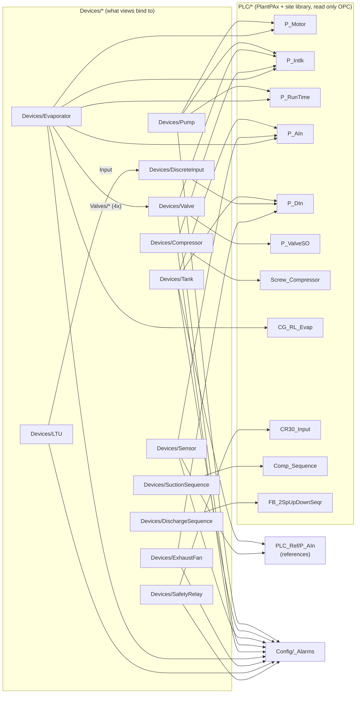
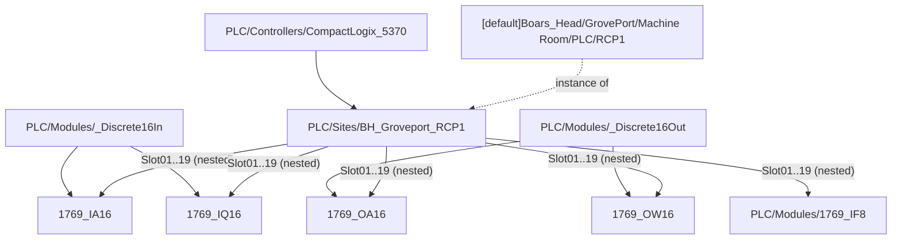

# UDTs

A **UDT** (User Defined Type) is a tag template. Its **definition** lists members (atomic tags, folders, nested UDTs),
**parameters** and per-member settings (OPC item path, tag group, history, alarms). An **instance** is a copy that
fills in the parameters. Change the definition once and every instance follows.

In the Designer the definitions are under **Tag Browser > default > Data Types** (tag path `[default]_types_/...`).
In the repo they are `gateways/standard/data/config/resources/core/ignition/tag-type-definition/default/<folder>/udts.json`.
Every definition has a generated page: [UDT Definitions](../reference/udts/index.md).

## The Families

| Folder | What it is | Pages |
|---|---|---|
| `PLC/` | The **PlantPAx library**: one UDT per controller object type (`P_Motor`, `P_AIn`, `P_DIn`, `P_ValveSO`, `P_Intlk`, `P_RunTime`) plus the site library types (`Screw_Compressor`, `CG_RL_Evap`, `Comp_Sequence`, `FB_2SpUpDownSeqr`, `CR30_Input`). Generic parameters `DeviceName` / `TagPrefix`, every member read only. 52 types; about 40 are still the raw L5K import that nothing uses. | [PlantPAx Library](pax-library.md) |
| `PLC_Ref/` | `PLC_Ref/P_AIn`: the same members as `PLC/P_AIn`, but as read-only **references** to another device's part (no OPC, no alarms, no history). Used where two devices show one transmitter. | [PlantPAx Library](pax-library.md#plc_refp_ain-the-reference-twin) |
| `Devices/` | The **device UDTs** the HMI binds to (`Pump`, `Tank`, `Sensor`, `Valve`, `Compressor`, `Evaporator`, `DiscreteInput`, `ExhaustFan`, `LTU`, `SafetyRelay`, `SuctionSequence`, `DischargeSequence`, plus the unmapped `CoolingTower` and `VFD`). Each one **nests** PLC library parts and adds a few members we own. | [Device And Unit UDTs](device-udts.md) |
| `Units/` | `Units/AHU`, an HMI-only unit type (no instances today). | [Device And Unit UDTs](device-udts.md#units) |
| `PLC/Modules/`, `PLC/Controllers/`, `PLC/Sites/` | The **PLC rack** model: one UDT per 1769 I/O card type (with shared input / output bases), a controller family base, and a site UDT per PLC that inherits the family and holds one card per slot. | [PLC Rack UDTs](plc-rack.md) |
| `_Root/` | Single-value building blocks (`Analog`, `Digital`, `String`, `Multistate`, `Document`, `Expression`) with one `Value` member and history settings. | [_Root, Config And Overview](root-and-config.md) |
| `Config/` | Helper UDTs: `_Alarms` (alarm counts and colors of a device), `Interlock` (HMI interlock layout of the unmapped types), `Integration` (one API endpoint under `_Config/Integrations`). | [_Root, Config And Overview](root-and-config.md#config) |
| `Overview/` | One `<Type> Overview` UDT per device table (Details tables / device counts per area). | [_Root, Config And Overview](root-and-config.md#overview) |
| `_PlcWriteLockTest/` | `TestCard`, a test-only type the write-lock self test flips. | [PLC Write Lock](../plc-write-lock.md#testing) |

## How They Fit Together



And the rack model, which uses inheritance (a child type gets every member of its parent):



(Arrows in the first diagram mean "nests"; in the second, a solid arrow from a base to a card means "is inherited
by".)

## Parameters Flow Down

A device instance sets a few parameters; the device UDT passes them to its nested parts, which build their OPC item
paths from them. Example, `HTLR-Pump 2`:

```text
Instance  [default]Boars_Head/GrovePort/Machine Room/Pumps/HTLR-Pump 2   (Devices/Pump)
  PlcDevice = RCP1, MotorTag = HTR_PUMPS[2], IntlkTag = HTR_PUMP2_INTLK, RunTimeTag = HTR_PUMPS_RUNTIME[2]
    Motor   (PLC/P_Motor)   DeviceName = {PlcDevice}, TagPrefix = {MotorTag}
      Sts_Running  OPC  ns=1;s=[{DeviceName}]{TagPrefix}.Sts_Running  ->  ns=1;s=[RCP1]HTR_PUMPS[2].Sts_Running
    Intlk   (PLC/P_Intlk)   TagPrefix = {IntlkTag}     ->  [RCP1]HTR_PUMP2_INTLK.*
    RunTime (PLC/P_RunTime) TagPrefix = {RunTimeTag}   ->  [RCP1]HTR_PUMPS_RUNTIME[2].*
```

The parts are **disabled in the type** (`enabled: false`) and **enabled per instance** where the PLC has the object,
so a device without, say, an interlock object subscribes nothing for it.

## Rules For Changing UDTs

1. **Edit definitions in the Designer.** Tag Browser > **UDT Definitions** tab > the folder (`PLC`, `PLC_Ref`,
   `Devices`, `Units`, `Config`, `_Root`) > the type. Change the definition once and every instance follows. See
   [How To Change Tags](../index.md#how-to-change-tags).
2. **Alarms go on the definition, never on an instance** ([Alarms](../alarms.md)).
3. **Don't invent PlantPAx members.** A member exists in `PLC/*` only if the controller has it (it came from the L5K
   import or the browse). Status icons and legend states only use members the PLC UDTs carry.
4. **Never edit these types during a PLC write lock flip**: an unlock / relock
   rewrites `PLC/udts.json` and `Devices/udts.json` itself ([PLC Write Lock](../plc-write-lock.md#notes-for-tag-editors)).
5. **After an edit**: check the client, and (when approved) commit the type file together with the
   instance files that depend on it.
