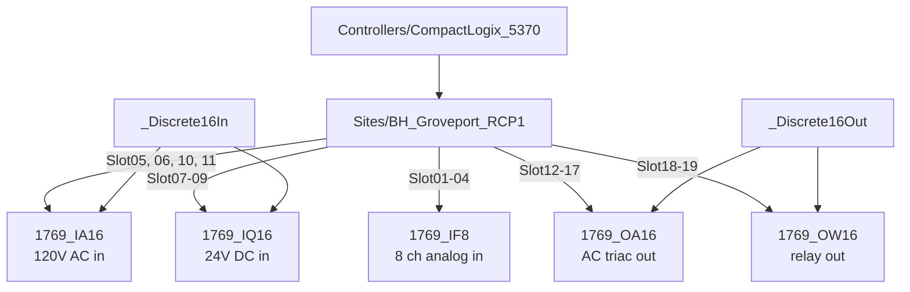

# PLC Rack UDTs

The page **Groveport > Operations > PLCs > RCP1** (`/operations/plcs/RCP1`, alias `/plc-rack`) draws the RCP1
controller and its 19 local 1769 I/O cards with live LEDs and channel values. Its data comes from one UDT instance,
`[default]Boars_Head/GrovePort/Machine Room/PLC/RCP1`, built from a small family of **modular** UDTs. Everything is
read only: the members read OPC directly and every OPC member is `readOnly`. Page and view details are in
[Perspective](../../perspective/index.md); the hardware story is in `docs/plc-rack-io.md`.

## The Layers

```text
PLC/Modules/_Discrete16In   <- 1769_IA16, 1769_IQ16      16-point discrete input base  (I.Data, I.Fault)
PLC/Modules/_Discrete16Out  <- 1769_OA16, 1769_OW16      16-point discrete output base (O.Data, I.ReadBack, I.Fault)
PLC/Modules/1769_IF8                                     8-channel analog input: data, over / under range, alarms,
                                                         C.Ch*Range / DataFormat / En, Signal / Unit / RangeText
PLC/Controllers/CompactLogix_5370                        family base: what every 1769-L3x has (driver diagnostics)
PLC/Sites/BH_Groveport_RCP1  (inherits the family base)  site: Slot01..Slot19 card instances + Rack + counts
[default]Boars_Head/GrovePort/Machine Room/PLC/RCP1      the one instance (DeviceName = RCP1)
```



**Inheritance** (a solid arrow from a base) means the child UDT's `typeId` is the parent: the child gets every parent
member and adds its own constants. The cards add only expression constants (`CatalogNumber`, `CatalogDescription`,
`PanelLabel`, `Series`); the I/O members come from the base.

## Card Types (`PLC/Modules/*`)

Parameters: `DeviceName` (OPC device), `Slot` (local bus slot number), `Description`. OPC item paths use the Logix
module tags:

```text
ns=1;s=[{DeviceName}]Local:{Slot}:I.Data       discrete input word (16 points as bits)
ns=1;s=[{DeviceName}]Local:{Slot}:O.Data       discrete output word
ns=1;s=[{DeviceName}]Local:{Slot}:I.ReadBack   output readback (DO cards)
ns=1;s=[{DeviceName}]Local:{Slot}:I.Fault      module fault word
ns=1;s=[{DeviceName}]Local:{Slot}:I.Ch3Data    analog channel data (IF8)
ns=1;s=[{DeviceName}]Local:{Slot}:C.Ch3RangeType   channel configuration (IF8)
```

| UDT | Inherits | Own members | Notes |
|---|---|---|---|
| [`_Discrete16In`](../reference/udts/plc-modules/discrete16in.md) | - | `Data`, `Fault`, `Faulted` (expr `Fault != 0`), `ConnectionFaulted` (expr `Fault = -1`), `ModuleType` 'DI', `Points` 16 | alarm **Module Fault** (High) on `Faulted` |
| [`_Discrete16Out`](../reference/udts/plc-modules/discrete16out.md) | - | as above + `ReadBack`, `ModuleType` 'DO' | alarm **Module Fault** (High) |
| [`1769_IA16`](../reference/udts/plc-modules/type-1769-ia16.md) | `_Discrete16In` | catalog constants | 16-point 120 V AC input |
| [`1769_IQ16`](../reference/udts/plc-modules/type-1769-iq16.md) | `_Discrete16In` | catalog constants | 16-point 24 V DC sink / source input |
| [`1769_OA16`](../reference/udts/plc-modules/type-1769-oa16.md) | `_Discrete16Out` | catalog constants | 16-point 120/240 V AC triac output |
| [`1769_OW16`](../reference/udts/plc-modules/type-1769-ow16.md) | `_Discrete16Out` | catalog constants | 16-point AC/DC relay output |
| [`1769_IF8`](../reference/udts/plc-modules/type-1769-if8.md) | - | 8 channels: data, over / under range, alarms, configured range / format / enable, `Ch<n>Signal` (EU counts / 1000), `Ch<n>Unit`, `Ch<n>RangeText` | alarm **Module Fault** (High). Range code 3 = 4-20 mA, 1 = 0-5 V; at RCP1 4 channels are 4-20 mA and 28 are 0-5 V. |

## Controller Base (`PLC/Controllers/CompactLogix_5370`)

[Generated page](../reference/udts/plc-controllers/compactlogix-5370.md). Parameters `DeviceName`, `Description`.
Reads the Logix driver diagnostics of the device connection
(`ns=1;s=[{DeviceName}][Diagnostics]/Connected`, `.../Device/Status`, `ProductName`, `ProductCode`,
`MajorRevision`, `SerialNumber` ...) and decodes the CIP identity `Status` word with expressions: `Mode`
(Remote Run ...), `KeySwitch`, `Run`, `MajorFault`, `MinorFault`, `IOFault`, plus `CommLoss = !Connected`.
Alarms (changed 2026-10-24): **Controller Communication Lost** (`CommLoss`, Critical, 12 s active delay so SecureLink blips ride through), **Controller Major Fault** (Critical), **Controller I/O Fault** (High), **Controller Not In Run Mode** (High) and **Controller Minor Fault** (Low). Every dependent member is gated on the driver connection, so with the link down only the Communication Lost alarm is active. The module cards' **Module Fault** alarm is High.

## Site UDT (`PLC/Sites/BH_Groveport_RCP1`)

[Generated page](../reference/udts/plc-sites/bh-groveport-rcp1.md). Inherits `CompactLogix_5370` and adds:

- `Slot01` .. `Slot19`: one nested card instance per occupied slot (slots 1-4 IF8, 5/6/10/11 IA16, 7-9 IQ16,
  12-17 OA16, 18-19 OW16) with `Slot` set;
- `Rack`: a memory **Document** with the drawing layout and the point labels (`slots[i].pointNames`, `channels`,
  `items` for the one-row flex layout, `source` = L5X file / export date / revision);
- constants: `CatalogNumber` (1769-L36ERM), `ControllerName` (BoarsHead), `MaxLocalModules`, `ModuleCount` (19), the
  controller IP (kept in the UDT; not repeated in the wiki);
- `MajorFaultRecordCode` / `Type` (controller tags) and `ModulesFaulted` (expression counting faulted slots).

The instance overrides `Rack`: edit the value on the instance in the Tag Browser.

## Where The Point Labels Come From

The rack's point descriptions come from the **L5X** (the Studio 5000 program export), not from the tags: the export
has no alias tags, so the labels are read from the `BufferIO` program, one rung per point, for example
`XIC(Local:5:I.Data.7) OTE(LTR_PUMPS[1].Inp_RunFdbk)` -> "Low Stage Recirculator Pump # 1 Run Feedback
(LTR_PUMPS[1])". 230 of the 272 points are labelled; 42 are "Spare (Not In Logic)"; 49 inputs are inverted
(`XIO`). The labels are stored in the `Rack` document. The L5X file itself is not in the repo. Loading labels from a new
L5X export is done by the system integrator.

## How To Add A Card Or A PLC

All steps are in the Designer Tag Browser (UDT Definitions tab for types, All Tags tab for instances).

### Add A New Card Type

1. UDT Definitions > `PLC/Modules`: copy a similar card type (for example `1769_IQ16`) and rename it.
   - A 16-point discrete card inherits its base (`_Discrete16In` / `_Discrete16Out`); set the catalog constants
     (expression members such as `CardCatalog`) and leave the points to the base.
   - A new shape (for example an 8-point output or a different analog card) needs its own members, with OPC paths
     `[{DeviceName}]Local:{Slot}:I|O|C.*` (read only) and a **Module Fault** alarm.
2. Add the slot to the site UDT `PLC/Sites/BH_Groveport_RCP1` (`SlotNN` nested instance with `Slot` set) and to the
   `Rack` document (an item with its units, x position and point names).
3. Add a module view under `02_Components/03_PLC` (copy the closest `Module_1769_*` view; a fluid SVG exported from
   Figma, see [Figma Workflow](../../perspective/styling/figma-workflow.md)).
4. **Gotcha:** an existing type that gains a parent may lose its inherited I/O members; check the card in the Tag
   Browser and re-add them if so.

### Add A New PLC

1. Reuse the family base (or copy `PLC/Controllers/CompactLogix_5370` for another family).
2. UDT Definitions > `PLC/Sites`: copy `BH_Groveport_RCP1` for the new site, with its slots and `Rack`.
3. Add one instance under `Boars_Head/<Site>/<Area>/PLC/<Name>` and set `ControllerName` / `IPAddress` and the OPC
   device name.
4. Point labels: load them into the instance's `Rack` document (a whole L5X export is loaded by the system integrator).
5. Add `[default]_Config/PLCs/List` an entry for the overview card, and a nav item `<Name>` under Operations > PLCs with
   page `/operations/plcs/<Name>` ([Navigation](../../perspective/navigation.md)); the page derives the tag path from
   the `:plc` route parameter.
6. Make sure the new PLC's OPC device is covered by the [PLC Write Lock](../plc-write-lock.md) (the lock flips every
   OPC member of `PLC/**`, so the type is covered; a new OPC device also needs its own server-level block decision from
   the system integrator).

## Open Items

- Bank layout / extra 1769 power supplies are not in the L5X: confirm on the panel.
- FORCE / SD lamps need a GSV routine in the PLC (controls engineer).
- Slot 4 Ch1 / Ch2 (TS_UF1 / TS_UF2) read 0 / Under Range: sensors or wiring to check.
- Only the raw module `Fault` word is shown (no fault code text).
